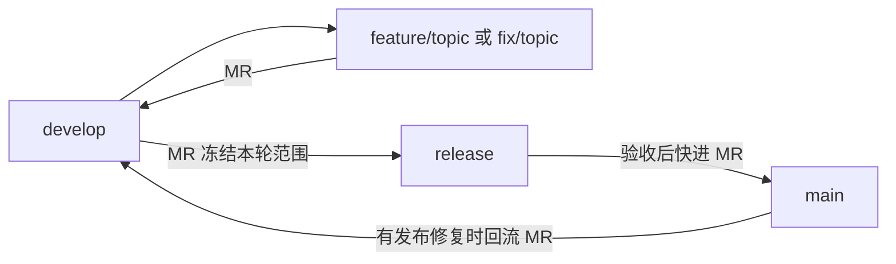

# 分支管理

本规范适用于 `data-platform-operators`，覆盖通用分支规范中 `release/v<仓库版本>` 的约定。本仓库包含独立版本的多个算子，使用固定 `release` 分支，不定义统一仓库版本号。

| 分支 | 用途与合入要求 |
|---|---|
| `feature/<topic>`、`fix/<topic>` | 从最新 `develop` 创建，通过 MR 合回 `develop`。只有实际关联 Issue 时才加入其编号，不使用 `codex/` 前缀。 |
| `develop` | 日常集成；按精确版本验证并发布 `-dev.<流水线编号>` 候选。 |
| `release` | 固定的受保护分支，同一时刻准备一轮发布。通过 MR 从 `develop` 推进，冻结本轮提交和 `ci/release-versions.yaml`。验收期间不混入下一轮功能。 |
| `main` | 接收已验收的 `release`，快进合并；正式镜像发布仍需手动执行。合并完成不等于正式镜像已发布。 |

发布修复从 `release` 创建 `fix/<topic>`，经 MR 合回 `release`，验收后进入 `main`，再通过 MR 回流 `develop`。如有分歧，通过合并解决，保留历史；不强推或重置长期分支。下一轮从已包含上一轮修复的 `develop` 向固定 `release` 提交 MR。

每轮发布可包含不同算子的不同版本，也可包含同一算子的多个版本。当前版本身份来自声明和包版本；历史版本来自原始提交及不可变记录；发布范围见[多版本发布清单](RELEASE_MANIFEST.md)。兼容组合只表达已验证的组合，不代表默认选用版本。

首次从 `release/v*` 切换时，先确认旧分支的全部提交已纳入 `main`，且无待合并 MR 或需要保留的独立修复，再退役旧分支并从确定的提交创建 `release`。Git 引用不能同时保留 `release` 和 `release/v*`；不通过删除分支丢弃未合并内容。配置固定分支的保护规则后再接入发布流水线。历史 MR、标签、镜像和发布清单保留。

## Git 标签

算子的正式 Git 标签为 `operators/<code>/v<version>`，例如 `operators/mcap_read_normalize/v2.0.0`。`code` 与 `operator.yaml.code` 一致；`version` 为该算子的三段数字版本，与声明、包版本及正式镜像标签一致。

- 一个标签只标识一个算子的一个精确发布版本；多个算子或同一版本的不同阶段可以在同一提交分别创建标签。
- 标签指向已交付镜像的原始构建提交，不因镜像复用而改成后续合并提交。创建前核对该提交的声明、镜像摘要及验收记录。
- 使用带注释标签，保留算子编码、版本、源码提交和声明路径、镜像摘要与发布证据；develop/release/main 的 `publish-operator-manifest` 在镜像两端核验、清单和回执写入后创建或补齐对应 Dev/RC/Stable GitLab Release；同步失败可重试，不移动标签。
- 候选也创建 Git 标签：`operators/<code>/v<version>-dev.<流水线>`、`operators/<code>/v<version>-rc.<流水线>`，与实际交付的候选镜像标签对应。复用旧候选保留原编号；发布 Stable 不覆盖候选标签或 Release。
- 共享包使用 `packages/<规范化发行名>/v<版本>` 带注释标签，例如 `packages/pretrain-cleaning-common/v0.4.3`，一包一版本对应一个 GitLab Release。`publish-packages` 核验 Nexus 发布记录后创建，固定指向记录中的 `source_commit`，历史补登记也不改成当前提交。
- 包标签和 Release 提供版本说明及下载入口；Nexus wheel 和 Data 发布记录仍是构建、安装及发布判断依据。包及算子标签均不触发流水线。使用 GitLab Release 必须保留其关联标签；删除标签会同时删除 Release。记录与恢复操作见[共享包流程](DEVELOPMENT_AND_CI.md#共享包与依赖边界)。
- 已发布标签不得移动或覆盖。经批准迁移标签时，先保留完整发布证据、创建并验证替代入口，再删除旧引用。

原全局 `v2.0.0` 已迁移为四个算子标签，原发布说明及验收记录见 [2.0.0 发布归档](releases/2.0.0.md)。仓库不再创建全局 `v<版本>` 标签。镜像标签和发布清单协议遵循各自规则，不受 Git 标签前缀影响。

GitLab Release 标题使用 `[Package][Stable] <包名> v<版本>` 或 `[Operator][Stable] <编码> v<版本>`；开发版和候选版按实际版本分别标识 `Dev`、`RC`。标题、说明和 Assets 的完整规则见 [Release 编写规范](RELEASE_NOTES.md)，不以所在分支推断版本阶段。

## 历史源码与修复

`operators/<code>/` 和 `packages/<name>/` 均只保留当前开发版本源码。按对应标签或发布记录的原始提交检出历史源码；历史声明的路径以该提交为准，不假定为当前目录布局。GitLab 默认源码下载是全仓；Release 的“本算子源码”或“本包源码”仅归档对应子目录。

常规修复从 develop 建 fix 分支并发布新版本。若需基于历史版本维护，可从其原始提交建立 `fix/<topic>`，使用新版本号，经 MR 验证；不得移动旧标签或覆盖旧镜像。进入主交付线前明确目标版本及兼容组合，不把多个源码版本并排复制回 operators。
