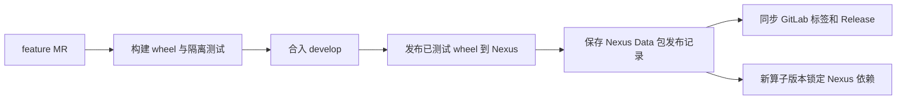
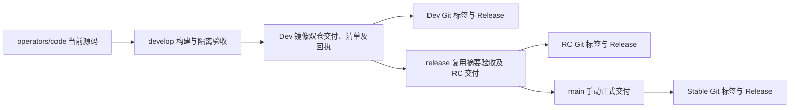

# 算子开发与 CI 发布

个人开发与 CI 均使用 Python 3.12、uv 及 `uv.lock` 固定的 SDK wheel。版本号、声明镜像和候选标签的含义见[命名与版本](../CONTRACT.md#命名与版本)。以下命令从仓库根目录执行。

## 本地开发

在用户的 `~/.netrc` 中配置 `nexus.striding.internal` 的只读账号，将文件权限设为 `600`。也可以使 `NETRC` 指向用户自己的凭据文件。已发布 wheel 从 `https://nexus.striding.internal/repository/pypi/simple/` 读取。

```bash
make dev OPERATOR=mcap_read_normalize/v4.0.1
cd operators/mcap_read_normalize
.venv/bin/python main.py --local-request-file /absolute/path/to/request.json
```

当前 B01–B03 `4.0.1` 锁定 SDK `0.3.0.dev7`；B04 `5.0.0` 锁定 `0.3.0.dev9`。需要使用本地 wheel 时，在仓库根目录指定与依赖锁摘要一致的文件。

```bash
python3.12 -m ci.build.packages --operator mcap_read_normalize/v4.0.1 \
  --sdk-wheel /absolute/path/to/striding_operator_sdk-0.3.0.dev7-py3-none-any.whl
```

该命令同时准备目标算子的 `.venv`。之后 `make dev` 会复用已验证的 wheel。

`make dev` 使用 uv 管理的 Python 3.12，按需校验或下载 SDK 和历史共享 wheel，仅构建版本匹配的当前共享源码，再将当前算子以可编辑形式安装到本目录的 `.venv`。修改自身 `src` 后直接运行。在已准备 SDK 和第三方缓存的机器上可用 `OFFLINE=1`。模板用 `OPERATOR=templates/python-operator`。使用 `OPERATOR=<code>` 选择当前源码；也可写 `<code>/v<version>` 核对声明版本，历史版本不能通过此入口重建。可用 `PYTHON=/path/to/python3.12` 指定带 pip 的解释器。

共同修改 SDK 时，可额外传入 `SDK_PROJECT=/absolute/path/to/data-platform-sdk`，仅在开发虚拟环境中覆盖安装同版本可编辑 SDK。随后再次运行常规 `make dev` 恢复锁定发行物。CI 使用正式 wheel。

## 共享包与依赖边界

`packages/<发行包名>/` 只保留当前开发版本，目录不带版本后缀。每个包维护 `pyproject.toml`、`uv.lock`、`src/` 和 `tests/source/`。历史 wheel 保存在 Nexus，历史源码按发布记录中的 Git 提交定位；不复制旧版本源码目录。

| 当前目录 | Python 发行包 | 导入模块 |
|---|---|---|
| `packages/pretrain-cleaning-common/` | `pretrain-cleaning-common==0.4.3` | `pretrain_cleaning_common` |
| `packages/pretrain-cleaning-engine/` | `pretrain-cleaning-engine==0.1.0` | `pretrain_cleaning_engine` |

新发行名称与原发行名称相互独立。当前 B01–B03 4.0.1 固定原 common 0.4.2 / SDK dev7，B04 5.0.0 固定原 common 0.4.3 / SDK dev9，两组均使用原 engine 0.1.0。它们的 wheel 已归档到 Nexus，源码提交、路径和摘要见[已迁移的包发布记录](PACKAGE_RELEASES.json)。改共享包名称不会自动升级旧算子。

### 开发和测试共享包

1. 修改当前目录的源码；已发布版本发生代码或依赖变化时，先提升 `project.version`。不要覆盖同版本的已发布 wheel。
2. 修改依赖时使用精确版本。采用仓内当前包时，在 `tool.uv.sources` 指定其 `../../build/wheels/<文件名>` 暂存路径；先构建依赖包，再在消费包目录执行 `uv lock --upgrade-package <依赖名>`。旧锁文件不得批量刷新。
3. 从根目录运行下列命令。命令构建当前包和本地依赖，下载其余精确 wheel，分别运行源码与安装包测试，不发布。

```bash
make package PACKAGE=pretrain-cleaning-engine
make package PACKAGE=pretrain-cleaning-common
```

源码与 wheel 环境分别位于 `.ci-envs/packages/<包名>/{source,wheel}/`；报告位于 `build/package-tests/<包名>/<模式>/result.json`。安装包测试复制到仓库外，不允许借用当前源码。固定上游 `_vendor/` 的文件内容与许可证保持不变。

### 发布和消费



MR 只验证。受保护 `develop` 在包测试成功后发布同一份 wheel 到 `pypi-internal`，保存并回读包发布记录，最后在同一个 `publish-packages` 作业中同步 GitLab Release。记录包含包名、版本、构建提交、源码路径及摘要、wheel 摘要、下载地址和构建作业身份。

发布记录保存在 Nexus 已有的 `Data`（raw hosted）仓库，每个包版本对应一个 JSON 文件：

```text
https://nexus.striding.internal/repository/Data/operators/package-releases/<发行包名>/<版本>/release.json
```

例如 [pretrain-cleaning-common 0.4.3 的发布记录](https://nexus.striding.internal/repository/Data/operators/package-releases/pretrain-cleaning-common/0.4.3/release.json)。包名按 Python 发行名规范化；记录保留原发行名、版本、源码提交和路径、源码及 wheel 摘要、wheel 地址和构建作业身份。共享包记录不依赖 Harbor；wheel 继续发布到 `pypi-internal`。

发布作业先验证已有记录、上传或确认同一 wheel，再回读 wheel 摘要并保存记录。相同内容的重试保留首次来源；同版本不同源码或 wheel 拒绝覆盖。只有 HTTP 404 表示记录缺失；认证失败、网络异常、超大或损坏记录均报错。包已上传但记录写入失败时可重试原发布作业；下一次 develop 流水线也会补做验证。release/main 核对记录，沿用已发布包。发布继续使用 `nexus-operator-packages` 串行控制；这不代表整个 Data 仓库禁止其他账号覆盖文件。

使用方从 `https://nexus.striding.internal/repository/pypi/simple/` 读取，精确版本和摘要写入自身锁文件。普通 Python 项目可直接执行：

```bash
uv add --default-index https://nexus.striding.internal/repository/pypi/simple/ 'pretrain-cleaning-common==0.4.3'
```

算子目录中的 `tool.uv.sources` wheel 路径是构建暂存位置。工具在当前源码版本匹配时构建，否则从 Nexus 下载并核对锁定摘要，历史算子无需保留依赖源码。CI 包发布凭据为 `NEXUS_PUBLISH_USERNAME` / `NEXUS_PUBLISH_PASSWORD`，仅在受保护分支的 `nexus-publish` 环境提供，需要读取/发布 wheel 及读取/写入上述 Data 路径。记录读取使用 `NEXUS_READ_USERNAME` / `NEXUS_READ_PASSWORD`，本地可使用 `NETRC` 或 `~/.netrc`。MR 使用只读账号；不需要 Harbor 凭据。开发者安装包的索引和方式不变。

### GitLab Release 与补登记

每包每版本对应一个 Release：标题为 `[Package][阶段] <规范化发行名> v<版本>`，例如 `[Package][Stable] pretrain-cleaning-common v0.4.3`；阶段按版本识别为 Dev、RC 或 Stable，详见 [Release 编写规范](RELEASE_NOTES.md)。标签为 `packages/<规范化发行名>/v<版本>`，指向 Nexus 记录中的原始 `source_commit`。CI 使用现有 `CI_JOB_TOKEN` 调用 GitLab Releases API；流水线触发者须有创建 Release 和对应标签的权限，若配置了保护标签也必须允许该主体创建。不新增长期 Token 变量，不让包标签触发流水线。

| 内容 | 来源和维护方式 |
|---|---|
| 版本说明 | 开发者在 `docs/releases/packages/<规范化发行名>/<版本>.md` 说明新增、修复和兼容性变化；新建 Release 时读取。未提供则明确标注，不从全仓提交猜测。 |
| 安装命令、wheel 文件名与 SHA-256 | 从 Nexus 记录生成；安装前配置内部索引与认证。 |
| 原提交与包目录 | 从 `source_commit`、`source_path` 生成，兼容历史目录名。 |
| 三个下载资产 | `wheel` 指向 Nexus 精确文件；`完整发布记录` 指向 Nexus JSON；`本包源码（tar.gz）` 使用原提交和包路径限定 GitLab 归档。 |
| 验收入口 | 原构建作业、子流水线和父流水线链接；不伪造记录未保存的单独测试/发布作业或测试结果。历史作业产物可能已过期。 |

自动生成的技术信息位于 `nexus-package-release` HTML 注释区块，人工版本说明和其他资产保留。已存在且一致时只读核验；缺少自动区块或下载链接时补齐。已知旧标题 `<包名> <版本>` 和旧技术小标题可升级格式；标签提交、技术事实或受管理下载链接冲突时作业报错，不移动标签或覆盖事实。人工修订说明可直接编辑 Release 区块外的文字；修改 Git 中的说明不会覆盖已有 Release。历史补登记日期不作为原包发布时间。GitLab 原生 Evidence collection 不作为本仓库的验收依据。

GitLab 写入失败会使作业失败，但 Nexus wheel 和记录保留。优先重试原 `publish-packages`；已发布内容按摘要复用。若仅缺 GitLab Release、原作业已过期或需补登记历史版本，使用下列入口；它只读取 Nexus 并核对 wheel，不构建、不重新发布包：

```bash
# 使用已安装 CI 工具依赖的 Python 3.12；Token 文件不要放入仓库。
python3.12 -m ci.publish.package_releases \
  --package pretrain-cleaning-common --version 0.4.3 \
  --token-file /absolute/private/path/gitlab-api.token
```

本地 GitLab Token 需具备本项目 Release/标签写入权限；Nexus 只需读取权限，可使用只读环境变量或 `~/.netrc`。该入口失败可再次执行；创建请求响应丢失也通过后续回读和重试恢复。**后续普通流水线只按 Nexus 判断包是否已发布，不保证自动发现缺失的 GitLab Release**，因此保留单独补登记入口。

GitLab 默认 Source code 下载仍是整个仓库；“本包源码”只包含该包目录，可能保留归档顶层目录，不包含其他算子或兄弟包，也不包含依赖 wheel。[Release API](https://docs.gitlab.com/api/releases/#create-a-release) · [包路径限定归档](https://docs.gitlab.com/api/repositories/#retrieve-file-archive-from-a-repository)。

### 查找历史源码

从 Nexus Data 中对应版本的 `release.json` 取得 `source_commit` 和 `source_path`。本次已迁移的五个版本见 [PACKAGE_RELEASES.json](PACKAGE_RELEASES.json)，其中 `record_url` 指向原记录、`record_sha256` 为该 JSON 的摘要；该文件是历史快照，后续版本以 Nexus 发布记录为准，不需手工追加到 Git。

例如 `pretrain-cleaning-common==0.4.3`：

```bash
git fetch origin
git show a4c54a59554509e8f82017c7eb937f927ab566c1:packages/pretrain-cleaning-common/pyproject.toml
```

也可从该包 GitLab Release 的“本包源码”下载，或 fetch 对应 `packages/<规范化发行名>/v<版本>` 标签。需要独立查看历史代码时，可将记录中的提交检出到 detached worktree。改名前的包按其记录中的原 `source_path` 查找，不能用当前目录名推断。算子正式版本使用 `operators/<code>/v<version>` Git 标签，完整命名规则见[分支与标签规范](BRANCHING.md#git-标签)。

### 导入边界

业务代码不得导入其他算子的私有模块或仓库 `ci`、`tests`、`tools`。当前共享包之间按声明的精确依赖定位源码。只有固定上游库需要额外导入根时，才在所属包声明：

```toml
[tool.operator-ci]
import-roots = ["src/pretrain_cleaning_engine/_vendor/qwen-manip-preprocess/src"]
```

目录须位于该包的实际 wheel 内。原 engine wheel 提供的 `robot_data_processing` 另在根 `pyproject.toml` 的 `tool.operator-ci.external-imports` 标注归属，静态检查仅在消费方确实锁定该发行包时放行；这不安装依赖、不修改 `sys.path`。普通共享包无需配置额外导入根。

## 基础镜像的选择与开发

**已有适用环境时，直接引用。** 在 Harbor 已发布版本或基础镜像作业的版本回执 中选择适配的系统、Python 版本和目标架构。将精确地址写在算子版本 Dockerfile 的 `FROM`，例如：

```dockerfile
FROM harbor.striding.internal/data/data-operators/base/runtime/python312-cpu:1.0.0 AS runtime
```

本地可拉取同系列的 `:dev` 测试最新环境；提交到 Git 时使用精确版本。构建时以该版本的发布回执核对镜像摘要。`operator.yaml.image` 仍指向该算子自身的最终镜像。只升级 SDK 或 Python 包时，改算子目录中的 `pyproject.toml` 和 `uv.lock`。CI 根据锁文件为 Linux/amd64 准备完整 wheel 集合，并在禁网构建中从空环境安装。

**需要新环境时，先独立发布配方。** 在 `images/runtimes/<name>/` 新增 Dockerfile、单行 `VERSION` 及运行测试 `check.sh`。只有需编译原生扩展或复用编译器工具链时才增加 `images/builders/<name>/`。builder 在 Dockerfile 中引用已发布的父 runtime，用 `check-build.sh` 生成样例、`check.sh` 在父 runtime 中检查结果。配方可以先于第一个算子提交。

以 CPU runtime 为例，提交前从仓库根目录构建并运行该配方的非 root、禁网测试：

```bash
python3.12 -m ci.base_images.manage check --recipe runtime/python312-cpu
```

| 环节 | 开发者操作或应核对的结果 |
|---|---|
| 配方 MR | 本地验证目标配方后提交，查看 `check-base-images:<配方>/<版本>` 的 Linux/amd64 构建与容器测试结果。 |
| 合入受保护的 `develop` | 等待 `publish-base-images:<配方>/<版本>`，从回执取得 `repository:version`，核对摘要。`dev` 随本系列最近发布的版本移动。 |
| 算子 MR | 将精确地址写入 Dockerfile，按下方命令准备 wheel 并构建镜像，运行实际入口测试。更新基础镜像版本只影响采用该版本的算子。 |
| 同步至 `main` | 基础镜像核对既有发布回执；最终算子镜像继续按算子的手动正式发布流程交付。 |

使用已发布版本运行以下命令。也可用同样的方法直接在容器中检查所需的系统库。

```bash
docker pull --platform linux/amd64 harbor.striding.internal/data/data-operators/base/runtime/python312-cpu:1.0.0
docker run --rm --platform linux/amd64 --network none --user 10001:10001 \
  harbor.striding.internal/data/data-operators/base/runtime/python312-cpu:1.0.0 python --version
```

发布权限、首次版本接入和失败恢复见[基础镜像维护手册](../images/README.md)。

## 构建与逐版本验证

先准备本仓 wheel，再运行独立版本检查。下面的命令分别使用目标版本的 SDK 和依赖锁，不将同编码的多个版本安装到一个环境。

```bash
python3.12 -m ci.build.packages --operator mcap_read_normalize/v4.0.1
operators/mcap_read_normalize/.venv/bin/python -m tools.check_operators \
  operators/mcap_read_normalize/operator.yaml
operators/mcap_read_normalize/.venv/bin/python -m tools.export_registration \
  operators/mcap_read_normalize/operator.yaml
python3.12 -m ci.acceptance.versions mcap_read_normalize/v4.0.1
```

全仓包准备使用 `python3.12 -m ci.build.packages`。通用检查环境通过 `python3.12 -m ci.build.environment environment` 安装到根 `.venv`，随后可运行 `.venv/bin/python -m pytest -q tests/ci`。根工具环境不安装全部算子的业务依赖；业务回归按下面的目录和环境执行。

| 测试位置 | 执行方式与覆盖范围 |
|---|---|
| `operators/<code>/tests/source/` | 本版本源码、声明、样例及注册转换；SDK 按本版本锁定。依赖闭包中的当前共享源码测试一同运行；历史共享包使用锁定 wheel。 |
| `operators/<code>/tests/wheel/` | 独立 wheel 环境；测试复制到仓库外，核对模块来源及安装版本，不借用业务源码。 |
| `operators/<code>/tests/container/` | 使用 `OPERATOR_TEST_IMAGE` 指定的实际镜像；至少成功和非法输入，自带固定输入，禁止通过运行上游生成验收数据。 |
| `tests/pipelines/<workflow>/` | 声明精确兼容组合、镜像测试和该流程的专项回归；独立算子不要求加入已有流程。 |
| `tests/templates/` | 模板 I/O、质检和错误行为，CI 使用模板锁定 SDK 及已构建 wheel。 |

源码与 wheel 环境位于 `.ci-envs/<code>/v<version>/{source,wheel}/`，本地报告位于 `build/version-tests/<code>/v<version>/<mode>/`。零用例、全部跳过、收集失败或任一必检失败均不能通过。共享包按“规范化发行名 + 版本”解析；同一闭包内不允许同名包版本冲突。

## 镜像构建与依赖缓存

```bash
python3.12 -m ci.build.images --operator mcap_read_normalize/v4.0.1
```

依赖准备仅访问 Nexus，固定版本及 SHA-256；不回退公网、不关闭 TLS。镜像安装继续禁网。Dockerfile 分别安装 SDK/第三方依赖和本仓业务 wheel，业务变化可以复用前一层。需要冷构建时使用 `--no-cache`，并将 `--wheel-cache` 指向新目录。

SDK 缓存在 `build/wheels/`。损坏或与锁不符的文件明确失败。目标版本的 SDK、路径和摘要须一起维护；旧版本锁保持不变。`ci.build.packages --refresh-local-locks` 是全仓操作，不用于仅升级一个新版本。

uv 缓存与 `.ci-cache/wheels/` 仅加速依赖获取，不能代替构建产物或验收报告。缓存按目标架构、保护分支状态及使用范围区分；源码/wheel 环境不通过缓存共享。跨 Runner 共享能力由 Runner 配置决定，缺失时从 Nexus 恢复并校验摘要。

## 兼容组合验收

`tests/pipelines/<workflow>/definition.yaml` 维护节点到精确版本的映射和测试路径。各组合使用声明的锁定环境；必要时通过组合的 `environment` 选择本流程目录内另一份锁。同一环境只能安装同名发行包的一个版本。

预训练数据清洗声明两组组合：B01–B03 均为 `4.0.1`，B04 分别为历史清单交付 `4.0.1` 和当前归档交付 `5.0.0`。两组均执行真实镜像链路；历史 B04 使用 `ci/archived-versions.json` 中的原镜像，不构建已删除源码，不安装旧算子 wheel。

当前四算子的本地文件及 gRPC/HTTP 传输回归使用各算子自己的 `.venv` 启动独立进程，测试驱动环境不安装算子包：

```bash
for code in mcap_read_normalize mcap_stats_global mcap_quality_detect mcap_delivery_accepted; do
  make dev OPERATOR="$code"
done
uv sync --frozen
.venv/bin/python -m pytest -q \
  tests/pipelines/pretraining_data_cleaning/test_pipeline.py \
  tests/pipelines/pretraining_data_cleaning/test_pipeline_files.py
```

实际容器组合用 `OPERATOR_TEST_IMAGES` 传入 JSON 文件：键为 `<code>/v<version>`，值至少包含 `reference`。CI 自动生成映射并校验摘要。运行 `test_container_pipeline.py` 检查正常、缺帧、ABC、空输入和非法输入链路。完整本地镜像检查也可使用 `python -m tests.pipelines.pretraining_data_cleaning.container_acceptance --images <文件> --output <报告>`；此入口接收以编码为键、含 `operator` 精确版本及 `image` 地址的映射，一次检查一组四节点链路。

## GitLab Runner 与凭据

| 配置 | 要求 |
|---|---|
| `software` Runner | Python 3.12、Docker CLI/daemon、公司 CA、内部仓库网络。使用 uv 0.12.6 和受控工具镜像中的 ORAS 1.3.0。 |
| `NETRC` 或 `NEXUS_READ_USERNAME` / `NEXUS_READ_PASSWORD` | 能读取 Nexus `pypi` 及 `Data/operators/package-releases/`；MR 也需要锁定 SDK 和第三方依赖。密码不写入 Git、构建上下文或镜像。 |
| `CI_JOB_TOKEN` | 能读取本项目作业身份、父子流水线、包含重试的作业列表及精确作业产物；正式入口先验证这些身份。 |
| `DP_HARBOR_USERNAME_B64` / `DP_HARBOR_PASSWORD` | 保护分支在现有 Harbor `data` 项目内暂存镜像、发布版本及保存 OCI 记录。MR 不使用这些凭据写入仓库。 |
| `DP_ALIYUN_REGISTRY_USERNAME_B64` / `DP_ALIYUN_REGISTRY_PASSWORD` | 同步作业通过公网读写北京 ACR `data-operators` 命名空间并回读摘要。用户名沿用 base64 配置。 |

`environment` 标识用途，不自动提供按作业隔离的凭据。当前受保护变量作用域为 `*`；CI 不改变项目权限或 Harbor 项目设置。MR 需能匿名或通过已有只读方式读取受控镜像。

## 按算子版本构建

阶段为 `plan → build → test → publish-packages → publish-images → mirror-images → publish-manifest`；没有包发布任务时不显示 `publish-packages`。`plan-changes` 冻结提交、版本、依赖、基础镜像及历史证据，生成动态子流水线；`run-jobs` 等待并传递子流水线状态。具体作业和报告见 [CI 维护说明](../ci/README.md)。

最小构建单元是当前 `operators/<code>/` 中声明的 `<code>/v<operatorVersion>`。`ci/release-versions.yaml` 列出允许正式发布的精确版本，同一编码可以包含多个版本。`develop` 对全部当前源码及发布范围中保留的历史版本规划候选交付；历史版本只复用原镜像；固定 `release` 和 `main` 按该列表及必需兼容组合规划验收，只有列表中的版本获得发布资格。已有可信构建与验收记录时直接复用。

| 修改内容 | MR | 保护分支：在各自发布范围内 |
|---|---|---|
| 纯文档且不参与打包 | 快速检查，不准备依赖或镜像 | 核对既有交付状态；没有未完成工作时不生成构建作业。 |
| 一个版本的普通业务源码 | 该版本的源码及 wheel 检查 | 只构建输入发生变化的版本，并验收其声明组合。 |
| 一个版本的依赖、Dockerfile、入口或契约 | 增加必要容器和交接检查 | 按精确版本构建、测试及发布。 |
| 当前共享包 | 独立构建和测试该包及受影响的当前源码消费者 | 验证后发布到 Nexus；引用历史 wheel 的算子不重建。 |
| 构建工具 | 由 `ci/plan/impact.py` 选择受影响版本及共享包 | 相同规则参与构建输入摘要；发布工具变更不直接使镜像失效。 |
| 仅修改发布范围 | 检查版本存在性和精确兼容组合 | `release/main` 增加相应版本的交付；已有镜像及验收满足要求时不重建。 |

风险 MR 在一个 `check-images:<组>` 内构建并测试关联镜像，不上传镜像。保护分支每个版本只构建一次，先暂存到现有 Harbor 仓库的 `<版本>-ci.<父流水线>.<构建作业>`，测试按摘要拉取。GitLab 只交接 wheel、计划和小型报告，不上传镜像 tar。

发布按[本仓分支规范](BRANCHING.md)使用 `develop → release → main`。同一轮可交付不同编码及同编码的不同版本，无需为仓库统一算子版本号。发布范围如何维护见[发布清单规范](RELEASE_MANIFEST.md#发布范围)。

## Harbor 与阿里云同步

| 分支 | 最终标签 | 示例 |
|---|---|---|
| `develop` | `<算子版本>-dev.<父流水线编号>` | `4.0.1-dev.12078` |
| `release` | `<算子版本>-rc.<父流水线编号>` | `4.0.1-rc.12079` |
| `main` | `<算子版本>`，手动发布 | `4.0.1` |

`publish-operator-images` 仅为已验收摘要创建标签，不构建或重新运行容器。`mirror-operator-images` 复制该摘要到 ACR 公网，逐个回读并核对 Harbor 与 ACR 公网的 manifest SHA-256；回执保留两端引用和原始 manifest。`publish-operator-manifest` 最后生成 v4 累计发布清单和逐版本交付回执，并在 develop/release/main 分别同步 Dev/RC/Stable 算子 GitLab Release。`main` 的发布作业未手动启动时，同步和清单不会启动。

| 位置 | 示例地址 |
|---|---|
| Harbor | `harbor.striding.internal/data/data-operators/mcap_read_normalize:4.0.1` |
| 北京 ACR 公网 | `registry-dp-registry.cn-beijing.cr.aliyuncs.com/data-operators/mcap_read_normalize:4.0.1` |

已存在标签只接受相同摘要；历史标签保留。构建与测试记录作为小型 OCI 制品保存在现有 Harbor 仓库，不依赖历史 GitLab 产物永久存在。v4 清单用 `(code, buildVersion)` 标识每个版本；发布新版本不覆盖旧版本。原 v2/v3 制品只读保留，当前 v4 继承可信历史并增加精确 `operator.yaml` OCI 引用。本地文件为 `build/release/manifest.yaml`；格式、仓库与平台适配见[多版本发布清单](RELEASE_MANIFEST.md)。

消费步骤失败时只重试对应作业；它会重新核对最新成功的生产作业。构建重试产生新作业 ID 后，旧测试报告不能放行新镜像。重建整个链路、触发器重试重建子流水线、计划或产物过期、交付基线已推进时，启动新的父流水线。

## B04 5.0.0 与多版本 SDK

B01–B04 `4.0.1` 继续使用 SDK `0.3.0.dev7` / common `0.4.2`；B04 `5.0.0` 使用 SDK `0.3.0.dev9` / common `0.4.3`。不通过提升全局 SDK 修改历史版本。新入口使用自己的 `.venv`，CI 使用逐版本环境。

```bash
make dev OPERATOR=mcap_delivery_accepted/v5.0.0
operators/mcap_delivery_accepted/.venv/bin/python -m tools.export_registration \
  operators/mcap_delivery_accepted/operator.yaml
python3.12 -m ci.acceptance.versions mcap_delivery_accepted/v5.0.0
```

B04 的业务字段、ZIP 内容及大小限制见 [输入输出说明](PRETRAINING_DATA_CLEANING.md#b04-500-归档交付)。SDK 使用独立 SDK 仓库发布的 wheel；修改 SDK 后先完成 Nexus 发布和摘要核对，再更新目标算子版本的依赖锁。

## 算子源码与历史版本



| 位置 | 保存内容 |
|---|---|
| `operators/<code>/` | 一个当前开发版本，含声明、实现、依赖锁和测试。 |
| Harbor / ACR | 已交付版本的精确镜像，历史版本保留。 |
| Harbor 构建/验收记录 | 原源码提交、构建输入、镜像和测试摘要；CI 复用的依据。 |
| `ci/archived-versions.json` | 仍需交付或参加兼容测试的历史版本引用：原构建记录、源码路径/声明摘要、source/wheel/container 记录。不复制源码或完整记录。 |
| `ci/release-versions.yaml` | release/main 本轮可交付的当前或已归档版本，非平台默认版本表。 |
| GitLab Release | Dev/RC/Stable 精确版本的说明、声明、单算子源码下载和版本发布清单。 |

**升级步骤：** 先确认旧版本的原镜像、原构建和三个验收记录可读、来源可信；旧版仍在发布范围或兼容组合中时，将这些不可变引用登记到 `ci/archived-versions.json`。在同一算子目录修改版本、代码和锁文件，更新发布范围与精确组合。声明版本必须与包版本一致；禁止历史引用与当前源码版本重名。

归档引用变更会触发原记录与兼容组合检查。历史源码/wheel 验收使用原记录，组合测试仍在当前测试代码下运行实际旧镜像。记录缺失、原提交/声明不符、镜像丢失或来源校验失败均停止；不能从当前代码重建旧版本。未来不再参与发布或组合时可移除归档引用，累计发布清单和已有镜像仍保留。

查看已正式发布版本：

```bash
git fetch origin tag operators/mcap_read_normalize/v2.0.0
git show operators/mcap_read_normalize/v2.0.0:operators/mcap_read_normalize/v2.0.0/operator.yaml
```

上例为历史目录布局。新版本从 Release 中的原源码路径查看，不拼接当前路径猜测。候选交付后使用含 `-dev.<编号>` 或 `-rc.<编号>` 的 Git 标签；未补登记的旧候选仍可用原构建提交查看。

## 算子 Release 同步与恢复

develop、release、main 的 `publish-operator-manifest` 在 Harbor/ACR 同摘要、清单和交付回执全部核对后，使用现有 `CI_JOB_TOKEN` 创建或补齐 Dev、RC、Stable Release。Git 标签为 `operators/<code>/v<实际镜像标签>`；复用旧候选时保留其原编号，MR 和仅参与兼容测试的版本不创建 Release。沿用包 Release 的权限要求；标签不触发流水线。main 仍需先执行手动发布作业。

版本说明写入 `docs/releases/operators/<code>/<业务版本>.md`，同一业务版本的 Dev/RC/Stable 共用此文件。首次创建读取本次交付提交中的说明；补登记读取指定清单提交中的说明，不读取最新工作区。自动“使用与来源”区块依据原构建记录生成，包括 Harbor/ACR 拉取命令、镜像摘要、源码提交和原流水线。Assets 为原提交的 `operator.yaml`、仅本算子目录的 tar.gz，以及存在对应文件时的版本发布清单。默认 Source code 仍为全仓归档。已存在且一致时跳过，人工说明及其他资产保留；标签提交或受管理内容冲突时失败。

GitLab 同步失败会使作业失败，已完成的镜像、清单和交付回执保留。优先重试原 `publish-operator-manifest`，重试重新核对同一计划和生产作业，只补齐 Release；不构建或复制镜像。较新流水线推进交付基线后，原作业不能继续写旧基线，需按已交付版本记录单独补登记。版本发布清单资产保存登记时核验的对应分支快照，后续累计清单不替换原链接；它不表示该版本的首次交付。

原作业失效或基线已推进时，使用独立补登记入口。显式提供包含该版本的已完成交付清单 OCI 摘要，以及原镜像构建记录 OCI 摘要；后者可从原计划/验收记录或 `ci/archived-versions.json` 查询。示例中的摘要需替换为真实记录：

```bash
python -m ci.publish.operator_releases \
  --branch main \
  --operator mcap_delivery_accepted/v5.0.0 \
  --manifest-digest "sha256:<main清单OCI摘要>" \
  --build-record-digest "sha256:<原构建记录OCI摘要>" \
  --registry-config /secure/path/registry.json \
  --token-file /secure/path/gitlab-api.token
```

需从包含原提交的仓库执行，保留完整 Git 历史；ORAS 默认 `build/toolchain/oras`，可用 `--oras` 指定。registry.json 只需 Harbor/ACR 读取权限，GitLab Token 需读取原作业及创建本项目 Release/标签权限。`--branch` 支持 develop、release、main，默认 main；对应清单必须来自指定分支。工具核对精确快照、固定 `delivery-<分支>-p<流水线>` 回执、原 GitLab 生产来源、版本/镜像摘要和双仓实际交付标签，之后只写 GitLab。缺失任何依据均失败，不推进交付指针、不重建、不推送镜像；可重复执行。

版本标题与资产规则见 [Release 编写规范](RELEASE_NOTES.md)。GitLab 是展示及源码入口，算子注册和运行继续依据精确声明、镜像及发布清单，不查询 Release 决定版本是否可用。
