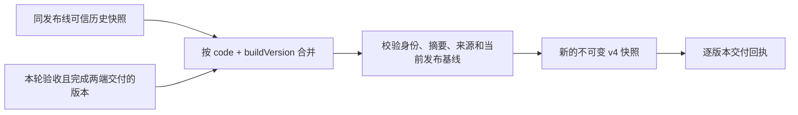

# 多版本发布清单

本文定义算子仓库对平台交付的 v4 清单。协议已在 develop 引入，本次源码布局调整保持该协议。清单描述已完成交付的镜像版本；`operator.yaml` 继续定义每个版本的业务契约。平台按精确编码和版本注册、选择和执行算子。

## 发布范围

`ci/release-versions.yaml` 列出允许进入固定 `release` 和 `main` 发布流程的精确版本。列表非空，禁止重复；版本必须对应当前源码或 `ci/archived-versions.json` 中的可信历史引用。同一编码允许多项：

```yaml
- mcap_read_normalize/v4.0.1
- mcap_stats_global/v4.0.1
- mcap_quality_detect/v4.0.1
- mcap_delivery_accepted/v4.0.1
- mcap_delivery_accepted/v5.0.0
```

新增版本完成开发与验收接入后，将其加入列表；仍需交付的旧版本保留。移出列表仅停止后续为其规划 rc/正式交付，不撤销既有发布，也不删除累计清单中的记录。当前树只保留每个编码的最新开发源码；历史版本仍参与发布或兼容组合时，删除源码前须保存并核验不可变引用，不必移出列表。

| 数据 | 作用 | 不表达的含义 |
|---|---|---|
| `operators/<code>/` | 维护当前版本的声明、实现、依赖和测试 | 不表示已发布；不包含全部历史源码 |
| `ci/archived-versions.json` | 保存仍参与交付/验收的历史版本引用 | 不代替原镜像、声明和验收记录 |
| `ci/release-versions.yaml` | 允许正式交付的版本范围 | 不限制每个编码只能发布一个版本；不指定平台默认版本 |
| `tests/pipelines/*/definition.yaml` | 显式兼容组合，参与版本隔离验收 | 不自动扩大发布范围；不推断任意组合兼容 |
| v4 发布清单 | 当前发布线的累计已交付版本快照 | 不代表当前源码目录全集或完整兼容矩阵 |
| 平台节点配置 | 用户明确选择的算子版本及参数 | 不根据清单数组顺序自动选版本 |

`develop` 对所有当前版本及发布范围中的历史版本规划候选交付；历史版本只复用原镜像；`release/main` 仅对范围列表中的版本规划交付，并按需验证其兼容组合。组合中的辅助版本可构建、测试和保存验收记录，但不会因此获得 rc/正式标签或进入本轮新增发布项。

## 清单内容

完整 YAML 示例：[operator-publication-v4.yaml](examples/operator-publication-v4.yaml)。示例中的提交、摘要和时间为格式占位值，不是可拉取镜像。

| 字段 | 类型与约束 |
|---|---|
| `schemaVersion` | 整数 `4`，为清单协议版本，与算子版本无关 |
| `producer` | 字符串 `operators` |
| `releaseLine` | `develop`、`release` 或 `main`，必须等于 `sourceBranch` |
| `sourceRepository` | `data-platform-operators` |
| `sourceBranch` | 生成清单的固定分支 |
| `sourceCommit` | 生成清单的完整 Git 提交 SHA，40 位小写十六进制 |
| `pipeline` | `projectId`、`pipelineId`、`pipelineUrl`；前两项均为正整数字符串，URL 与流水线 ID 对应 |
| `parentPublication` | `artifactDigest` 和 `sourceCommit`；均为空或均为有效摘要/提交，指向同发布线的前一快照 |
| `components` | 非空数组，每项以 `(code, buildVersion)` 唯一 |

每项 `components` 的字段：

| 字段 | 类型与约束 |
|---|---|
| `code` | 算子编码；小写字母开头，仅含小写字母、数字和下划线，最长 64 字符 |
| `buildVersion` | 三段数字版本字符串，例如 `4.0.1`；各段除 `0` 外不带前导零，不含 dev/rc 标签 |
| `sourceCommit` | 该镜像原始构建提交；复用镜像时保留，不改为清单提交 |
| `digest` | `sha256:` 加 64 位小写十六进制，镜像 manifest 摘要 |
| `repositories.local-harbor.role` | `canonical` |
| `repositories.local-harbor.repository` | `harbor.striding.internal/data/data-operators/<code>`，不带标签或摘要 |
| `repositories.local-harbor.verifiedAt` | UTC 字符串，格式 `YYYY-MM-DDTHH:mm:ssZ` |
| `operatorYaml` | 精确声明的 OCI 引用，含 `repository` 和 `digest`；本次交付项必须有，无法恢复声明的历史累计项允许缺省。 |

除历史项可缺省的 `operatorYaml` 外，其余字段均必填，拒绝未知字段及重复版本身份。字符串身份不转换为数字。数组按编码和版本字符串排序，以产生稳定字节；顺序不表示版本优先级。消费镜像使用 `repository@digest`，不从候选清单的 `buildVersion` 推断 `:<正式版本>` 已存在。

v4 保留唯一 canonical Harbor 记录。ACR 复制结果、两端地址与摘要在交付回执中保存，完整同步验证成功后才写入清单；本次不新增第二套仓库字段。

## 累计规则与失败恢复



- 新增版本时保留旧版本，源目录或发布范围删除不等于下架。下架属于平台独立操作，不通过清单缺项暗示。
- `main` 已发布的同一 `(code, buildVersion)` 只能保持同一镜像摘要，冲突必须升级算子版本。原构建提交和验证信息保留。
- `develop/release` 的同一业务版本可有后续候选。新快照保留该版本最近完成交付的记录；旧快照及镜像标签不覆盖。
- 每条发布线独立累计。`release` 的候选不自动成为 `main` 正式发布；清单没有跨线父指针。
- 测试、Harbor、ACR 任一步失败，不能生成宣称交付完整的新清单。重试消费步骤不重建镜像；上游生产作业重试后须重新校验关联测试。
- 清单已写、交付回执失败时，重试必须重现相同清单字节和摘要。若较新发布已推进基线，则新建父流水线重新规划。
- `main` 手动发布未执行时，同步和清单不会启动。历史通过记录不能代替正式发布操作。

## OCI 制品与历史迁移

| 项目 | v4 约定 |
|---|---|
| OCI manifest | `application/vnd.oci.image.manifest.v1+json`，OCI 自身 `schemaVersion` 仍为 `2` |
| `artifactType` | `application/vnd.striding.data-platform.publication.v4` |
| YAML layer media type | `application/vnd.striding.data-platform.publication.v4+yaml` |
| develop 清单仓库 | `192.168.121.144/data/data-platform/release-publications/operators-develop` |
| release/main 清单仓库 | `192.168.121.144/data/data-platform/release-publications/operators` |
| 清单标签 | `v4-<releaseLine>-p<20 位左补零父流水线 ID>-<提交前 12 位>` |
| 本地文件 | `build/release/manifest.yaml`、`receipt.json`、`delivery.json` |

沿用现有 Harbor `data` 项目；上表是既有清单访问地址，不新增 Harbor 项目。镜像标签继续为 `<版本>-dev.<流水线>`、`<版本>-rc.<流水线>` 和 `<版本>`，与清单标签分开。

v2 的 `components` 为以编码为键的对象，v3/v4 为版本数组；v4 增加可独立获取的声明引用。历史 v2/v3 标签、媒体类型和原始字节保留。无可信累计快照时，汇总同发布线、相同项目、当前祖先链上的历史 v2；有可信 v3/v4 时继承其累计内容。main 同版本不同摘要失败；候选保留最近交付记录。读取最多 4096 个候选标签，超过上限失败，不静默截断；权限或网络失败不视作无历史。

v4 父快照可引用可信 v2/v3/v4。固定 `release` 不拼接旧 `release/v*` 候选线。发布时只写 v4，原 v2/v3 继续只读。

### 精确声明

`operatorYaml.repository` 固定为 `192.168.121.144/data/data-operators/definitions/<code>`，`digest` 是 OCI manifest SHA-256。制品类型为 `application/vnd.striding.data-platform.operator-definition.v1`，单个 YAML layer 类型为 `application/vnd.striding.data-platform.operator-definition.v1+yaml`。

发布工具从该镜像 `sourceCommit` 读取精确声明，允许原 `operators/<code>/v<version>/` 路径或新 `operators/<code>/` 路径，要求编码/版本匹配且无歧义。原始 YAML 字节以 `sha256-<文件摘要>` 标签保存，再将 OCI digest 写入清单。相同原始字节复用制品；同一业务版本的不同 dev 候选不会争用一个声明版本标签。原有版本标签保留。

本次交付项找不到原声明时失败。仅继承的历史累计项若无法恢复声明，可保留无 `operatorYaml` 的记录，不以当前文件补造。消费方不能对缺少契约的历史项自动注册；应保留已注册版本或恢复原声明后再接入。

## 平台侧适配清单

本次仅修改算子仓库。平台团队需完成以下适配后，才执行正式 v4 清单发布：

| 能力 | 必须调整的行为 |
|---|---|
| 发现与解析 | 在算子清单消费入口识别 v4 标签、OCI `artifactType` 和 layer 类型，验证三者与 YAML 协议版本一致；保留 v2/v3 读取。不要顺带改变平台其他 producer 的 v2 协议。 |
| 版本身份 | 以 `(code, buildVersion)` 保存独立算子版本；候选按发布线隔离，不能覆盖正式注册。禁止仅按 `code` 覆盖或以数组第一项作为默认。 |
| 全量应用 | 一份清单完成字段、重复身份、来源及摘要验证后再整体应用；按制品摘要幂等，重复消费不重复注册。主线同版本不同摘要拒绝。 |
| 顺序和历史 | 同项目、同发布线按发布流水线先后处理，旧清单不能回滚当前记录。首次接入读取累计 v4；历史快照保留追溯，不因缺项删除已注册版本。 |
| 契约读取 | 优先按 `operatorYaml.repository@digest` 获取并验证 OCI 及 YAML layer 摘要，再校验声明编码/版本。历史缺省项使用原 `sourceCommit` 下的原路径；不得读取最新分支或猜测目录布局。 |
| 编排执行 | 节点固定编码和版本，按该版本的 I/O、SDK 约定与资源执行。更换版本显式校验；兼容组合由对应测试证据证明，不通过版本排序推断。 |
| 镜像选择 | 校验 `repository@digest`；跨环境镜像映射须使用已验证的 ACR 同摘要镜像，不能重新构建替代。 |
| 迁移验收 | 同编码两版本共存、v2 历史恢复、重复通知、乱序通知、部分处理失败重试、同版本摘要冲突，以及候选不覆盖正式版本。 |

本地只读检查发现平台 `deploy/ci/publication_manifest.py` 的通用发布工具仍限定 v2 对象结构，`deploy/ci/contracts.py` 等也包含发布路由约束。平台团队应先确认实际算子清单消费入口，再按 producer 分派适配；不能据此将所有平台 v2 工具整体升级。算子仓库不修改平台业务逻辑、注册数据或平台权限配置。

CI 格式校验入口为 `ci.publish.manifest.validate_document()`，相关回归位于 `tests/ci/test_multiversion_publication.py` 和 `test_release_scope.py`。示例也由测试读取并校验，避免文档与实际协议漂移。
