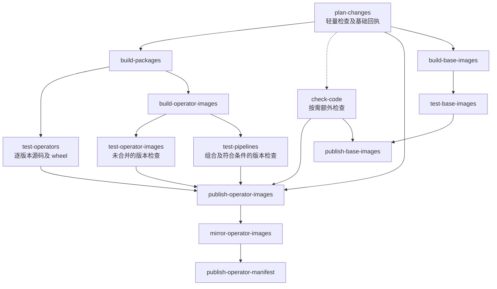

# 算子仓库 CI 调整方案与实施计划

> 历史方案与验收记录。2026-11-06 起，单版本选用表、`release/v*` 分支和外部 v2 写入规则由[多版本发布实施计划](2026-11-06-multi-version-release.md)及[发布清单规范](../../RELEASE_MANIFEST.md)替代。下文保留当时的决策与实跑证据，不能作为当前发布配置。

> **For agentic workers:** REQUIRED SUB-SKILL: Use `superpowers:executing-plans` to implement this plan task-by-task. 设计与原始任务保留供追溯，当前实施及验收状态见第 14 节。范围仅为算子仓库，不修改 SDK 或平台业务仓库。

**Goal:** 缩短算子 MR 的反馈时间，减少重复下载、安装和镜像构建，并建立适用于任意算子及业务流程的 CI 结构。

**Architecture:** MR 默认执行声明、源码和轻量安装包验证，仅构建高风险变更涉及的容器。受保护的 develop 按 build、test、publish 职责依次完成受影响版本的镜像构建、容器及流程验收、Harbor 发布、ACR 同步和完整发布清单。复用 Nexus、依赖缓存、Docker 分层缓存及已发布镜像，首期不建设 MR 镜像跨流水线交接机制。

**Tech Stack:** GitLab CI/CD、Python 3.12、uv、pytest、Docker/BuildKit、Nexus、Harbor、阿里云 ACR、ORAS。工具版本沿用仓库锁定值；GitLab YAML 能力以实际实例的 CI Lint 校验结果为准。

**Spec:** 本文第 1–9 节维护设计规则，第 10 节为唯一实施任务清单，第 11 节维护验收条件，第 12 节列参考资料，第 13 节只保留评审发现及结论索引。任务引用正文规则，不另行维护规则副本。现状依据为仓库 `.gitlab-ci.yml`、`ci/`、`images/ci.yml`、`docs/DEVELOPMENT_AND_CI.md` 及此前核对的 GitLab 作业记录。

**日期与范围：** 初稿 2026-11-04，实施验收更新至 2026-11-06；仅 `data-platform-operators`。三批改动及 ACR 公网交付调整均已合入 develop，现行操作规则见 `ci/README.md` 和 `docs/DEVELOPMENT_AND_CI.md`。本文保留设计、历史问题和验收证据，不以第 1 节的旧实现描述代替当前配置。main 与正式版本发布不属于本次交付。

## 全局约束

- 最小构建单元保持为 `operators/<code>/v<operatorVersion>/`；同时存在多个版本时独立选择、测试和构建。
- 保留算子编码、业务输入输出、SDK 公共接口及当前已发布镜像，不因 CI 整理修改业务契约。
- 算子候选标签保持 `<版本>-dev.<流水线编号>`、`<版本>-rc.<流水线编号>`，main 正式标签保持 `<版本>`，正式发布保留手动入口。
- 外部 v2 发布协议保持不变，包括清单结构、OCI 封装与媒体类型、仓库地址及标签规则；CI 本地产物统一使用 `build/release/manifest.yaml` 和 `build/release/receipt.json`，历史路径仅用于读取适配。基础镜像回执继续使用 `build/base-images.json` 及现有仓库端格式。
- 基础镜像在 develop 发布数字版本及 `dev` 别名，main 只核对既有回执。算子 Dockerfile 直接引用精确版本。
- 不恢复 `images/profiles.toml`、`OPERATOR_BASE_IMAGE`、`OPERATOR_BUILDER_IMAGE`；不要求配置 Harbor 标签不可变规则，沿用 CI 回执核对和同版本冲突检测。
- 阶段统一为 `plan → build → test → publish-images → mirror-images → publish-manifest`；镜像构建、验收及外部交付保留独立作业边界。轻量检查并入计划，版本容器与流程测试按条件合并；不要求每项检查独占作业。
- 构建目标沿用 `linux/amd64`；依赖准备阶段允许访问受控仓库，算子镜像安装阶段继续禁网并校验文件摘要。
- 后续实施使用 `feature/ci-workflow` 等符合仓库规范的分支；无 Issue 不加数字，不新建 `codex/` 分支。不切换或覆盖他人的在用工作树。

## 重点复核条件

1. 普通 Markdown 与打包输入的 Markdown 必须区分；删除、移动和改名也要计算原属版本的影响。
2. develop 前次发布失败后，下一次计划必须包含仍未发布的改动；纯文档提交不能掩盖待交付的源码差异。
3. 新增无预训练流程依赖的算子、一个算子的非选用版本，均能独立验收；不得强制组成四节点链路。
4. 缓存损坏、跨架构缓存、Nexus 认证失败与基础标签漂移不能被缓存命中或空结果掩盖。
5. 发布作业改名后仍能读取历史清单；并发或重试的旧流水线不能覆盖较新的发布结果。

上述五项分别由任务 1、2、3、4、6 的测试覆盖。

## 1. 现状与调整目标

此前核对的 MR !23 成功流水线 #11947 总耗时约 24 分 52 秒，其中 `verify-wheels` 约 4 分 18 秒，`verify-images` 约 19 分 44 秒。wheel 打包本身约 5 秒；时间主要分布在依赖准备、镜像构建与导出、源码测试和容器验收。合入 develop 后，同一提交再次进入 wheel 与镜像构建路径；部分 Docker 步骤命中缓存，但仍执行构建及验收流程。

这些数据是定位依据，不是所有流水线的固定耗时。更早流水线出现过公网下载耗时明显增加，也出现过镜像缓存命中后构建很快的情况。

| 现状 | 目标 |
|---|---|
| 普通算子 MR 默认完整构建和验收镜像 | 默认轻量验证，仅高风险变更增加容器检查 |
| 多个作业重新下载工具与依赖 | Nexus 统一来源，持久缓存加速 |
| 所有 wheel 一起复制，源码变更使大依赖安装与复制失效 | 稳定依赖和算子自身内容分层 |
| `verify-wheels` 混合打包、声明和多类测试 | 按职责命名，并通过明确依赖并行执行 |
| 通用工具引用四个 MCAP 算子和 `tests/v4` | 通用执行能力与业务测试分离 |
| 发布作业候选与正式名称重复，历史查询依赖名称 | 统一作业名，保留历史查询兼容 |

不以“MR 不出现 build 字样”为目标。保留便宜且有效的 wheel 验证，减少耗时镜像构建及重复环境准备。

### 1.1 设计阅读索引

| 内容 | 规则位置 | 实施任务 |
|---|---|---|
| 分支检查、作业组织、计划冻结与产物交接 | 第 2、3 节 | 任务 2、4、5 |
| Nexus、依赖缓存、镜像复用及记录定位 | 第 4、5 节 | 任务 3、4、6 |
| 多版本隔离、兼容组合、静态合并与交付恢复 | 第 6、8 节 | 任务 1、2、5、6 |
| 通用 CI、预训练业务命名及文档迁移 | 第 7、9 节 | 任务 1、7 |

历史评审见第 13 节，任务映射见第 10 节，实际执行证据和剩余验收范围见第 14 节；验收依据仍以第 11 节为准。

### 1.2 当前多版本问题与容器验收位置

依据当前实现 `f7ced2c` 核对，版本发现、构建选择和候选标签已使用精确版本；存在多个版本目录不等于全量构建。以下问题是目标方案需要修复的现状：

| 现状与代码位置 | 影响 | 目标要求 |
|---|---|---|
| `tests/v4/conftest.py:selected_versions()` 按编码覆盖版本 | 同时修改同算子多个版本，源码测试进程最终只加载一个版本 | 每个受检版本独立进程、环境和报告，见 6.2.1 节 |
| `ci/plan_wheels.py:verify_installed()` 只安装选用版本，并为其他算子注入源码路径 | 未选用版本缺少独立 wheel 安装验证，源码可能掩盖漏打包 | 每个受检版本在无业务源码路径的独立环境安装验证，见 6.2.1 节 |
| `ci/change_plan.py` 对未选用版本使用单次差异，`ci/gitlab_plan.sh` 先走文档快速路径 | 未选用版本发布失败后，文档提交可能漏掉待交付内容 | 先核对持久交付基线，再决定跳过；恢复规则见 6.4 节 |
| `ci/verify_v4_containers.py` 固定四节点，非选用版本只替换一个节点 | 联动升级或不兼容旧上下游的新版本被强制放进旧组合 | 版本容器测试独立，流程测试使用明确的兼容组合，见 6.2.2、6.2.3 节 |

当前容器验收由 GitLab Runner 执行的作业调用 Docker 完成，目标为 `linux/amd64`：

| 分支场景 | 当前作业 | 当前执行顺序 |
|---|---|---|
| MR | `verify-images` | 构建镜像 → 容器验收，结束 |
| develop / release | `publish-candidates` | 构建镜像 → 容器验收 → Harbor 候选发布 |
| main | `publish-versions`（手动） | 构建镜像 → 容器验收 → Harbor 正式发布 |

入口均为 `.gitlab-ci.yml` 中的 `.images` 模板 → `ci/gitlab_images.sh` → `ci.verify_v4_containers`。脚本先执行镜像构建，再通过 `docker run` 调用镜像实际入口，生成 `build/container-acceptance.json`。因此当前发布作业也包含构建和验收；第二批按第 3 节将其迁入独立 `build`、`test` 作业，发布只消费通过报告。

2026-11-05 本地核查中，10 项既有规划/发布规则测试通过；补充复现确认，同算子 `v4.1.0`、`v4.2.0` 同时进入构建列表时源码测试仅选中 `4.1.0`，以及未选用版本待交付后仅改文档会得到空构建列表。该记录不代表多版本真实镜像验收已经通过。

## 2. 分支与检查边界

### 2.1 MR 默认检查

| 检查 | 要求 |
|---|---|
| 声明与注册转换 | 校验 `operator.yaml`、示例、命名、版本、资源声明和注册导出；覆盖本次受影响对象 |
| 依赖与锁文件 | 校验声明与锁的一致性、SDK 版本及 wheel 摘要，不在 CI 静默更新锁文件 |
| 源码测试 | 运行受影响单元测试及无需 Docker 的契约测试；公共工具变更运行对应工具测试 |
| wheel 验证 | 构建受影响项目及必需的本仓依赖，检查元数据、资源文件、安装和入口导入 |
| 容器检查 | 默认不执行；按 2.2 节确定必检范围 |
| 发布 | 不推送候选、正式标签或发布清单，不使用正式发布凭据 |

源码及 wheel 验证均以 `<code>/v<version>` 为单位，受检范围包含选用及未选用版本；分别使用独立进程和环境。wheel 验证在仓库外执行，移除业务源码路径，具体要求见 6.2.1 节。不能按算子编码合并多个版本的测试结果。

### 2.2 MR 必须增加最小容器检查的情况

| 变更 | 容器检查范围 |
|---|---|
| 新增算子，或新增版本尚无可继承的运行环境基线 | 对应版本 |
| Dockerfile、基础镜像引用、系统或原生依赖 | 对应版本及受影响消费方 |
| Python/SDK 依赖及锁定制品发生变化 | 受影响版本 |
| `main.py`、声明中的 `command` 等启动方式发生变化 | 对应版本 |
| 构建上下文、打包资源、安装脚本或公共镜像构建工具发生变化 | 受影响版本；公共规则覆盖全部消费方 |
| 基础镜像配方或其构建、测试工具变化 | 受影响配方 |

已存在算子复制出新版本且构建相关内容相同，按实际差异分类，不仅因目录新增就强制全量容器测试。新增依赖、SDK 或执行环境仍按上表处理。

最小容器检查至少覆盖目标架构、依赖导入、非 root 启动、一次真实入口成功调用及一次失败调用。涉及交接契约时按 6.2.3 节增加明确兼容组合的最小集成用例，不能默认单节点替换后仍兼容。昂贵的完整业务流程回归默认留在 develop。

普通算法函数、阈值逻辑和不涉及启动或环境的业务变更，默认无需 MR 镜像构建。允许维护者主动增加完整容器验收，但不能通过手动选项关闭必检项。新增构建输入未能分类时明确失败，不静默当成普通源码。

### 2.3 develop、release 与 main

| 发布线 | 行为 |
|---|---|
| develop | 检查合并后的源码；构建受影响 wheel 和镜像；完成版本级容器验收及受影响业务流程；发布 Harbor 候选、同步 ACR、提交完整清单 |
| release/* | 优先复用有可信验收记录且构建输入相同的受保护分支镜像，重新核对组合；变化或证据不匹配时构建验收；生成 rc 标签 |
| main | 自动检查源码、构建输入及基础回执；先在 build/test 阶段处理缺失产物和必要验收；手动正式发布只核对并生成数字版本标签 |

仅执行发布、改标签或跨仓同步，不应调用编译和依赖安装工具。保护分支的可发布镜像至少匹配源码构建输入、Dockerfile、锁文件、共享包 wheel、基础镜像实际摘要、架构和验收范围。新增测试或变更组合可能需要重跑验收，但不自动要求重建镜像。

本期不读取 MR 镜像作为保护分支交付产物。高风险 MR 与 develop 各执行一次构建是有意保留的验证成本，依赖和镜像层缓存用于降低成本。

## 3. 阶段、作业与依赖

### 3.1 组织原则与阶段

恢复此前按职责拆分的六个阶段：`plan → build → test → publish-images → mirror-images → publish-manifest`。

- **阶段表示职责，作业按环境、权限和重试边界组织，分支规则决定是否执行。** 同环境、同权限且可共同重试的检查可合并；不把 MR、候选或正式版本分别复制成整套同功能作业。
- **构建、测试、发布分别负责自己的产物。** 保护分支测试作业不隐式构建镜像，发布作业不隐式构建或补跑整套测试。MR 的 `check-images` / `check-base-images` 按 3.5 节明确合并构建与验收。
- **任务是否执行按变更和风险选择。** 普通 MR 只有轻量包构建和测试；风险 MR 增加对应镜像构建与测试；保护分支增加发布链路。
- **并行由 `needs` 决定。** 阶段展示有先后，不要求所有作业按整阶段串行等待。
- GitLab 阶段与 `operator.yaml.stage` 的业务含义无关。

| 阶段 | 职责 | 完成后交给后续阶段的内容 |
|---|---|---|
| `plan` | 轻量声明及基础回执检查，确定精确版本、测试执行作业、复用与交付范围 | `build/plan.json`、子流水线配置、分项检查报告及复用来源 |
| `build` | 准备 wheel，构建确实需要的新镜像 | wheel、Harbor 临时镜像及构建记录；复用对象只传既有摘要 |
| `test` | 剩余声明/工具检查，逐版本源码、安装包、容器及业务流程测试 | 与实际构建内容绑定的检查和验收报告 |
| `publish-images` | 核对验收证据并向 Harbor 发布标签与回执 | Harbor 镜像和发布回执 |
| `mirror-images` | 将指定 Harbor 镜像同步到 ACR 并核对摘要 | ACR 同步回执 |
| `publish-manifest` | 汇总本次更新与继承组件，发布完整清单 | 完整 v2 发布清单 |

### 3.2 作业清单

作业名表达主要职责，不串联 build、test、publish。动态子流水线只生成必要实例；版本级实例追加 `<code>/v<version>`，基础镜像实例追加配方与版本，流程实例追加组合。以下为作业类型，不表示每次全部执行。

| 阶段 | 作业名 | 执行范围与职责 |
|---|---|---|
| plan | `plan-changes` | 所有流水线；完成可在轻量环境运行的声明、版本、依赖元数据检查，按需核对基础镜像回执，计算范围、复用和各检查的执行作业 |
| build | `build-packages` | MR 及需要新产物的保护分支；集中生成所需算子及共享 wheel，SDK 从 Nexus 下载 |
| build | `build-operator-images` | 保护分支的受影响版本；构建缺少匹配产物的镜像并上传临时标签 |
| test | `check-images` | 高风险 MR；在同一作业内完成关联版本的构建与验收，不写 Harbor |
| build | `build-base-images` | develop；构建受影响基础镜像并上传临时标签 |
| test | `check-base-images` | 配方 MR；同一作业构建并验证配方，不写 Harbor |
| test | `check-code` | 仅在需要额外依赖或独立运行的检查存在时生成，如受影响 CI 工具测试、工具和模板的专项检查；不重复计划已完成项 |
| test | `test-operators` | 每个精确版本一个作业，源码与 wheel 两个模式分别使用隔离环境并报告；不因是否选用而漏检 |
| test | `test-operator-images` | 执行未并入流程作业的版本容器检查；独立算子、多组合共享版本、耗时较长或需独立重试的检查保留此作业 |
| test | `test-pipelines` | 执行明确兼容组合；按 6.2.2 节承接符合条件的版本容器检查，同一镜像只下载、加载一次，分别输出版本与组合报告 |
| test | `test-base-images` | 独立验证基础运行环境或编译样例，验收失败可直接使用原构建产物重试 |
| publish-images | `publish-operator-images` | 保护分支；等待全部必检后推送镜像、增加标签或仅写验收记录；main 全部交付写入经此手动入口 |
| publish-images | `publish-base-images` | develop；发布已验收基础镜像数字版本与 dev 别名 |
| mirror-images | `mirror-operator-images` | 按 Harbor 回执同步 ACR，并核对 manifest 摘要 |
| publish-manifest | `publish-operator-manifest` | 核对交付结果，按需发布完整 v2 清单并持久化交付回执；未选用版本和仅补测可只更新回执 |

第二批切换后，不生成无工作对象的构建、测试或发布作业。第一批仍沿用固定作业时，允许入口读取空范围后快速结束，不能先安装依赖再判断。

#### 3.2.1 合并范围与保留边界

| 对象 | 调整 | 必须保留的边界 |
|---|---|---|
| `check-base-image-receipts` | 并入 `plan-changes`，不再生成独立作业 | 按需读取并固定精确回执/镜像摘要；main 基础配方核对仍必须执行，发布时校验实际消费身份 |
| `check-code` 的轻量部分 | 版本目录、依赖元数据和必检分配提前到计划；SDK 声明、样例及注册转换随对应版本源码检查执行，工具及模板检查按需保留 | 计划不安装算法依赖或运行大测试集；每项必检分配明确执行位置，不以合并为由省略示例、注册和工具检查 |
| 源码与 wheel 验证 | 保持同一版本一个 `test-operators` | 两个模式独立进程、环境及报告；不同版本仍独立作业，不共享已安装环境 |
| 版本容器与流程验收 | 符合 6.2.2 节条件时由同一 `test-pipelines` 执行 | 每个测试项只有一个执行作业；版本与组合报告、容器及工作目录分别隔离；可共同重试 |
| 包构建与源码/wheel 验证 | 保留 `build-packages` 与 `test-operators` | 共享 wheel 集中构建一次，供各版本验证及镜像构建消费 |
| 镜像构建与验收 | 保护分支保留独立构建、测试作业；MR 采用 3.5 节的合并检查 | 保护分支验收重试不构建；风险 MR 共同重建和重测，版本隔离及报告不合并 |
| Harbor 发布、ACR 同步、清单交付 | 三类作业分别保留 | 外部依赖与写入权限不同；必需制品及计划仍有效时只重试对应步骤；制品过期或需改计划时按 8.2 节启动新父流水线 |

合并减少 Runner 启动、环境准备和重复加载，不能假定能从作业内失败步骤继续执行。GitLab 原生重试创建新作业实例；合并作业中的检查共同重跑，不为省作业另建步骤恢复机制。`check-code` 只保留实际需要的额外检查，计划失去轻量特征时将相关检查移回该作业，不扩大计划环境。

### 3.3 分支执行路径

| 场景 | 实际执行组织 |
|---|---|
| 普通算子 MR | plan 完成轻量检查；受影响 wheel 构建、逐版本源码和安装包验证；其余检查按需生成 `check-code`。没有镜像 build/test/publish |
| 高风险算子 MR | 普通 MR 检查，加对应版本镜像构建与容器验收；必要流程已需运行且满足合并条件时，由 `test-pipelines` 一并执行，否则版本验收独立。没有发布 |
| 基础配方 MR | plan、工具检查、`build-base-images → test-base-images`。不构建无关算子 |
| develop 算子交付 | plan、必要的包和镜像构建、源码及容器/流程验收、Harbor 发布、ACR 同步、完整清单 |
| develop 基础镜像交付 | plan、配方构建、工具及基础镜像测试、基础镜像发布；不产生算子清单 |
| release/main 推进已验收版本 | plan 解析可信已发布镜像；必要检查及组合核验；发布目标标签、同步 ACR、发布清单。输入一致时跳过镜像构建 |
| release/main 存在新构建输入 | plan 明确列入构建范围，先执行 build/test，再允许 publish；发布作业本身不重建 |
| 仅基础配方同步 main | 在 `plan-changes` 核对回执与来源，完成其余必要检查后结束；不重新构建、不移动 dev 别名 |

进入 release/main 的 MR 可使用已验收的保护分支镜像作为测试输入；不能仅因目标分支较旧、文件差异较多而重复构建已验收内容。仍须核对精确构建输入、测试范围和组合。

### 3.4 作业依赖



图中表示可用职责路径，不表示全部作业同时生成。父子边界见 3.7 节；生成器按 3.9 节和每项检查的唯一执行作业生成实际 `needs`。已由 `test-pipelines` 承接的版本检查不再生成对应 `test-operator-images`。发布等待计划报告及全部已分配的必检作业，不能用 `needs:optional` 掩盖缺失检查。

镜像复用时测试直接读取计划中的仓库摘要；仅补测时省去镜像构建和同步，由记录发布连接交付回执作业。裁剪后仍保留 main 手动入口。

`check-code` 仅在有额外必检项时生成，计划完成后即可运行。源码/安装包测试与镜像构建在 wheel 就绪后并行；未合并的版本容器测试与流程测试可并行，合并项在同一作业内复用已加载镜像。基础镜像与算子按实际依赖独立；新基础版本先独立发布，再由算子引用。

### 3.5 镜像交接与性能边界

2026-11-05 实测单版本镜像归档上传返回 413 后，用户确认：不提高 GitLab 上传上限、不新建 Harbor 项目；沿用现有 `data` 项目及各镜像仓库。GitLab artifacts 交接 wheel、计划、构建记录、测试报告和回执，不上传完整镜像归档。

| 场景 | 镜像交接与重试边界 |
|---|---|
| 普通 MR | 不构建镜像；源码及 wheel 验证仍逐版本隔离 |
| 高风险 MR | `check-images` 在同一作业内构建并验收；不推送 Harbor。独立版本分别执行；存在必须一起验证的兼容组合时，将其关联的新版本放入同一作业，逐版本隔离并分别报告，避免重复构建或跨 Job 假设共享 daemon。重试共同重建、重测该组新镜像 |
| 基础配方 MR | `check-base-images` 在同一作业内构建并测试目标配方，不推送 Harbor |
| 保护分支的新镜像 | 独立构建作业推送临时标签，生成精确 manifest/config 摘要及构建记录；独立测试按摘要拉取，发布核对全部证据后为同一内容增加候选或正式标签 |
| 已有可信镜像 | 从 Harbor 按精确摘要读取，按当前必检范围补测或复用通过记录；不重新构建 |

临时标签采用 `<版本>-ci.<父流水线ID>.<构建JobID>`，仓库来自已校验的算子声明或基础配方。构建重试产生新 Job ID 和新标签；已有标签指向不同内容时失败，不覆盖。测试和发布只消费记录中的摘要，标签仅用于留存与定位。构建记录保留冻结计划身份、构建输入、目标架构、实际 wheel 摘要、manifest/config 摘要及生产 Job ID；测试报告绑定相同内容。

同一 `data` 项目的临时标签与发布标签没有原生权限隔离。MR 不注入 Harbor/ACR 写凭据；保护分支构建复用现有受控 Harbor 凭据，代码只允许生成并写入临时标签，测试使用只读访问。正式标签、长期验收记录、ACR 同步和清单仍由相应发布作业处理；main 的临时构建上传可以自动执行，正式交付及长期记录写入仍须经过手动入口。不新增凭据代理、项目或存储服务。

临时标签保留至少 30 天，覆盖当前重试窗口。清理工具按明确前缀、来源、时间及运行状态生成清理清单，只删除过期临时标签，不能删除整个镜像制品或发布标签；被保留标签引用的镜像及记录不受影响。删除权限不足时明确失败，不自动扩权。临时内容缺失或计划失效时启动新父流水线；不得在测试或发布作业内补建。MR 的共同重建是上述明确例外。

跨 Runner 验收须核对同一 manifest/config 摘要，测量推送、拉取、磁盘峰值和总耗时。版本与流程测试符合合并条件时共用一次拉取，分别输出报告；mirror 与清单只下载小型回执。暂存成功不代表通过验收，不写输入查找入口或发布清单。MR 镜像不作为 develop 交付产物，保护分支的跨流水线复用仍遵循第 5 节。

### 3.6 现有作业迁移

| 现有作业 | 目标组织 |
|---|---|
| `prepare-plan` | `plan-changes`，增加轻量检查及基础镜像回执核对 |
| `verify-wheels` | 轻量检查归入计划；打包与逐版本验证分别由 `build-packages`、`test-operators` 执行，额外检查才生成 `check-code` |
| `verify-images` | 构建归入 `build-operator-images`；测试按风险及合并条件分配给版本或组合验收作业，同一版本检查不重复生成 |
| `foundation-check` | 拆为 `build-base-images`、`test-base-images` |
| `foundation-publish` | 构建及测试归入前置作业，`publish-base-images` 只发布 |
| `publish-candidates`、`publish-versions` | 构建及验收归入前置作业，统一 `publish-operator-images`；用分支选择标签和 main 手动入口 |
| `mirror-candidates`、`mirror-versions` | 统一 `mirror-operator-images` |
| `publication-candidates`、`publication-versions` | 统一 `publish-operator-manifest`；历史读取保留旧作业名兼容 |

### 3.7 动态子流水线与作业实例

工程评审 D3 已确认采用 GitLab 原生动态子流水线。本次只读核对的实例版本为 `19.3.3-jh`；第二批开始时依据 8.1.1 节要求及 8.1.2 节已有实证，补齐保护分支上下文和正式入口校验，再以该实例 CI Lint 和真实 MR 验收确认执行行为。保留六阶段职责，不新增调度服务，不为每个算子手工维护一份 CI YAML。

```text
父流水线（同项目、同一提交）
  plan-changes（轻量检查及基础回执核对）
    ├─ build/plan.json
    ├─ build/checks/<job-id>/checks.json
    └─ build/child-pipeline.yml
          │
       run-jobs（触发并等待，strategy: mirror）
          │
子流水线（只展开本次必要实例）
  build-packages ──┬─ test-operators:<code>/v<version>
                  └─ build-operator-images:<code>/v<version>
                       ├─ test-operator-images:<code>/v<version>（未合并项）
                       └─ test-pipelines:<workflow>/<combination>（可承接版本检查）
  check-code（仅额外检查）
  必检报告 + 对应镜像 ── publish-operator-images
                         ── mirror-operator-images
                         ── publish-operator-manifest
```

- **配置生成：** `plan-changes` 校验计划后，使用仓库内固定模板生成实例、参数和依赖，输出配置作为 job artifact；`run-jobs` 通过 `trigger:include:artifact` 创建一个同项目、同提交的子流水线。生成器只接受合法版本键与测试组合，不把业务字段直接拼成 shell 或任意 YAML。子流水线使用固定的模板引用，不依赖动态 `include` 内的变量展开。
- **数据传递：** 子流水线通过 `needs:pipeline:job` 读取父计划及检查报告，但“父流水线 + 作业名”只用于下载，不作为计划身份。消费前须核对下述冻结信息；发布同样核对父检查证据。子流水线内用 `needs:artifacts` 交接 wheel 和构建记录；保护分支镜像通过 Harbor 摘要交接，MR 镜像只在同一检查作业内使用。无工作时仅生成轻量 `check-plan`，避免空子流水线失败。
- **结果传递：** 使用 `trigger:strategy: mirror` 等待并传递子流水线状态；必须验证失败、取消与 main 手动发布的状态。必检作业不允许失败；不以成功创建子流水线作为 MR 验收通过。不使用当前实例尚未支持的跨父子流水线 `needs:pipeline:job optional`。
- **身份与权限：** 子流水线的 `CI_PIPELINE_SOURCE` 为 `parent_pipeline`，MR 判断和发布授权不能沿用“只看该值”的逻辑。记录并核对父流水线来源、项目、分支、提交与实际父子关联；MR 不生成发布作业，保护分支发布仍需独立校验。仅传递必要的非敏感上下文，不覆盖 GitLab 预定义变量。
- **计划冻结：** `plan.json` 记录项目、提交、父流水线及本次 `plan_job_id`。文件写定后计算原始文件字节的 `plan_sha256`，将这两个值作为固定值写入生成的子配置；摘要不写入被计算的 `plan.json` 本身，避免自引用。父检查报告及后续构建、测试、发布报告均引用这组计划身份，消费时核对内容、实际作业及父子关系。
- **交付编号：** 候选标签和 v2 清单沿用父流水线编号；内部记录实际子流水线和作业 ID。子流水线创建后，不能通过重跑原父 `plan-changes` 改变其计划。下载到其他尝试的计划必须拒绝，不能更新预期摘要继续执行。
- **重试边界：** 冻结计划、基线及必需制品有效时重试具体失败 Job；需要重新创建整个子流水线，或改变计划/依赖关系时，一律启动新父流水线，不再区分发布前后。已有子流水线后，通过重试 `run-jobs` 创建的另一条子流水线须在入口校验时停止并提示新建父流水线，不执行构建、测试或发布。新候选标签使用新父流水线编号；既有标签是否可补同步按 5.3 节判断。main 数字版本规则不变。

```text
写定 plan.json（含 plan_job_id）
  → 计算 plan_sha256
  → 生成含固定计划身份的子配置
  → 每个消费作业核对计划身份及内容
```

重试父计划不能替换原有子流水线的冻结计划；重试触发作业也不能用同一父编号重新创建整条执行链。入口依据 8.1.1 节已验证的服务端关联和触发重试历史，核对当前子流水线是否为该父流水线首次创建的子流水线；仅看到一条当前关联不足以证明首次创建。不维护发布前后两套恢复条件；无法核实关联时拒绝继续。具体失败 Job 的重试仍属于原有子流水线，按新的 Job ID 记录；有效镜像通过第 5 节复用。

镜像发布必须等待计划规定的全部必检项。首期保留一个 `publish-operator-images` 汇总发布作业和一个 main 手动入口，只下载本次需发布的构建记录及必检报告，并按摘要读取 Harbor 镜像；既有镜像按摘要复用。发布与清单汇总按 3.8 节校验完整性，体积及依赖数量须满足实例限制，不预先扩展多级子流水线。动态展开不改算子声明、镜像交付标签格式或 v2 发布清单外部字段。仅补测可只写记录；没有待同步标签时不生成同步作业，已有 Harbor 标签仍可单独补同步。main 只更新记录或交付回执时仍保留该手动入口，不能绕过正式发布授权。

### 3.8 版本产物路径与报告汇总

作业名和 `artifacts:name` 不提供下载后的文件路径隔离。每个生产作业使用下列路径；`<job-id>` 为运行时实际生产作业 ID，重试生成新的 ID。计划生成时不预填尚不存在的子作业 ID；不能让不同版本同时输出到根级 `build/images.json` 等路径。

```text
build/
  plan.json
  child-pipeline.yml
  operators/<code>/<version>/
    build/<job-id>/build.json
    test/<job-id>/<mode>/acceptance.json  # mode: source / wheel / container
  base-images/<kind>/<name>/<version>/<action>/<job-id>/...
  pipelines/<workflow>/<combination>/test/<job-id>/acceptance.json
  checks/<job-id>/checks.json        # 父 plan-changes 或按需 check-code 的分项报告
  release/
    manifest.yaml                    # 本次生成的完整 v2 发布清单
    receipt.json                     # 本次发布步骤的回执
```

计划固定逻辑作业名、版本或组合、测试集标识、模式及报告路径模板。执行作业用自己的实际 Job ID 展开模板，并将该 ID 写入报告；不修改 `plan.json` 或其摘要。父检查报告直接核对已冻结的 `plan_job_id`；子作业报告由消费方按逻辑作业查验本次子流水线的 GitLab 元数据，确定其当前有效的成功尝试，再核对下载路径、报告中的 Job ID、冻结计划身份和制品摘要。最新尝试失败、取消或仍在执行时不得回退使用旧成功报告；不能只按目录名或文件扫描结果选择一次尝试。各消费方复用同一元数据查询逻辑，接口、权限及分页前提见 8.1.1 节。

例如计划保留 `test/<job-id>/wheel/acceptance.json` 模板，首次执行和重试分别展开为不同目录；两次均引用原 `plan_sha256`，消费方只接受其核实的有效尝试。当前流水线报告按此规则解析，显式复用的历史记录按第 5 节核验原始来源，不伪装成本次 Job。

构建记录绑定冻结的 `plan_job_id`/`plan_sha256`、版本、构建输入、镜像 manifest/config 摘要及生产作业；测试报告按源码、wheel 或容器模式绑定相应源码输入、实际消费的 wheel 或镜像摘要，以及对应生产作业。合并测试作业同时写入各版本 `operators/.../test/<job-id>/container/` 和组合 `pipelines/.../test/<job-id>/acceptance.json`，不把多份报告压成一个通过布尔值；未执行项标明未执行，不伪造通过。继承镜像引用 Harbor 镜像及记录摘要。同一版本的源码与 wheel 模式不得覆盖彼此报告。路径可用于定位，不能替代报告内容校验；报表必须包含格式版本和通过/失败结果，失败报告不能作为发布证据。

汇总逻辑在消费方执行，不新增仅搬运大文件的作业。按计划要求的版本、必检测试集、唯一执行作业及来源身份读取分项报告，拒绝缺失、额外未声明或重复的测试集报告、错误版本及旧尝试报告。具体 pytest 用例由测试作业收集并报告，不要求在计划中逐条枚举，边界见 6.2 节。一个作业可产出多项报告；父计划与子检查各自负责的项也必须齐全，并引用同一冻结计划，不能因为作业合并就减少必检集合。不能用“扫描到哪些文件就汇总哪些文件”替代完整性判断，也不能从多个尝试中各取一部分拼成通过结果。计划明确引用的历史通过记录按 5.2 节核对完整的制品和测试身份，不等同于混用本次失败重试的分项报告。

`build/images.json`、`build/container-acceptance.json` 等聚合文件由单个消费作业在需要时生成；路径保留，内部格式及消费者按 3.9 节配套升级，旧报告通过读取适配处理。每个接口在一个交接步骤只能有一个指定生产者。转换逻辑共用，既有聚合报告不能反向覆盖已下载的分项证据。mirror 只下载 Harbor 回执，清单作业只下载验收摘要、交付回执及所需小型元数据。

### 3.9 内部交付计划与执行动作

第二批为 `build/plan.json` 增加内部格式版本，统一切换生成器、校验器、构建、测试、发布和同步消费者。外部 v2 发布清单不变。第一批可保留旧计划适配；第二批不能继续用 `publish ⊆ build` 或“候选发布范围等于 build”判断交付。

新计划按精确版本记录镜像来源、必要测试及交付动作，避免以是否构建推断是否发布。`operators` 只列需要镜像操作或参与流程的版本；普通 MR 的纯源码及 wheel 检查留在 `checks`，不因存在选用表就创建镜像任务：

| 内容 | 定义与校验 |
|---|---|
| `format_version`、`commit`、`active`、基线与执行身份 | 内部格式版本、当前提交、选用版本表、两种基线摘要、项目、父流水线及 `plan_job_id`；文件外的 `plan_sha256` 按 3.7 节绑定，不与构建输入摘要混用 |
| `operators[<code>/v<version>].source` | `build` 表示本次构建；`registry` 表示已校验的仓库镜像摘要及构建记录。新构建在计划中引用生产作业，实际摘要由构建报告提供，不能提前伪造 |
| 版本及流程 `tests` | 每项代表必检测试集并指定 `run` 或 `reuse`；`run` 固定测试集标识、逻辑 `job`、模式及报告路径模板，实际 Job ID 按 3.8 节解析；`reuse` 给出精确测试身份和记录摘要。流程项绑定参与版本，不在计划中枚举 pytest 具体用例 |
| `publish_tags`、`write_records`、`mirror_tags` | 分别列出需增加的 Harbor 标签、是否写入新构建/验收记录、需同步到 ACR 的标签；允许数组为空。标签动作明确镜像来源及证据引用；既有标签补同步与仅有摘要时新增标签按 5.3 节区分，不要求所有同步动作先增加标签 |
| `publication.write_manifest`、`publication.write_delivery_receipt` | 分别决定是否更新选用版本的完整清单、是否确认本次交付完成；未选用版本和仅补测可以只更新交付回执 |

`checks` 继续表示源码、wheel、工具等必检范围，与镜像交付动作分开；每项明确由父 `plan-changes` 或哪个子作业执行及报告，不得遗漏移入计划的检查。旧 `build`/`publish` 列表仅在过渡适配中派生，不作为新计划的另一套权威数据；旧 `images.json` 中“本地镜像 ID 或继承父清单”的二选一校验也随之调整，显式接受已核实的其他保护分支镜像来源。

| 场景 | 镜像来源 | 必要动作 |
|---|---|---|
| 新增构建输入 | `build` | 构建、测试、写记录、发布标签、同步；按是否选用更新清单，最后更新交付回执 |
| release/main 推进相同产物 | `registry` | 复用通过记录，按需增加目标标签和同步；不创建镜像构建作业 |
| 仅修改测试，交付镜像不变 | `registry` | 补测、写新验收记录、更新交付回执；已有两端交付仍有效时不加标签、不同步、不更新完整清单 |
| 前次 ACR 或清单步骤失败 | 原作业使用仍有效的产物；新父流水线优先 `registry` | 制品及基线有效时重试原步骤；否则按 8.2 节重新规划，只生成仍缺少的交付动作 |
| 无待交付变更 | 继承既有结果 | 仅运行必要检查；不生成镜像交付动作 |

生成器根据上述动作裁剪作业及 `needs`；临时镜像或元数据缺失不能通过伪造 `build` 项补救。MR 的交付动作必须为空。保护分支构建完成后可上传临时标签；候选/正式标签及可信记录须等待完整必检集合，main 继续经过手动入口。只更新交付回执的情况也有明确计划和授权，不使用无条件空发布作业。

## 4. Nexus、缓存与环境准备

### 4.1 依赖来源与存储职责

| 能力 | 用途与约束 |
|---|---|
| Nexus `pypi` 聚合入口 | 本地与 CI 统一读取入口，沿用 `https://nexus.striding.internal/repository/pypi/simple/` |
| Nexus `pypi-internal` | 保存 SDK 等内部发行包；算子 CI 下载锁定 wheel，不重编 SDK |
| 现有 PyPI 代理仓库 | 缓存第三方包；沿用实际仓库名称，不因拼写差异创建重复仓库 |
| uv 缓存 | 保存依赖及工具下载结果，按 Python、平台、信任范围及依赖集合组织；避免随业务源码变化整体失效 |
| wheel 下载缓存 | 延续按文件 SHA-256 寻址，读取时复核；与 uv 私有缓存分开，不依赖其内部目录布局 |
| Docker 缓存 | 稳定依赖层复用；首期复用受控 Runner 的缓存，跨 Runner 的外部缓存能力单独核验 |
| GitLab artifacts | 保存 wheel、计划、构建记录、报告和回执；按版本限定下载，不保存完整镜像 |
| Harbor | 保存基础镜像、已发布算子镜像、镜像关联的构建与验收记录、回执与清单；不把镜像文件放进 Nexus PyPI 仓库 |

需要同步修改索引配置、锁文件记录的下载来源以及 `sdk_wheel`、`wheelhouse`、uv 自举的下载实现。只设置 pip/uv 的默认索引不能替换锁文件中既有的公网 URL。迁移时逐包核对版本与哈希，不借此隐式升级依赖；保留内部分发包不能从公共代理意外解析的约束。

认证沿用现有 NETRC 或 CI 变量。下载器支持公司 CA，不把认证值写入锁文件、URL、镜像层或日志；跨主机跳转不转发凭据。401/403 明确失败，不能回退公网绕过认证或下载同名未知包。

每个缓存键指定一个写入作业，其他消费作业优先只读，减少并发上传覆盖；不同版本可使用独立缓存键。保护与非保护分支保持缓存隔离；缓存缺失可以重新下载，缓存摘要不匹配必须拒绝该文件。不要把 `.venv` 或未校验的本仓产物当作通用共享缓存。

GitLab 多 Runner 的共享缓存需要 Runner 端支持。仓库配置先定义缓存策略和路径；如未配置共享后端，不宣称跨 Runner 已命中，使用 Nexus 作为稳定回退并记录命中率。无需为本次方案直接新建外部缓存服务。

计划、发布和同步工具使用轻量依赖环境；不执行完整根项目的 `uv sync`。源码测试、安装包测试与发布工具分别声明所需依赖，避免仅生成清单也安装 NumPy 等算法依赖。

### 4.2 wheel 构建如何使用 Nexus

**现状已经部分接入。** `ci/build_v4.py` 的 `build()` 使用 `uv build --wheel --no-sources --default-index INDEX`，`ci/sdk_wheel.py` 的 `INDEX` 指向 Nexus `pypi`。当前算子采用 `hatchling==1.27.0` 构建后端。因此不是新增一个 Nexus 构建入口，而是补齐所有依赖路径与缓存。当前根锁文件仍包含 `files.pythonhosted.org` 的第三方 wheel 地址，uv 自举也直接访问该域名。

Nexus 保存、代理和分发制品，不承担 Python 包编译。其加速作用分为以下几类：

| 对象 | 处理方式 | 加速边界 |
|---|---|---|
| Hatchling 等构建后端及传递依赖 | 通过 Nexus 获取，固定构建约束并复用 uv 缓存 | 减少隔离构建环境的下载与解析；项目运行依赖锁不能替代构建依赖约束 |
| SDK | 直接读取 Nexus 中已发布、与锁匹配的 wheel | 避免算子 CI 克隆并重编 SDK |
| NumPy、grpcio 等第三方依赖 | 优先选择已发布且匹配 Python/平台/ABI 的 wheel，由 Nexus 代理缓存 | 避免公网重复下载及无意的源码编译 |
| 必须自行编译的原生依赖 | 在对应 builder 中独立生成并验收 wheel，记录来源、平台/ABI和摘要后发布到受控内部仓库，消费锁明确来源 | 后续算子重复使用编译结果；Nexus 不会自行把源码包编译成 wheel |
| 本仓正在修改的算子和共享包 | 根据当前源码构建一次，供同流水线的安装测试与镜像构建消费 | Nexus 无法加速本地打包计算，也不能用同版本旧 wheel 代替当前源码 |

保留构建隔离，不以关闭隔离作为默认提速方案。添加 `ci/build/build-constraints.txt` 管理构建依赖的精确版本及制品哈希，使用锁定 uv 版本支持的约束与校验方式；同时覆盖构建后端返回的传递依赖，不依赖开发机偶然已安装的包。实施时核验实际 uv 命令能力，不直接采用最新文档中的实验参数。

**本期不把每次 MR 的算子 wheel 上传 Nexus。** 它是流水线临时产物，使用 GitLab artifacts。SDK 或以后独立发行的共享库才按各自发行流程进入 Nexus；同名、同版本但源码不同的 wheel 不能覆盖已有发行物。若以后需要跨流水线复用自有 wheel，必须额外绑定源码输入、构建环境、来源流水线和哈希，本期不为节省约 5 秒打包时间建立这套机制。

### 4.3 依赖准备去重与缓存维护

去重保证限于同一作业的一次准备过程，不要求跨 Runner、重试或整个流水线严格只下载一次。

1. 同一准备过程内，按基础镜像实际摘要与目标架构复用 Python/ABI 探测；每份不同锁文件只解析一次。不能仅凭可变标签共享结果。
2. 按目标平台筛选 wheel，以 SHA-256 合并本作业下载集合；相同文件只下载一次，再生成各版本独立的 wheelhouse 和安装清单。并发下载上限初始为 4，校验后原子提交，失败不留下可消费的半文件。
3. `build-packages` 是本仓源码 wheel 的唯一生产作业，通过 GitLab artifacts 交给安装检查和镜像构建。第二批的各版本镜像作业自行准备第三方依赖，优先读取经校验的缓存，未命中则访问 Nexus；不通过缓存交接本次源码 wheel。
4. 跨作业缓存是性能优化，缺失时下载仍须成功。缓存键按工具、平台、依赖集合和信任范围组织；保护与非保护分支隔离，普通业务源码变化不清空第三方下载缓存。
5. 不无条件执行 `uv cache prune --ci`。先比较重新下载和缓存传输成本，保留可复用预编译 wheel，以容量及生命周期控制清理，不修改 uv 私有缓存布局。
6. 分别记录下载、环境准备、本仓 wheel 打包、安装及测试耗时。不为跨作业严格去重增加分布式锁、下载协调服务或新的大体积共享 wheelhouse 产物。

集中下载第三方依赖不作为本期要求；只有测量证明优于 Nexus 回退后，再明确生产作业、目标平台、产物大小和消费依赖。当前实施及验收不依赖这一优化。官方机制参考：[GitLab 缓存可用性](https://docs.gitlab.com/ci/caching/#availability-of-the-cache)、[uv 缓存](https://docs.astral.sh/uv/concepts/cache/)。

### 4.4 轻量计划与发布工具

`ci/plan/baseline.py` 只依赖清单解析、校验和仓库读取能力；将当前 `publication_base.py` 对完整 `publish_publication.py` 的依赖拆到 `ci/registry/publications.py` 等只读模块。计划和发布不安装算法包，也不为读取清单执行完整根环境的 `uv sync`。

对于已能通过 GitLab 读取可信基线的普通 MR，计划生成不需要启动 Docker 容器。按需基础回执及其他读取路径如需 ORAS，使用独立锁定的轻量工具；合入计划的声明/元数据检查也不得引入算法包。算子声明、示例及注册转换在 `test-operators` 的源码步骤使用该版本锁定 SDK 验证；工具和模板专项检查分配给 `check-code`。流程选择只按 6.2.3 节读取轻量 `definition.yaml`，不导入测试包、`conftest.py` 或执行 pytest 收集。检查归属由固定规则确定，缺依赖不静默跳过；保留来源和权限校验。

## 5. 镜像分层与产物复用

Dockerfile 按“基础运行环境 → 稳定第三方依赖 → SDK/共享包 → 本算子 wheel 与入口”组织。稳定依赖的安装及向最终镜像的复制必须发生在引入算子自身内容之前；仅拆开 pip 命令、最后仍复制整个变化的虚拟环境，不能消除大文件层重复。

各层消费从同一份依赖锁解析的制品集合，继续固定文件摘要、禁网安装、依赖完整性检查。编译工具只进入专用 builder；最终镜像保留运行所需文件，非 root 运行。使用 BuildKit 挂载等能力前核验 Runner 版本，不能以优化为由取消哈希或禁网检查。

同一次流水线的本仓源码 wheel 构建一次，安装检查与镜像构建通过作业产物共同使用；第三方依赖准备按 4.3 节执行。共享包只准备本次目标的依赖闭包，模板仅在模板自身或依赖受影响时准备。不同算子版本即使发行包名称相同，也独立保存制品与环境。

保护分支测试和发布分别读取同一构建作业的镜像记录；Harbor OCI manifest/config 摘要和验收记录必须一致，不依赖同一 Docker daemon。风险 MR 按 3.5 节在同一作业内构建并验收。恢复按两类处理：

- **原作业重试：** 冻结计划、基线及全部必需 GitLab 制品仍有效时，重试失败的测试、发布、同步或清单步骤；这些消费步骤不调用 Docker build，合并测试按其约定共同重跑。包或镜像构建作业自身失败可以重试构建，后续检查重新绑定本次实际制品，具体见 8.2 节。
- **新父流水线重新规划：** 必需制品过期/缺失、基线变化或需要改变计划时，读取第 5.3 节的输入查找入口及可信记录；可复用则生成 `registry` 来源作业，移除对过期制品的依赖，只有缺少可信镜像时才生成镜像构建作业。缺少当前必检项的有效证据时仍须补测。原 Job 的制品下载先于脚本，不能在其脚本内实现过期元数据的 Harbor 兜底。

摘要、来源或权限错误必须明确失败，不视为普通未命中。重新规划的操作边界及候选编号见 3.7、8.2 节；不改变原计划或旧报告。

release/main 复用保护分支已发布内容，以镜像实际摘要及构建、验收记录为依据；不能凭可变标签直接复用。只有交付标签变化时不重新构建，源码构建输入或基础镜像实际内容变化时必须重新验收。

### 5.1 构建与验收记录的长期保存

工程评审 D4 已确认：保护分支镜像的构建与验收记录作为独立 OCI 制品保存到现有 Harbor，并关联精确镜像摘要。GitLab artifacts 承担本次执行的 wheel、元数据、报告和重试交接；历史复用不以这些临时产物始终可下载为前提。记录仅保存复用所需的小型元数据，复用现有基础镜像回执和 OCI 访问能力，不新增存储服务，不改变 v2 发布清单的外部字段。

下表信息由构建记录与测试记录分别承担，以精确摘要关联，不在每项测试记录中复制完整构建元数据。测试记录对应 6.2 节的一个必检测试集，保留实际用例数及结果摘要，不按每条用例或断言生成 OCI 制品；详细用例结果保留在 GitLab 测试报告。执行这些测试集的作业可以相同，版本与流程记录仍分别保存并保留实际作业 ID。

| 记录内容 | 必须能够核对的信息 |
|---|---|
| 格式与对象 | 记录格式版本、算子编码和版本、镜像仓库及 manifest 摘要、config 摘要、操作系统和架构 |
| 构建依据 | 构建前输入摘要及规则版本；构建后实际 SDK/共享包/算子 wheel 与镜像摘要。两类信息分别记录，按 5.2 节使用；源码提交保留用于溯源 |
| 验收依据 | 必检测试集标识、测试代码及共用辅助代码/固定数据/选择参数/环境的摘要、实际用例数与结果摘要、验收策略版本；流程测试记录参与版本和镜像摘要，不能把旧组合通过等同于新组合通过 |
| 来源身份 | GitLab 项目、保护分支、提交、父/子流水线 ID、冻结计划身份、构建/测试/发布作业 ID 和产物摘要；记录写入前完成真实来源与作业结果核对 |

**写入顺序与失败恢复：**

```text
构建或复用镜像 → 全部必检通过 → 核对 Harbor 镜像、按需增加标签
                              → 按需写入并回读验证记录及输入查找入口
                              → 按需同步 ACR
                              → 按需发布完整清单 → 更新交付回执
```

只有已完成相应必检且具备保护分支发布权限的作业可写入记录；MR 不发布。镜像上传成功但记录写入失败时，该次发布未完成，不更新完整清单；重试核对已有镜像和同次验收证据后补写，不隐式构建。同一来源和内容的重复写入可复用，冲突内容拒绝覆盖；补跑变化后的测试生成新身份的记录，不改写既有验收事实。完全相同身份已有可信通过记录时保留原记录，本次执行报告另存 GitLab，不覆盖原作业溯源。

版本构建及版本测试记录放在对应算子镜像仓库，跨算子流程记录放在现有发布清单仓库；均使用 5.3 节的确定地址定位，读取后固定 OCI 制品摘要并复核内容和来源。标签本身不作为可信证明，不依赖新增 Harbor 标签不可变规则或尚未核实的 Referrers API。记录与其关联镜像采用匹配的保留周期，清理时保留仍被候选、release/main 或完整清单引用的记录。

**复用判定：** 计划阶段按 5.2 节分别比较构建前输入和测试定义：构建输入精确匹配且当前所需测试项均有精确匹配的通过记录时复用；仅测试或组合变化时保留镜像、补验收。镜像或记录明确缺失时输出原因；能证明构建输入一致则补验收，无法证明则重新构建。鉴权、网络、摘要或来源校验错误应失败，不能当成正常未命中。首次迁移不为历史镜像补造记录。

该记录证明镜像构建与验收状态，不代表 ACR 已同步或完整清单已发布；后两步继续各自生成和核对回执。Harbor/ACR 镜像摘要一致性和现有完整清单提交条件保持不变。

### 5.2 构建前判定与构建后核验

计划阶段不要求先构建本仓 wheel 才能判断镜像是否可复用。

| 信息 | 何时可得 | 用途 |
|---|---|---|
| 构建前输入 | 源码、随包资源、Dockerfile、依赖锁、本仓共享包源码闭包、构建工具/后端约束、目标架构及已解析的基础镜像摘要 | 生成可在计划阶段计算的确定性摘要，用于寻找相同构建输入的可信镜像 |
| 外部已发布依赖 | SDK 等锁定文件的摘要、来源及目标平台 | 纳入构建前输入；下载后仍核对实际文件 |
| 本仓 wheel 与镜像实物 | 实际构建后产生的 wheel 与镜像摘要 | 绑定构建、测试和发布，证明使用的是同一份实际制品；不作为首次计划时尚不存在的必需输入 |
| 溯源信息 | 提交、父/子流水线及作业 ID | 核实来源与执行关系；不因流水线编号或无关文档提交变化而改变构建输入摘要 |

构建前摘要采用规范化相对路径、排序后的输入及明确规则版本，不包含工作目录、时间和凭据。规则版本仅在构建输入语义变化时更新；纯发布规则变更不应使所有镜像失效。基础标签在计划中解析并固定实际摘要，构建和复用消费同一身份。

复用本仓共享包对应的旧镜像时，必须由可信记录证明其共享包源码、依赖及构建环境与当前输入一致，并保留旧 wheel 的实际摘要；不能仅比较包名和版本，也不为比较摘要重新编译 wheel。新构建则核对实际 wheel 与当前源码及元数据，沿用现有打包校验。

验收以每项版本测试或流程测试的标识、测试代码/固定数据/策略摘要、测试工具及环境锁定输入、精确参与镜像组成匹配条件。首期只做精确匹配，不推断“新旧用例语义等价”或任意测试集合的覆盖关系；任一必检项没有精确通过记录就补跑该项，构建输入未变时不重建镜像。只改变检查所属作业不合并测试身份；若随合并改变了测试工具、隔离条件或环境锁定输入，仍需重新验收。

```text
当前构建前输入 + 有界候选记录
  ├─ 无可信匹配 -> build -> test
  └─ 构建输入精确匹配 -> 使用已有镜像
       ├─ 必检项均精确匹配 -> 可进入发布核对
       └─ 测试/组合变化 -> 只补 test -> 新验收记录
```

### 5.3 记录定位与查询边界

计划以精确版本和当前构建前输入摘要查找可信镜像，不要求事先知道镜像摘要或失败流水线编号。`H` 为带格式版本、排序键及规范化值的 SHA-256 全长十六进制摘要；目标架构及基础镜像摘要已包含在构建输入中。

| 对象 | 所在仓库与标签 | 已知查找输入 |
|---|---|---|
| 构建输入查找入口 | 算子镜像仓库，`input-<H(版本键, 构建前输入摘要)>`，指向构建记录的 OCI 内容 | 精确版本及当前构建输入，不含待查镜像摘要 |
| 构建记录 | 算子镜像仓库，`build-<H(版本键, 镜像摘要, 构建前输入摘要)>` | 已定位的构建记录及实际镜像，用于精确留存 |
| 版本验收记录 | 算子镜像仓库，`test-<H(测试身份)>` | 第 5.2 节的测试、环境及精确镜像 |
| 流程验收记录 | 现有发布清单仓库，`test-<H(流程测试身份)>` | 流程定义及完整参与镜像映射 |
| 发布线交付回执入口 | 现有发布清单仓库，`delivery-<H(项目ID, 完整发布线名)>` | 项目与发布线；正文及更新规则见 6.4 节 |

输入查找入口只是同一构建记录的附加标签，不新增索引制品、数据库或服务。解析后固定记录 OCI 摘要，核对精确版本、构建输入、镜像实际摘要、允许复用的保护分支和作业来源，再逐项核对当前测试范围。它证明构建记录可定位，不代表 ACR 或交付清单已经成功。

**写入与保留规则：**

1. 保护分支镜像与必检通过、构建记录写入并回读成功后，在现有 Harbor 发布写锁内设置输入查找入口；入口回读成功后才能进入 ACR 同步。MR 不写入。入口写入失败时重试发布步骤补写，不推进交付回执。
2. 同一输入已有可信有效记录时优先复用，不移动入口或覆盖原记录。同输入再次构建产生不同摘要时仍保留原有效入口，新记录按精确摘要留存，本次交付继续遵循原计划及标签冲突规则。
3. 输入入口与其关联记录、镜像按匹配的保留策略管理。仅在确认旧目标确已删除、本次替代记录通过全部核对后，才可在同一写锁内修复入口；鉴权、网络、内容或来源错误不能解释成目标已删除。有效历史记录不被覆盖。

**读取顺序：** 先按输入入口直接定位；明确未建立时，再使用本发布线或允许复用保护分支的交付回执、完整清单及明确指定的可信失败执行回执。后者用于旧格式/部分写入恢复，不作为新版本自动定位的前提。记录中的镜像已明确删除时按第 5 节恢复；认证、网络、摘要或来源错误均失败，不静默回退。

输入入口恢复的是镜像内容及其构建来源，不保证能够恢复原发布标签。未选用新版本首次 Harbor 发布成功而 ACR 失败，即使没有成功交付回执、GitLab 临时制品也已过期，新父流水线仍可定位镜像，再按下表确定交付动作：

| 可核实的证据 | 新父流水线的动作 |
|---|---|
| 可信历史 Harbor 回执明确记录符合本次发布线及目标版本的标签，且当前标签仍指向已核实摘要 | 固定标签、镜像摘要和原回执引用；仅补缺失的同步或清单动作，不强制增加候选标签 |
| 只有可信镜像及通过记录，缺少可核实的历史标签回执 | develop/release 使用新父编号增加候选标签，再按该标签同步；保留镜像摘要，不重新构建，缺少当前必检证据时另行补测 |
| main 正式交付 | 仍使用算子数字版本并经过手动入口；同标签同摘要复用，不同摘要明确失败，不套用候选标签恢复规则 |

跨 develop/release/main 晋级仍须生成当前发布线要求的目标标签，不能用其他发布线的旧标签替代。历史回执的来源提交、父子流水线及 Job ID 与本次执行身份分别保留。同步校验应核对历史来源、当前构建输入及标签到摘要的对应关系，不能要求历史 `receipt.commit` 等于本次提交，也不能改写旧回执使其相等。本次同步报告绑定当前冻结计划并引用原证据；新建标签只新增本次发布回执，不改写镜像的原构建来源。

标签缺失、来源未核实和内容冲突分别处理：可信旧标签已删除时可按当前发布线重新计划标签动作；已有标签指向其他摘要、回执损坏或鉴权失败必须报错，不能当成“没有历史标签”绕过。不得通过全仓标签扫描猜测原标签，也不新增标签索引服务。

仅旧执行标签保留分页回退：每版本最多检查 20 条旧记录，每次发现最多读取 10 页，遵循服务端分页，不依赖时间排序。新输入入口不得依赖历史标签扫描。HTTP API V2 标签按字典序分页，参见[官方规范](https://distribution.github.io/distribution/spec/api/#listing-image-tags)。外部 v2 清单字段、镜像版本标签及发布线规则保持不变。

## 6. 增量范围、测试组合与失败处理

MR 使用与目标分支的 Git 差异决定必检范围；保护分支按 6.4 节上次完成交付的回执确定增量，包含选用及未选用版本尚未交付的改动。完整 v2 清单继续作为选用组合的继承依据。各基线分别记录，不能用一次 push 的差异或仅完整清单替代全部版本的交付状态。

| 场景 | 预期 |
|---|---|
| 只有非打包文档，且没有待发布的源码差异 | 不构建 wheel 和镜像，不发布新清单 |
| 普通文档提交之前存在未成功交付的算子改动 | 不将整条发布线视为已完成；恢复构建或明确标识待交付状态 |
| 仅改某算子的一个版本 | 默认只检查、构建和发布该版本；兼容组合所需的缺失配套镜像必须单列原因，不能扩展到无关版本 |
| 改未选用版本 | 验证该版本；develop/release 发布该版本候选并同步，更新交付回执，完整清单仍保留选用版本；main 只正式交付选用版本 |
| 修改选用表 | 以新组合验收；有匹配的可信镜像则复用，无匹配产物才构建 |
| 修改共享包 | 按实际依赖关系扩展消费版本 |
| 流程测试变化 | 复用匹配镜像重跑该流程，测试变化本身不等于镜像输入变化 |
| 无历史发布基线 | 保护分支完整构建选用组合；MR 扩大源码检查范围但仍按变更风险决定容器检查 |

仅鉴权失败、网络失败或回执损坏不能被解释成“首次无基线”；保护分支应明确失败。纯文档快速路径必须能够确认不存在待交付的代码差异，否则不能提前退出。

**公共 CI 文件按实际职责判断影响。** 变更 `ci/publish/`、同步脚本、清单生成或纯编排规则时，优先运行对应工具测试和 CI Lint，不仅因为路径属于 `ci/` 就构建全部镜像。只有影响构建输入、环境或实际镜像生成行为时，才增加受影响镜像的构建与验收。`ci/registry/` 同时可能被构建和发布使用，应按调用方与行为判断，不能仅依目录名豁免。

### 6.1 共用文件归属与影响规则

工程评审 D5 已确认：在 CI 内部维护一套公共 Python 规则，复用并补齐项目发现、项目文件枚举和依赖闭包，供检查选择、构建输入摘要、发布复用及子流水线生成共同使用。规则属于 CI 代码，不增加算子声明字段，也不要求开发者另行维护一份配置。

```text
Git 差异 + 项目文件/依赖 + 公共 CI 职责规则
                 │
            文件归属和影响
                 ├─ MR 差异基线 → 源码/wheel/必要容器检查
                 ├─ 交付差异基线 → 待构建、待验收、待发布版本
                 ├─ 构建输入集合 → 摘要 → Harbor 记录复用核对
                 └─ 检查与交付计划 → 子流水线作业及依赖
```

| 文件或变化 | 共用判定依据 | 检查、构建与复用行为 |
|---|---|---|
| 算子版本源码和随包资源 | 版本目录、真实打包输入、声明依赖 | 精确影响本版本；普通源码 MR 可只做源码和 wheel 检查，保护分支的构建输入变化仍需重建 |
| 依赖、Dockerfile、入口和构建工具 | 目标平台、依赖闭包、实际参与构建的文件及工具版本 | 纳入对应构建输入摘要，并选择必要容器检查；公共构建能力影响其消费版本 |
| 测试定义、固定测试数据、流程组合 | 所属版本或流程、参与镜像和必检策略 | 更新验收范围及其摘要，已有镜像可用于重测，不仅因测试文件变化重建镜像 |
| 仅发布、同步、清单的实现 | 显式公共模块职责及调用方 | 运行相关工具测试和发布检查，不进入镜像构建输入，不触发无关镜像重建 |
| 文档 | 是否进入发行包或构建上下文 | 非打包文档不触发镜像；打包 README 等按真实消费关系处理 |

同一公共模块可同时影响构建和发布，影响类别不能强制互斥。对混合职责文件按全部已声明用途处理，必要时先拆分职责；不依据目录名豁免构建影响，不引入推测行为变化的通用静态分析器。新增未归属文件明确失败并提示补充规则；删除和改名同时检查变更前后归属。

检查选择与构建失效共用事实，但不合并执行策略：MR 使用目标分支差异，交付使用上次成功交付基线；普通源码 MR 不构建镜像，不代表该源码可以在 develop 复用旧镜像。构建输入摘要包含实际参与构建的工具及规则版本；构建、验收和复用读取相同定义，不能只有失效列表变化而摘要仍遗漏关键输入。

第一批完成规则抽取、消费者接入和一致性回归，保留现有入口；第二批目录迁移时移动同一实现，移除旧的重复路径列表，不重新建立另一套判定。具体实现位置为 `ci/plan/impact.py`，对外输出带原因的归属、影响类别、精确版本和输入集合；GitLab YAML 仅控制分支入口，业务影响判断由计划统一生成。

### 6.2 测试分工与流程组合

本方案中的“测试项”统一指计划内的**必检测试集**：版本级按精确版本及 `source`、`wheel`、`container` 模式区分，流程级按业务流程及精确兼容组合区分。具体 pytest 用例及参数化实例在测试 Job 中收集；计划不导入测试代码、不逐条保存 pytest node ID。一个 Job 可以执行多个测试集，但每个测试集只有一个指定执行作业和一份分项报告。

| 层次 | 主要验证内容 | 范围与重复控制 |
|---|---|---|
| 源码单元测试 | 算法逻辑、边界输入、业务字段和错误分支 | 每个受检版本独立执行；公共工具测试不在每个版本中重复运行 |
| wheel 安装测试 | 无业务源码路径时的导入、入口、元数据、资源和代表性调用 | 每个受检版本安装本次对应 wheel；不重复整套算法测试 |
| 版本容器测试 | 镜像实际入口、用户身份、依赖、文件 I/O、日志、质检及成功/失败行为 | 只调用该版本，必要业务输入由固定样例提供；不依赖四节点链路 |
| 兼容组合流程测试 | 真实数据交接、来源绑定、批次语义、失败传播和交付结果 | 只运行声明的受影响组合，不枚举全部历史版本的笛卡尔积 |

**发现与执行约定：**

| 对象 | 计划阶段的轻量发现 | 测试阶段的收集与结果 |
|---|---|---|
| 独立算子或流程成员的版本测试集 | 从 `operators/<code>/v<version>/tests/{source,wheel,container}/` 按模式定位目录及 `test_*.py`；采用 CI 的固定执行要求及该版本锁定环境，不要求创建流程声明 | 在对应隔离环境中执行指定目录，报告实际用例数、结果及生产作业身份 |
| 兼容组合测试集 | 从 `tests/pipelines/<workflow>/definition.yaml` 读取版本映射、测试路径及选择参数；按文件归属规则固定相关测试和数据输入 | 执行组合测试集，收集实际用例；与同 Job 执行的版本测试集分别报告 |

只检查本次计划要求的模式；必检目录或引用不存在时计划失败。测试作业出现收集失败、零用例、全部跳过或缺失必检测试集报告时不得通过；具体用例新增或参数化数量变化不被误判为“计划外测试集”。测试定义摘要覆盖测试代码、共享 fixture/`conftest.py`、固定数据、选择参数、测试策略及环境锁定输入，依据明确的文件归属计算，不通过运行 pytest 获取；相关变化仍按第 5 节使旧验收失效。

实施前为现有用例建立覆盖对应表，只有其他用例保留相同故障检测能力时才删除重复执行。质量拒绝、非法输入、上传下载失败、来源变化及标准报告等必要场景须保留。

#### 6.2.1 逐版本源码与 wheel 隔离验证

1. 计划输出精确版本及测试模式，完整覆盖所有受检版本，包括非选用版本和本次确需构建的配套版本。源码模式和 wheel 模式各有结果；不能按编码去重、取最高版本、依赖排序覆盖或仅遍历 `active`。
2. 源码测试为每个版本启动独立 Python 进程和环境，只加载该版本源码及其声明的依赖；共享包、SDK 和第三方依赖按该版本锁定输入准备，不借根测试环境混用其他版本。不得在同一 Python 进程中切换同名模块验证多个版本。
3. wheel 测试使用另一独立环境，在仓库外工作目录安装该版本的精确 wheel 及锁定依赖；不得安装本版本 editable 包、注入业务 `PYTHONPATH`/源码 `.pth`，或导入依赖其他算子源码的测试辅助模块。测试辅助代码可复制到临时目录，业务导入必须来自安装环境。
4. 报告记录版本键、源码输入摘要、测试模式和用例结果；wheel 报告额外核对文件 SHA-256、安装包版本、模块来源路径及资源。只检查 wheel 元数据不等于安装验证通过。各模式报告按版本/作业隔离，汇总缺少任一必检项即失败。
5. 第一批可在现有 `verify-wheels` 中按精确版本循环，但每次创建独立进程和环境。第二批使用 `test-operators:<code>/v<version>`，同一作业内源码和 wheel 模式仍分别执行和报告；无需仅为模式不同再增加一层子流水线。

例如同一提交修改 `mcap_quality_detect/v4.1.0` 和 `v4.2.0`，必须取得两份源码结果和两份 wheel 安装结果。可复用第三方下载缓存，不能复用含另一个版本的已安装环境，也不能用一个版本的容器成功代替另一个版本的源码或 wheel 检查。

#### 6.2.2 容器验收位置、合并条件与重试

容器验收位于动态子流水线的 `test` 阶段，由具备 Docker 能力的 Runner 执行。源码/wheel 测试仍按版本独立，不因容器作业合并改变环境或覆盖范围。

| 验收对象 | 作业与用例位置 | 执行方式 |
|---|---|---|
| 独立版本容器检查 | `test-operator-images:<code>/v<version>`；用例属于 `operators/<code>/v<version>/tests/` | 使用对应 Harbor 镜像摘要和固定样例；适用于独立算子、多组合共享版本、长测试或需独立重试的检查 |
| 兼容组合及可合并版本检查 | `test-pipelines:<workflow>/<combination>`；版本用例位置不变，流程用例属于 `tests/pipelines/<workflow>/` | 一次下载并加载参与镜像；先运行分配给本作业的版本检查，再执行组合流程，分别输出报告 |

版本检查并入流程作业须同时满足：

1. 该版本检查与对应流程检查本次均需执行，且该版本只参与一个待运行组合；不能为了合并而强制补跑原本可复用的流程。
2. 声明要求的 Runner 选择条件、架构、工具环境和权限一致；版本检查可以在独立容器及工作目录中使用固定样例完成，不依赖前一测试留下的状态。
3. 第 6.2.3 节声明对该版本检查设置 `merge_with_pipeline: true`；该静态许可需经基准结果和共同重试成本评审，默认 `false`。长测试或需要单独重试的检查保持关闭。

生成器在完成测试范围及复用判断后，再为待运行项分配作业。合并版本不再生成自己的 `test-operator-images`；同一版本参加多个待运行组合时，其版本检查只由一个独立作业执行，流程各自验收。计划只校验静态许可、环境一致性及本次待运行组合数，记录选择和原因；不查询历史耗时或进行动态成本优化。执行要求由版本测试的 CI 默认约定和流程声明共同确定，不新增服务或算子声明字段。

同一作业内相同镜像摘要只下载、加载一次；每次调用仍使用新的容器、独立输入/输出目录并清理状态。版本报告只证明该版本必检用例通过，组合报告证明完整交接通过；二者按 3.8 节分别保存，允许记录相同实际作业 ID，但不互相替代。

| 失败位置 | 重试范围与约束 |
|---|---|
| 独立版本容器检查失败 | 重试对应版本测试作业，读取原构建产物或可信摘要，不执行构建 |
| 合并作业的版本检查或流程失败 | 整个合并测试作业失败，发布阻断；重试时共同重跑分配给它的检查，保持镜像身份，不重建镜像 |
| 必需临时镜像、计划或报告已过期/缺失 | 原作业可能在脚本执行前即因制品下载失败而停止；启动新父流水线，按第 5 节复用可信镜像并移除过期 `needs`，或计划必要构建/测试；原作业不作脚本内兜底 |

失败作业的部分通过报告仅用于诊断；发布不能选取旧尝试的版本通过报告拼接新尝试的组合报告。日志和分项结果应在失败时保留，重试使用新的作业 ID 生成完整证据。首次切换需按 11.1 节验证合并作业失败、重试及发布阻断。

通用 `ci/acceptance/containers.py` 负责启动、资源、挂载、超时、退出码、日志和清理；业务断言由版本或流程用例负责。使用目标 `linux/amd64`、镜像实际入口和受控数据，保留成功、拒绝、非法/空输入及传输失败场景。保护分支测试作业不调用 Docker build。风险 MR 的 `check-images` 合并构建与验收，失败后重试整个组；所有验收均不得使用本地业务源码覆盖镜像。

普通 MR 保留源码与 wheel 检查；高风险 MR 增加必要版本及最小交接用例。保护分支等待全部必检；release/main 的镜像及验收复用继续按第 5 节执行，不因改变作业归属重复验收已匹配的测试。

#### 6.2.3 兼容版本组合的声明与验收

兼容组合在 `tests/pipelines/<workflow>/definition.yaml` 维护；执行用例仍位于该目录的测试文件及各算子版本的 `tests/`。声明与执行分开，计划补齐镜像来源，报告固定实际摘要；不新增 `operator.yaml` 字段或独立配置服务，不按版本号大小推断兼容性。

| 轻量声明内容 | 要求 |
|---|---|
| 组合及版本映射 | 组合标识、节点到精确版本的映射；缺失版本、重复标识明确失败 |
| 测试集引用 | 流程测试路径及选择参数，以数据保存；版本测试集按 6.2 节目录约定发现，不在这里复制每条 pytest 用例或参数化实例 |
| 执行要求 | Runner 选择条件、架构、锁定工具环境及权限要求，供合并条件核对 |
| `merge_with_pipeline` | 针对版本容器检查的静态布尔许可，默认 `false`；允许共同重试且基准评审确认成本合适时才设为 `true` |

`definition.yaml` 仅保存数据，复用现有安全 YAML 解析与字段校验；不执行表达式、自定义对象构造或 Python 导入，不另建受限 Python 语法读取器。计划读取声明、版本目录和测试路径，不触发测试包 `__init__.py`、`conftest.py` 或 pytest 收集；执行 Job 再加载实际用例。格式错误、重复键、未知字段或无效引用明确报错。独立算子无所属流程时不要求新增流程声明；声明只维护组合及执行选择，测试代码继续维护具体用例。

合并许可通过 Git 审查维护，基准结果记录在相关测试说明或变更验收记录中；运行时不读取耗时历史来开关合并。相同声明与计划输入生成相同作业分配，静态许可变化按测试策略变更处理，不触发无关镜像重建。

| 情况 | 选择与验收要求 |
|---|---|
| 单版本保持交接兼容 | 轻量声明明确支持替换当前组合中的该节点；运行替换后的精确组合，其余节点可复用可信镜像 |
| 上下游必须联动升级 | 声明包含全部配套版本的组合，并在同一计划中验收；不能分别把新上游、新下游塞入旧组合后判定整体不兼容 |
| 同算子多个版本同时变化 | 每个版本独立完成源码、wheel 和必要容器验证，再分别选择包含它的兼容组合；一份组合通常为该节点选择一个版本，不合并不同版本的报告 |
| 已有流程成员缺少新版本组合 | 计划明确报出缺少的组合或配套镜像；可完成版本级检查，但必需流程验收未完成不得发布，不默认为独立算子跳过 |
| 无所属流程的独立算子 | 版本级验收即可满足其发布要求，无需拼入预训练数据清洗四节点流程 |
| 变更 `active-versions.json` | 新的完整选用组合必须有匹配通过记录；单版本成功或其他组合成功均不能代替 |

以下仅说明组合方式，版本号不表示仓库已发布对应镜像：

| 组合 | B01 | B02 | B03 | B04 | 用途 |
|---|---|---|---|---|---|
| 当前组合 | 4.0.1 | 4.0.1 | 4.0.1 | 4.0.1 | 保持现有选用结果 |
| 统计与质检联动组合 | 4.0.1 | 4.1.0 | 4.1.0 | 4.0.1 | 当 B02/B03 的新交接格式要求配套升级时，共同验收 |

只有轻量声明包含该组合且实际测试通过后，第二行才形成兼容证据；不能据此自动将 `B02 4.1.0 + B03 4.0.1` 视为兼容。组合变化本身不要求重建内容相同的镜像；缺少可信配套镜像时，计划按其精确版本补构建及必检并说明原因，缺源码或依赖则明确失败。

首期只检查当前选用组合、受影响版本声明的替代/联动组合，以及显式要求的回归组合。发布前检查每个版本及其全部必需组合覆盖完整，失败不推进完整清单或交付回执。兼容关系是经测试确认的具体组合，不承诺任意版本之间可以混用。

### 6.3 共享包发现与依赖顺序

算子继续从 `operators/*/v*/pyproject.toml` 发现；共享包从 `packages/*/pyproject.toml` 发现，移除 `shared_projects()` 中固定两个包的列表。模板仅在自身或依赖受影响时加入，不隐式成为所有算子的依赖。

共享包从 `packages/*/pyproject.toml` 发现，以“规范化 Python 发行包名 + 版本”唯一标识；相同标识重复声明时明确失败。仓库允许为不同 SDK 依赖保留同一共享包的多个版本，每个算子依赖闭包必须唯一解析到其中一个兼容版本，不能按目录或版本排序静默选择。算子项目另以 `<code>/v<version>` 标识，同一算子的多个版本允许使用相同发行包名，不能放入按包名去重的映射后误报重名或相互覆盖。

依据每个目标版本的项目声明、锁文件和目标环境分别解析依赖闭包，并按依赖顺序构建；跨版本共存不等于在同一安装环境混装。复用标准依赖解析能力，不通过目录名或导入名猜测发行包关系。同一目标环境内的包名冲突、循环依赖及本仓依赖版本不满足约束均明确失败，错误指出目标版本、包和依赖路径。外部依赖仍由各项目锁文件约束，不引入新的包注册配置。

至少验证“新增独立算子 + 第三个共享包 + 该共享包的传递依赖”，并确认无关算子不构建；另覆盖共享包规范化包名与版本重复拒绝、同算子多版本同发行包名正常发现及隔离验证、目标环境内冲突、循环和版本约束错误。业务包改名是第三批工作，通用发现与依赖校验属于第一批，不能等待改名后才支持新包。

### 6.4 选用组合与逐版本交付状态

完整 v2 清单回答“本发布线当前选用哪些镜像”；CI 内部交付回执回答“已完成哪些版本的交付、哪些提交仍需处理”。两者分别保留，不把未选用版本加入外部清单，也不把“清单未变”当作“没有交付工作”。

`publish-operator-manifest` 复用现有回执能力，在现有发布清单仓库存储一份小型 OCI 交付回执；不新增作业或服务。回执包含格式版本、项目/完整发布线名、完成核对的源码提交、计划及父子作业身份、父回执摘要、当前完整清单摘要（如有），以及按精确版本记录的构建输入、镜像摘要、构建/验收记录摘要和 Harbor/ACR 标签核对结果。只保留当前各版本的有效结果及必要流程记录，不把历史尝试全部嵌入同一文件。

交付回执的更新遵循以下规则：

1. develop/release 将相对上次交付提交有变化的全部保留版本纳入计划，包括未选用版本；无关历史版本不因此全量构建。main 的镜像交付范围只含选用版本，非选用版本检查不等于正式交付成功。
2. 版本交付成功以必检、Harbor 和 ACR 核对完成为准；仅补测时可继承相同镜像已有的两端交付事实，并引用新验收记录。任一必需动作失败不推进交付回执。下一次即使仅改文档，也仍与旧交付提交比较，包含未完成的版本。
3. 完成后按需发布完整清单，再写入并回读交付回执，最后更新 5.3 节的发布线交付回执入口。未选用版本或仅补测允许只更新回执；纯文档且没有待处理动作时不写回执。回执更新不触发重建或新的镜像标签。
4. 回执正文按 OCI 摘要保存，并保留按执行标识命名的历史标签；固定入口仅指向最新完成的回执，不覆盖历史正文。读取时核验内容和来源，计划固定其摘要。写入使用同发布线清单作业的资源锁及祖先校验，不允许旧执行回退入口。完整清单已写入但回执写入失败时，恢复需核对本次清单及交付证据，不伪造全部交付完成；基线发生变化则重新规划。
5. 第二批首次切换无新回执时，使用可信旧完整清单的源码提交作为初始差异基线，对其后的未选用版本变化一并处理；没有任何基线时只初始化选用组合。未实际验证的历史非选用版本不补造成功结果，后续修改或选用时再验收交付。认证、内容错误不能进入这一首次初始化分支。

保护分支的文档快速路径必须在读取可信交付基线、计算全部版本的待交付范围之后执行；父流水线不能仅凭 `rules:changes` 跳过计划和后续生成。第一批仍使用固定作业时，至少明确报出未完成交付并禁止文档成功掩盖失败；第二批由动态子流水线为待交付版本生成实际恢复作业。

| 未选用版本的失败位置 | 后续计划与恢复 |
|---|---|
| 源码、wheel 或容器/组合测试失败 | 保留待交付状态，重新执行失败所需的检查；修复改变构建输入时重建，不能沿用失败报告 |
| Harbor 已推送并有可信验收，ACR 同步失败 | 原计划及必需制品有效时重试同步；否则启动新父流水线，通过 5.3 节输入入口定位镜像。有可信标签回执时补同步，只有可信镜像时增加新候选标签后同步；不因文档提交清空范围或重建有效镜像 |
| 完整清单或交付回执写入失败 | 两种基线未变且必需制品仍有效时重试对应步骤；否则启动新父流水线重新规划，复用仍有效的镜像和记录 |
| 前次临时产物已过期 | 新父流水线重读输入入口及可信记录，生成不依赖旧元数据的作业；无法证明有效时计划必要构建/测试，不在旧作业脚本中恢复 |

恢复范围覆盖失败版本及其必要兼容组合；已成功且未受影响的其他版本不重复构建。读取失败执行证据不等于信任整条失败流水线：只复用已经通过并核对精确身份的构建、验收及推送结果，不伪造新的来源编号。

例如，选用 `A/v1.0.0` 时只修改 `A/v1.1.0`：候选和同步成功后，回执记录 `A/v1.1.0`，完整清单仍选用 `A/v1.0.0`；后续文档提交无需重做。若 `A/v1.1.0` 同步失败，回执不推进；文档提交仍能发现该版本待交付，复用已核实的镜像。可核对原标签时补同步原标签；仅恢复镜像内容时，新增如 `1.1.0-dev.<新父流水线编号>` 的标签后同步。

回执读取与聚合只涉及当前保留的版本和声明的流程，删除版本时移除其当前结果但保留历史制品。旧临时回执过期不影响新机制；首次切换的历史证据不足须如实补验收，不能声称历史未选用版本已交付。

## 7. 目录结构与命名

```text
.gitlab-ci.yml                       # workflow、stages、include
ci/
  README.md                         # 作业、模块、输入产物与排障入口
  active-versions.json               # 保留现有发布线选用表
  gitlab/
    common.yml
    plan.yml
    child.yml                       # 子流水线入口、workflow 与静态模板引用
    build.yml
    test.yml
    publish.yml
  scripts/                          # GitLab 环境、凭据与 CLI 调用包装
  plan/                             # Git 差异、依赖影响、风险分类、历史基线
  build/                            # wheel、依赖准备、镜像与构建上下文
  acceptance/                       # 通用版本和流程测试调度、容器执行、报告
  base_images/                      # 基础配方发现、构建、验收和发布
  publish/                          # 镜像发布、ACR 同步和完整清单
  registry/                         # Harbor/ACR/OCI 访问与回执读取
tools/                              # 面向开发者的声明检查和注册导出
images/
  README.md
  runtimes/<name>/                   # Dockerfile、VERSION、check.sh
  builders/<name>/                   # 另含 check-build.sh
operators/<code>/v<version>/
  tests/
    source/                         # 该版本源码测试集
    wheel/                          # 隔离安装与资源/入口测试集
    container/                      # 该版本容器入口测试集
tests/
  ci/                               # CI 与发布工具测试
  templates/                        # 模板测试
  pipelines/pretraining_data_cleaning/
    definition.yaml                 # 组合、测试路径及静态合并许可，不枚举具体用例
    test_*.py                       # 运行时才加载的业务用例
  fixtures/                         # 固定来源样例与历史对照
```

GitLab 作业文件按职责组织：`plan.yml` 放计划及其轻量检查，`build.yml` 放包和镜像构建，`test.yml` 放剩余检查、逐版本验证及流程验收，`publish.yml` 放镜像发布、同步和清单。基础镜像与算子各有任务，但共用这套阶段和配置结构，不在 `images/` 下保留第二套流水线入口。

目录按职责建立，不预建没有代码的空模块。GitLab include 文件不跨文件共享 YAML anchor，使用受支持的 `extends` 等机制，并校验展开后的真实配置。

| 现有入口 | 目标位置或处理 |
|---|---|
| `ci/change_plan.py`、`ci/publication_base.py` | `ci/plan/changes.py`、`ci/plan/baseline.py` |
| `ci/build_v4.py`、`ci/plan_wheels.py` | `ci/build/packages.py`、`ci/build/environment.py`，拆除四算子常量及无条件模板依赖 |
| `ci/build_v4_images.py`、`ci/wheelhouse.py` | `ci/build/images.py`、`ci/build/wheelhouse.py` |
| `ci/verify_v4_containers.py` | 通用能力移至 `ci/acceptance/containers.py`；MCAP 样例与业务断言移至流程/版本测试 |
| `ci/check_v4.py`、`ci/registration.py` | `tools/check_operators.py`、`tools/export_registration.py`；保留通用校验边界 |
| `ci/mcap_files.py` | 按真实调用方移入预训练流程测试支持模块，不作为通用 CI API |
| `ci/publish_images.py`、`ci/mirror_images.py`、`ci/publish_publication.py` | `ci/publish/images.py`、`ci/publish/mirror.py`、`ci/publish/manifest.py`；仓库客户端拆入 `ci/registry/` |
| `images/config.py`、`images/manage.py` | `ci/base_images/config.py`、`ci/base_images/manage.py` |
| `images/test_config.py`、`images/ci.yml`、`images/gitlab.sh` | 测试、GitLab 配置、入口脚本分别归入 `tests/ci/`、`ci/gitlab/`、`ci/scripts/` |
| `tests/v4/` | 按工具、模板、算子版本及业务流程重新归属，不整目录改名后继续混放 |

迁移模块时统一使用明确的仓库根目录参数或根目录定位工具，不能保留因目录加深而失效的 `Path(__file__).parents[1]`。同步调整 Python 导入、Makefile、Docker 挂载路径、锁文件、测试路径及文档命令。

**业务命名使用“预训练数据清洗”与 `pretraining_data_cleaning`。** 自有公共包的目标名称为 `pretraining-data-cleaning-common`、`pretraining-data-cleaning-engine`；Python 模块分别为 `pretraining_data_cleaning_common`、`pretraining_data_cleaning_engine`，发行包使用 `striding-` 前缀。包名迁移独立提交，成组更新消费依赖、wheel 名称和锁定摘要，按版本规范处理制品变化。

不能全局替换 `v4` 或 `stage_b`：真实的 `v4.0.1` 版本目录、GitLab `/api/v4`、协议字段、既有发布记录、固定上游源码及其校验摘要保留。上游来源中的旧名称继续作为来源事实；当前开发文档、通用工具及自有业务包装使用新名称。

## 8. 历史记录、权限与可观测性

发布作业统一后，先从已核对的父流水线定位其子流水线及 `publish-operator-manifest` 作业，再兼容原父流水线中的 `publication-candidates` 或 `publication-versions`。内部证据记录实际父、子流水线及作业 ID，按精确作业定位产物，不能假设发布作业仍直属父流水线。每次读取仍验证项目、分支、提交祖先关系、流水线关联、产物摘要和回执；改名和引入子流水线不能导致无条件退化为全量构建。

发布清单本地产物改为 `build/release/manifest.yaml`，发布步骤回执为 `build/release/receipt.json`；新作业只写新路径，GitLab `artifacts.paths`、生成命令、基线读取和文档示例配套调整。没有生成新完整清单时不伪造 `manifest.yaml`，回执明确说明结果；6.4 节的持久交付回执继续按独立规则处理。

历史读取兼容 `build/publication/publication.yaml` 和 `build/publication/receipt.json`。按作业及报告格式选择路径，清单和回执必须来自同一次可信作业；不能跨路径或跨执行混配，也不能在新产物损坏时回退旧路径掩盖错误。旧作业名仅用于历史定位，不重新写入旧目录。

此次命名调整仅涉及 CI 本地文件路径；外部 v2 文档字段、OCI 媒体类型及封装、仓库地址和标签保持不变，不对协议中的 `publication` 标识做全局替换。`build/plan.json` 等其他文件路径保留；内部计划和聚合报告按 3.9 节显式升级，生成器与消费者配套切换，历史报告通过读取适配处理。

### 8.1 作业读取与写入权限

| 作业 | 必需读取范围 | 写入权限 |
|---|---|---|
| MR 的计划及镜像复用检查 | 可信 GitLab 基线/作业元数据、Harbor 发布清单、候选镜像构建验收记录 | 无仓库发布权限 |
| MR 的包/镜像构建及测试 | 核对冻结计划、父子关联及生产作业所需的 GitLab 元数据；Nexus 锁定依赖、受控基础镜像；按需读取指定算子镜像及验收记录 | 仅本次 GitLab 作业产物和允许的缓存 |
| 保护分支计划及测试 | 同上，包含允许复用的保护分支记录 | 只读职责，不调用发布工具 |
| 保护分支镜像构建 | 同上及冻结的基础镜像摘要 | 在现有镜像仓库写入计划内临时标签；不写候选、正式标签或可信记录 |
| Harbor 发布 | 本次构建/验收证据及其 GitLab 作业元数据、需核对的镜像/记录 | 对应镜像仓库；流程验收记录写入现有发布清单仓库，不推进交付入口 |
| ACR 同步 | Harbor 精确镜像及回执、目标镜像状态、来源校验所需的 GitLab 元数据 | 对应 ACR 仓库 |
| 完整清单及交付回执 | 两种基线、必要验收摘要和 Harbor/ACR 回执、来源校验所需的 GitLab 元数据 | 现有发布清单仓库，包含交付回执固定入口 |

凭据优先按环境作用域注入，不通过父流水线变量转发发布凭据。2026-11-05 核对现有 Harbor/ACR 变量均为 `Protected=true`、环境作用域 `*`：MR 不获得这些写凭据，但保护分支作业会继承。实施时显式区分已有凭据配置与代码写入边界，不宣称已实现作业间或标签级权限隔离；收窄项目变量作用域须与实际作业环境配套核验。MR 镜像复用使用现有匿名或只读访问，缺少必需读取权限时明确失败，不把 401/403 当作未命中，也不静默跳过检查。最终 publish 操作仍独立校验实际保护分支及父子来源。

#### 8.1.1 GitLab 接口与权限验证前提

第二批开始时先完成接口和凭据验证，再实现依赖这些能力的报告解析与首次子流水线校验；不能等到整套编排实现后才确认接口可用。区分三层证据：本地 API Token 的只读查询、实际作业中 `CI_JOB_TOKEN` 的权限、真实触发与重试后的行为。前一层通过不代表后一层通过。

| 用途 | 只读接口与读取要求 | 官方细粒度权限分类 |
|---|---|---|
| 核对实际流水线身份 | `GET /projects/:id/pipelines/:pipeline_id`，读取项目、提交、分支及来源 | `READ_PIPELINES` |
| 核对作业当前尝试与历史 | `GET /projects/:id/pipelines/:pipeline_id/jobs`；使用 `include_retried=true` 并读完分页，按本次流水线和逻辑作业识别尝试；不得只筛选成功状态 | `READ_JOBS` |
| 核对父子关联与触发重试 | `GET /projects/:id/pipelines/:pipeline_id/trigger_jobs?include_retried=true`，读取全部分页并核对同名触发作业及下游流水线；该参数已在 `19.3.3-jh` 实跑验证，默认查询只返回当前关联，实例升级须回归 | `READ_PIPELINES` |
| 读取精确作业产物 | `GET /projects/:id/jobs/:job_id/artifacts` 或其单文件下载接口；核对指定生产作业，不以 ref 上最近成功作业替代 | `READ_JOBS` |

权限名来自 GitLab 的[细粒度 Job Token 权限](https://docs.gitlab.com/ci/jobs/fine_grained_permissions/#available-api-endpoints)，用于对照端点所需读取范围，不表示本项目必须重新配置这些权限。8.1.2 节已确认现有配置下，同项目 MR 父子作业的 `CI_JOB_TOKEN` 可以读取本次所需端点，无需为该路径新增凭据或修改权限；不据此推断所有角色、保护分支或跨项目均已验证。默认 Token 的[访问范围](https://docs.gitlab.com/ci/jobs/ci_job_token/#job-token-access)及实际实例行为分别核对，本机个人 API Token 不注入 MR 或代替运行时凭据。

任务 5 的接口预验证与 11.1 节的真实演练共用以下要求，不增加独立服务或固定 CI 作业：

1. 分别在实际 MR、保护分支及其子作业上下文中，以拟采用的凭据调用必需接口，记录实例版本、认证类型、端点、HTTP 状态、字段和分页结果，不记录 Token。需要配置细粒度权限时明确项目设置及最小范围；若实例不能提供，先确定经审查的只读认证方式再继续，不能借用发布凭据或扩大到写权限。
2. 验证普通作业重试前后的 ID、状态及全部尝试可区分；最新失败、取消或运行中的尝试不能被成功状态过滤掩盖。验证触发重试后，服务端证据能区分首次已创建子流水线和后来创建的子流水线；不能把空列表、仅当前关联或未读完的分页解释为首次。若接口不能提供所需历史，先调整识别方案并补实证，不实现依赖猜测的入口校验。
3. 各消费者复用同一轻量只读客户端；认证失败、字段缺失、分页未完成或关联无法核实均明确失败。`404` 需区分端点不支持与资源缺失/不可见，不能自动当作无历史。端点选择以该实例验证结果为准，不使用静默回退掩盖错误。

**2026-11-05 只读核查记录：** 使用本机已有 API Token 对算子项目 `395` 执行 GET；未创建或重试流水线，未修改项目权限。以下为最小流水线执行前的本地核查，仅证明当时该凭据下的接口行为；运行时补充结果见 8.1.2 节。

| 核查对象 | 实际结果与证据边界 |
|---|---|
| 实例与流水线详情 | `/version` 返回 `19.3.3-jh`；[流水线 #11947](https://gitlab.striding.internal/stridingai/data/data-platform-operators/-/pipelines/11947)详情返回 200，可读取项目、提交、来源和状态 |
| 作业分页 | #11947 的 Jobs 接口以 `per_page=2` 读取两页，分别返回 2 和 1 个作业；分页信息与总数 3 一致 |
| 普通作业重试历史 | [流水线 #11617](https://gitlab.striding.internal/stridingai/data/data-platform-operators/-/pipelines/11617)开启 `include_retried` 后返回 6 个作业，包含 `mirror-candidates` 的失败尝试 `27046`、`27047` 和成功尝试 `27048`；关闭后返回 4 个作业，仅保留该作业当前尝试 `27048` |
| 触发接口及父子历史 | #11947 的 `trigger_jobs` 和兼容接口 `bridges` 均返回 200、空数组；当时项目按 `source=parent_pipeline` 查询总数为 0，仅确认接口可访问；后续样本见 8.1.2 节 |
| 作业 Token 权限 | Job Token scope 查询返回 200，`inbound_enabled=true`，allowlist 含本项目；这些设置不足以证明目标端点可由 `CI_JOB_TOKEN` 读取。后续实际作业与触发历史证据见 8.1.2 节 |

#### 8.1.2 最小测试流水线实证

2026-11-05 在项目 `395`、GitLab `19.3.3-jh` 完成隔离实验。从当时 develop `958e7259` 创建 `feature/ci-metadata-probe`；[测试提交 `a57c754a`](https://gitlab.striding.internal/stridingai/data/data-platform-operators/-/commit/a57c754a8ebc92024297f53ff642608023b9add3)只替换该分支的 `.gitlab-ci.yml` 并增加 `ci/probes/gitlab_metadata.py`。[测试 MR !27](https://gitlab.striding.internal/stridingai/data/data-platform-operators/-/merge_requests/27)已关闭、未合并，测试分支保留供复验。

配置不引用现有构建/发布模板，仅使用 Python 标准库、GitLab GET 请求和小型 JSON/YAML artifacts；无依赖安装、镜像构建、Harbor/ACR 写入或项目权限变更。运行时探针仅使用 `CI_JOB_TOKEN` 认证，以 `GET /job` 返回的 ID 与实际 Job ID 相同验证其身份；本地 API Token 仅用于创建、重试测试和取回报告，未注入作业。父子作业均为非保护 MR 上下文，此结果不替代保护分支验收。

| 验证项 | 实际结果与证据 |
|---|---|
| MR 与子作业 Token 权限 | 父流水线 [#12059](https://gitlab.striding.internal/stridingai/data/data-platform-operators/-/pipelines/12059)和子流水线作业读取自身身份、流水线详情、作业列表及父触发记录均返回 200；重试后的子观察 [Job #28418](https://gitlab.striding.internal/stridingai/data/data-platform-operators/-/jobs/28418)和父观察 [Job #28419](https://gitlab.striding.internal/stridingai/data/data-platform-operators/-/jobs/28419)的 `/job` 身份均与实际作业匹配 |
| 普通 Job 重试 | 子流水线 [#12060](https://gitlab.striding.internal/stridingai/data/data-platform-operators/-/pipelines/12060)内作业 `28415 → 28416`，流水线 ID 不变；`include_retried=true` 可同时读到旧成功尝试和正在运行的新尝试，不能只筛选成功状态 |
| 触发作业重试 | 父流水线仍为 #12059，触发作业 `28413 → 28417`，子流水线从 #12060 变为 [#12061](https://gitlab.striding.internal/stridingai/data/data-platform-operators/-/pipelines/12061)；新子流水线使用同一源码提交和父准备作业 `28412` 的制品 |
| 触发历史可读性 | 重试后父、子作业用各自 Job Token 查询 `trigger_jobs`：默认仅返回 `28417 → 12061`；`include_retried=true` 同时返回 `28413 → 12060` 和 `28417 → 12061`。兼容接口 `bridges` 得到相同结果；目标实现使用前者 |
| 作业分页 | #28419 以 `per_page=2` 查询父流水线全部尝试，第一页返回 2 条及下一页标识，第二页返回 1 条并结束，总数为 3；包含旧成功和当前运行中的同名作业 |
| 父子制品交接 | 子配置通过 `trigger:include:artifact` 动态生成；`needs:pipeline:job` 下载父准备作业制品成功。子作业另用 Job Token 按精确 Job ID 下载 `marker.json`，返回 200，内容与原生下载文件一致 |
| 执行状态 | 父流水线 #12059、首次子流水线 #12060、重试创建的子流水线 #12061 最终均成功。探针成功表示观察完成及上述结果已核对，不代表第二批完整失败恢复或发布验收通过 |

观察报告保存在各作业的 `build/ci-metadata-probe/observation-<job-id>.json`，仅含白名单身份字段、端点、状态、分页、关联及制品摘要，不含 Token；GitLab artifacts 保留 30 天。该测试分支仅供实验，不合入 develop/main 或替代正式 CI 配置。

**对方案的结论：** 当前同项目 MR 路径具备所需读取权限和触发历史，不需要新增访问令牌、索引或协调服务。`trigger_jobs` 的 `include_retried` 依赖该实例实证，不能因默认列表只显示一条就认定首次创建；当前示例可识别 #12060 为首次、#12061 为触发重试所建。原方案“整条子流水线重建使用新父流水线”的规则保持不变。

本实验只观察重试行为，没有部署“非首次子流水线停止”的正式入口校验，所以 #12061 执行成功是预期实验结果。剩余门槛为保护分支上下文、正式生成器与冻结计划消费链路、非首次入口拒绝及 11.1 节其余失败/取消/手动等待场景；本次未构建或发布任何镜像，不替代容器及交付验收。

### 8.2 并发提交与基线过期恢复

镜像发布、同步和清单提交使用作业级 `resource_group` 控制竞争；父 `run-jobs` 不持有发布锁，构建、测试及 main 未执行的手动作业不占用发布锁。保留现有 `harbor-data-operators` 和 `acr-data-operators` 写入串行边界；清单提交按同一项目、同一发布线使用同一个资源组键，发布线键需规范化并避免名称碰撞。

清单作业取得锁后重新读取完整清单与交付回执两种基线，核对原计划、提交祖先关系和证据，完成写入后释放。完整清单无变化时也必须检查交付回执是否已推进。锁仅保证写入互斥，不保证旧计划仍有效，也不代替“较旧执行不能覆盖新交付”的检查。

| 失败类型 | 恢复方式 |
|---|---|
| 测试、发布、同步或清单作业临时失败，原基线与全部必需制品仍有效 | 按冻结计划重试对应消费作业；不隐式调用构建，不重建整条子流水线 |
| 包或镜像构建作业自身临时失败，冻结计划及必需输入仍有效 | 可以重试该构建作业，包括重新执行依赖准备和构建；使用新 Job ID 及实际制品摘要生成记录，后续测试与发布核对新的生产尝试，不沿用绑定旧尝试的报告 |
| 同提交或祖先提交的另一执行推进完整清单或交付回执，使基线过期 | 启动新父流水线重新规划，不在原父流水线重跑计划来覆盖已有子配置。输入和组合一致则复用，组合变化补测试，构建输入变化才重建 |
| 必需 GitLab 制品过期/缺失，或需重新创建整个子流水线 | 一律启动新父流水线，不区分发布前后；根据输入入口及可信记录生成 `registry` 来源和有效 `needs`。缺少可信镜像才构建，缺少必检证据则补测；标签按 5.3 节选择，旧计划及报告保留 |
| 更新提交的交付已经完成，当前执行已被取代 | 停止旧执行，不尝试更新清单或将最新基线回退到旧提交；由最新提交的计划决定后续工作 |
| 摘要、来源或权限错误 | 修复原因后重新核验，不按可重试网络错误自动放行 |

本节“重新规划”统一指启动新的父流水线；具体失败 Job 的重试不改变冻结计划。“重试不调用构建”仅约束测试及交付消费步骤，不禁止失败构建作业自身重试；因重试导致生产尝试或实际制品改变时，受影响下游须重新生成匹配证据，不能假定 GitLab 自动重跑已完成的下游作业。两条流水线从同一基线出发时，后一条不能无限重试旧计划。复用按 5.2、5.3 节核对，main 新父流水线仍等待手动发布，不继承旧授权操作。

### 8.3 取消与耗时记录

MR 新提交可取消旧提交中可中断的检查和构建；发布、同步和清单写入不可自动中断。避免为同一 feature 提交同时创建 push 和 MR 两条等价流水线。实际 GitLab 不支持的新 YAML 能力不直接引入。

各作业报告环境准备、下载、wheel 构建、镜像构建与导出、Harbor 临时镜像推送/拉取、容器验收、推送、同步耗时，附目标范围、缓存命中情况和重建原因。先检查 Runner 的 CPU、内存、磁盘 I/O 与可用空间，再决定构建并发；首期保持可控并发，不直接对所有版本四路并行。

## 9. 文档调整清单

| 文档 | 更新内容 |
|---|---|
| `README.md` | MR 与 develop 的职责、开发和 CI 文档入口，避免复制整套规则 |
| `CONTRACT.md` | 注册与验收要求，区分源码验证、安装包验证、容器验收；不引入 CI 内部字段到算子声明 |
| `AGENTS.md` | 阅读顺序、精确版本检查、测试归属及新工具入口 |
| `docs/DEVELOPMENT_AND_CI.md` | Nexus、本地与 CI 环境、风险检查矩阵、作业、标签和失败恢复 |
| `ci/README.md` | 计划冻结与运行时报告定位、YAML 测试声明和测试集边界、镜像及标签恢复、失败 Job 重试与整条子流水线重建规则；规则引用设计正文，不复制评审历史 |
| `images/README.md` | 新的基础镜像命令、MR/develop/main 路径、回执恢复 |
| `docs/FOUNDATION_IMAGES.md` | 同步阶段及作业名，删除已完成的一次性迁移步骤或明确归档 |
| `templates/python-operator/README.md` | 三类版本测试目录、运行时收集及空测试失败规则、打包检查和容器测试合并条件；独立算子不要求流程声明，本地执行不依赖 CI 作业数量 |
| `docs/V4_IMPLEMENTATION.md`、`docs/V4_REVIEW.md` | 分别整理为预训练数据清洗当前说明和保留日期的评审记录；更新当前入口链接 |
| 来源与历史验收记录 | 保留历史标识和证据；移动文件时更新所有链接，不重写历史事实 |

## 10. 实施任务

实施从最新 develop 建立合规 feature 分支，先确认现有并发工作。本节是唯一可勾选任务清单，评审部分仅引用任务编号。以下步骤描述目标实现；8.1.2 节的最小前置实验已完成，仅新增隔离测试 CI，不代表正式配置切换或业务代码修改，未构建/发布镜像或合并测试分支。测试命令使用按开发指引准备的 Python 3.12 `.venv`；环境准备改造后由对应的新入口生成该环境。核心实现保留父子身份与依赖图、镜像内容绑定图及发布部分失败状态说明，分别随任务 4–6 的代码维护。

### 10.1 分批交付与验收边界

工程评审 D2 已确认：保留全部目标，分为三批交付。下列任务编号用于追踪工作项，不代表必须按编号顺序在同一 MR 中完成；每批可包含多个具有明确依赖关系的 MR。每个 MR 从当时最新的 develop 开始，独立完成检查和验收后合入，不能依赖尚未合入的后续改动才能运行。

| 批次 | 范围与任务映射 | 合入前及合入后验收 | 回退边界 |
|---|---|---|---|
| 第一批：减少重复工作 | 任务 2、3，以及任务 4 中的 wheel 选择、Docker 稳定依赖分层；任务 2 同时完成共享包自动发现及依赖顺序校验；同时落实任务 1 中逐版本源码/wheel 隔离，先在现有作业内循环运行；仅提取必要测试接口。复用现有版本选择与发布链路，暂不进行全目录迁移、镜像跨作业交接或业务包改名 | MR 风险分类与精确版本选择回归；冷、热缓存依赖准备；打包与容器验证；develop 候选及现有完整清单正常，记录各环节耗时 | 按 MR 回退检查策略、缓存或构建层调整；缓存缺失不影响正确性；保持原发布格式与调用入口可用 |
| 第二批：统一 CI 与发布结构 | 任务 1 的版本/组合验收与条件合并，任务 4 的 Harbor 临时镜像交接及 MR 合并检查，任务 5、6；落实轻量检查并入计划、六阶段及短作业名、通用 CI 与业务测试分离，以及 release/main 的可信产物复用 | 开始时依据 8.1.2 节实证补齐保护分支和正式入口校验；切换前确认跨 Runner 使用同一镜像，测试集归属及合并报告完整；冻结计划与运行时 Job ID/路径对应；YAML 声明无需导入测试；构建前可判断复用，镜像与恢复标签分别核对；整条重建统一新父流水线；新旧记录及逐版本回执、权限、Harbor/ACR 摘要和传输成本满足第 11 节门槛 | 配置与对应入口作为配套变更回退；新旧作业名读取保持兼容；保留已发布镜像和历史证据，不通过覆盖标签实现回退 |
| 第三批：迁移业务包名 | 任务 7 的共享包目录、发行包名、Python 导入、消费依赖及锁文件迁移；清理完成过渡的入口 | 受影响版本依赖闭包完整验证，隔离安装与四算子完整调用通过；固定上游源码摘要不变；版本与制品变更遵循仓库规范 | 包名、导入、依赖及锁作为配套变更回退，避免新旧包混装；已发布制品保留 |

每批同步更新受影响的 README、CONTRACT、AGENTS、开发指引、模板及 CI 文档，不将实际入口变更的说明延迟到第三批。每个 MR 标明前置 MR、修改范围、实际验收记录及回退对象。第一批的版本隔离不得等到第二批目录迁移才修复；完整的逐版本交付回执及自动恢复在第二批验收。第一批仅评价其实际完成部分的提速效果；最终验收仍覆盖第 11 节全部要求，包含第二批引入的镜像传输成本。测试迁移在计划/报告接口确定后可与 CI 实现并行，包名迁移等待前两批完成；`ci/`、根配置和共享文档由统一集成步骤更新，避免并行搬移冲突。

### 任务 1：确定范围与测试接口，拆分通用和业务测试

**文件：** 创建 `ci/acceptance/containers.py`、`ci/acceptance/selection.py`、`tests/ci/test_acceptance_selection.py`、`test_version_isolation.py`、`test_pipeline_combinations.py`、`test_workflow_definitions.py`；创建流程 `definition.yaml`，先调整 `tests/v4/conftest.py` 的版本选择及 `ci/plan_wheels.py:verify_installed()`，再迁移容器工具和业务用例；添加各版本 `tests/` 及流程目录。

**接口：** `select_test_sets(root: Path, operator_keys: list[str], workflow_paths: list[str]) -> list[dict]` 按 6.2 节返回测试集标识、精确版本/组合、模式、测试路径和选择参数，不枚举具体 pytest 用例。版本测试按目录约定发现；流程组合及静态合并许可来自 `definition.yaml`；不加载执行模块、不按编码压缩版本。`run_container(image: str, request_path: Path, output_dir: Path, timeout_seconds: int) -> dict` 仅返回通用执行结果和日志路径，业务断言由调用方负责。pytest 收集及 marker 筛选只在测试 Job 内进行，框架传入精确版本映射。

- [ ] 添加独立新算子、同编码双版本及替代版本流程测试；独立算子至少依赖一个新共享包并包含传递依赖，断言不强制四节点、不串版本、不遗漏共享依赖、不丢失败退出码。
- [ ] 增加同算子两个版本同时修改的隔离回归：两份源码与两份 wheel 结果齐全；在其中一个版本放入独立缺陷必须准确失败。覆盖非选用 wheel 漏资源、源码路径泄漏、同名模块串用，以及不同锁定依赖的独立环境。
- [ ] 增加兼容组合测试：单节点兼容替换、上下游联动升级、缺少必需组合、选用表切换、配套镜像复用/缺失及独立算子。未声明组合不自动生成笛卡尔积，不把版本排序当作兼容判断。
- [ ] 用现有测试集记录迁移前通过项，将通用执行能力与业务断言分开，保留测试覆盖。
- [ ] 按 6.2、6.2.3 节实现版本测试目录发现及 YAML 组合读取；在只有计划工具依赖的环境生成完整计划，验证不导入 pytest/SDK/算法库或包初始化。覆盖 YAML 格式错误、重复键、未知字段、无效引用、重复组合及默认不合并；不实现 Python 声明执行或受限语法解析。
- [ ] 覆盖独立算子无流程声明、运行时参数化用例增减、缺失必检测试目录/报告、收集失败、零用例和全部跳过；报告按测试集聚合，具体用例正常增加不得被误拒为额外测试集。改变共用 fixture 或选择参数须使相关验收身份失效。
- [ ] 将版本、模板、流程测试分别归属；按 6.2.2 节校验静态许可及环境/组合条件，不查询历史耗时。许可变更需基准依据，合并执行不迁移用例归属，通用 CI 不依赖 MCAP。
- [ ] 按第 6 节建立源码、wheel、容器和流程覆盖对应表，删除无差别重复整套测试的调用；保留漏打包资源、真实入口、拒绝和传输失败等各层独有检查。
- [ ] 执行 `rtk proxy .venv/bin/python -m pytest -q tests/ci/test_acceptance_selection.py tests/ci/test_workflow_definitions.py` 和迁移后的流程测试；预期全部通过，已有成功、拒绝、非法输入及传输失败场景继续成立。
- [ ] 单独提交测试归属与验收接口调整。

### 任务 2：实现 MR 风险分类与发布差异分离

**文件：** 迁移 `ci/change_plan.py` 至 `ci/plan/changes.py`；创建共用规则 `ci/plan/impact.py`、`ci/plan/checks.py`、`tests/ci/test_impact.py`、`tests/ci/test_check_selection.py`；复用并调整 `ci/projects.py` 的项目发现、文件与依赖枚举，新增 `tests/ci/test_project_discovery.py`；迁移并扩展 `test_change_plan.py`、`test_build_inputs.py`。

**接口：** `select_checks(root: Path, changed_paths: list[str], plan: dict) -> dict` 返回 `wheels`、`tests`、`containers`、`recipes`、`reasons`。精确算子标识均使用 `<code>/v<version>`；结果写入 `checks`，MR 的 `containers` 根据本次差异分类。第一批保留旧计划适配并让待交付失败可见；第二批按 3.9 节升级计划，不能继续从 `build` 推导发布、同步或记录写入范围。

- [ ] 添加普通源码不触发容器、依赖/入口触发精确版本、未分类构建输入报错的用例；覆盖纯发布/同步工具改动不触发全部镜像、公共构建工具改动正确扩展消费方。
- [ ] 添加打包 README、文件删除/改名、前次发布失败后文档提交、无基线及鉴权失败的用例；覆盖真实 shell 文档快速路径和 GitLab 作业生成，不只测试 `make_plan()`，防止入口层提前跳过。
- [ ] 按 6.1 节抽取共用文件归属和影响规则，检查选择、构建输入摘要和计划生成统一消费；GitLab 不重复维护影响路径清单。
- [ ] 按 6.3 节分开维护共享包规范化包名映射和算子精确版本索引，按各目标环境计算依赖顺序；覆盖第三个共享包、传递依赖、共享包相同包名与版本重复拒绝、同算子不同版本同发行包名共存、目标环境冲突、循环及版本约束错误，删除固定两包列表。
- [ ] 添加跨消费者一致性回归：仅发布工具变化不改变镜像构建摘要、不触发 develop 全量构建；构建上下文工具变化进入摘要并使消费方旧镜像失效；普通源码在 MR 与 develop 的执行策略不同但归属一致；覆盖混合职责、未知文件及删除/改名。
- [ ] 实现 MR 检查与交付增量的不同基线，输出每项原因；第二批与任务 6 接入 6.4 节回执，覆盖未选用版本成功/失败后的文档提交、仅测试变化和首次切换，不以清单未变提前结束。
- [ ] 执行 `rtk proxy .venv/bin/python -m pytest -q tests/ci/test_impact.py tests/ci/test_check_selection.py tests/ci/test_project_discovery.py tests/ci/test_change_plan.py tests/ci/test_build_inputs.py`；预期各场景与第 2、6 节一致。
- [ ] 单独提交计划与分类逻辑，不同时改变镜像发布格式。

### 任务 3：统一 Nexus 来源并持久化依赖缓存

**文件：** `ci/build/sdk_wheel.py`、`ci/build/wheelhouse.py`、`ci/build/environment.py`、`ci/build/build-constraints.txt`、`ci/scripts/`、根及各消费项目的依赖声明和锁文件、`ci/gitlab/common.yml`；测试 `tests/ci/test_dependency_downloads.py`、`test_wheelhouse.py`。

**接口：** 下载入口接受锁定包记录、缓存目录及现有 NETRC 配置，返回已校验的本地 wheel 路径；保持 SDK 文件名、版本和哈希匹配规则。工具环境与算法测试环境分别准备。

- [ ] 添加 Nexus 401/403、错误摘要、缓存命中、错误架构、跳转凭据隔离的回归用例；构建后端/传递依赖摘要错误必须失败，不能关闭隔离或回退公网。
- [ ] 将公共依赖及工具获取统一到 Nexus；重新生成来源变更的锁，逐项核对版本和文件摘要。
- [ ] 配置 uv 和 wheel 缓存，限制缓存写入作业；检查 Runner 是否实际支持跨机器缓存，不更改保护分支隔离策略。
- [ ] 将目标探测、锁导出与下载按第 4.3 节去重；添加“同一准备作业内共用 wheel 只下载一次”“跨 Runner 缓存未命中仍可由 Nexus 完成”“不同 ABI 不串用”“并发失败不留下可消费的半文件”测试，网络并发上限初始为 4。
- [ ] 区分运行依赖与构建依赖约束，保留构建隔离；测试 uv 工具和构建后端均通过 Nexus 获取，缓存保留策略不会每次删除全部下载 wheel。
- [ ] 执行上述下载测试；再用空缓存准备依赖，并用热缓存重复准备，记录网络请求和耗时，确认 wheel 未从公网绕行。
- [ ] 更新本地开发说明并单独提交依赖来源与缓存调整。

### 任务 4：优化 wheel 与 Docker 构建

**文件：** `ci/build/packages.py`、`ci/build/images.py`、`ci/build/image_handoff.py`、构建上下文模块、各受影响版本 Dockerfile、模板 Dockerfile；测试 `tests/ci/test_package_selection.py`、`test_image_build_inputs.py`。

**接口：** `build_packages(root: Path, operator_keys: list[str], output_dir: Path) -> dict` 返回本次制品与摘要，不包含无关模板和其他版本。`build_identity(root: Path, operator_key: str, resolved_bases: dict) -> dict` 按 5.2 节从已知输入计算构建前身份，不调用 wheel 或镜像构建。`stage_image(image: str, target: str) -> dict` 上传临时标签并返回 manifest/config 摘要及引用；记录按 3.8 节隔离，测试和发布按实际身份校验，旧聚合接口由共用转换逻辑生成。

- [ ] 添加只改一个版本、共享依赖闭包、模板不受影响、双版本隔离、wheel 缺资源失败用例。
- [ ] 添加构建前身份测试：本地不存在 wheel 时也能判定可信镜像匹配；源码、构建工具、依赖或基础摘要变化使匹配失效；仅流水线编号或无关文档变化不失效；不以同名同版本替代共享包源码核对。
- [ ] 将稳定依赖安装及复制移到算子内容之前，保留禁网和哈希要求；本仓 wheel 通过产物交接，第三方 wheel 按 4.3 节由消费作业准备。
- [ ] 执行包与构建输入测试，在目标架构验证冷构建和只改算子源码后的热构建；检查稳定依赖安装及复制层确实命中缓存。
- [ ] 核验 Harbor 临时推送、跨 Runner 拉取和发布后的内容身份；同时下载同编码双版本的分项产物，确认路径无覆盖、来源不混用；聚合时缺项、重复、额外项及旧报告均被拒绝。
- [ ] 测量实际产物限制、磁盘峰值及各消费方下载/加载次数和总字节数，比较合并前后正常及失败重试成本，按 3.5、11 节决定是否切换；不只记录构建和一次上传耗时。
- [ ] 完成当前四算子的真实容器调用及预训练数据清洗流程验证，确认输出、错误、日志、质检及交付契约不变。
- [ ] 单独提交构建优化并记录冷热缓存实测，暂不提高并发。

### 任务 5：落地阶段与作业边界

**文件：** `.gitlab-ci.yml`、`ci/gitlab/{common,plan,child,build,test,publish}.yml`、`ci/plan/pipeline.py`、`ci/scripts/`；测试 `tests/ci/test_pipeline_rules.py`、`tests/ci/test_child_pipeline.py`、`tests/ci/test_report_aggregation.py`、迁移后的 `test_ci_plan_wiring.py`。

**接口：** 第二批首先按 8.1.1 节验证 GitLab 查询与运行时凭据，再接入统一轻量只读客户端。所有作业消费 3.9 节的内部计划；MR 风险范围来自 `checks.containers`，保护分支按逐版本来源和动作生成任务；各消费者校验 3.7 节冻结计划身份。测试消费新构建产物或可信仓库镜像，发布消费对应证据。Shell 只负责 GitLab 环境、凭据及模块调度，不放业务判断。

- [x] 完成同项目 MR 最小前置实验：实际父子 Job Token 查询、分页、普通作业重试、触发重试历史和父子制品交接均通过；证据见 8.1.2 节。测试 MR 已关闭，未合入业务分支，不代表整个接口及恢复验收已完成。
- [ ] 第二批开始时按 8.1.1 节补齐保护分支上下文，在正式生成器和消费链路中复用已验证的查询方式；实现并验收非首次子流水线拒绝。实例或授权条件变化时重跑相关前置实验，不能用当前同项目 MR 结果推断未经验证的权限范围；无需重复新增凭据或测试服务。
- [ ] 添加只读客户端边界测试：401/403、端点或资源 404、缺字段、分页不完整、仅成功状态导致漏掉最新尝试，以及仅当前关联不足以证明首次；共用查询实现，不新增元数据服务。
- [ ] 添加普通 MR 无 Docker、风险 MR 有 Docker、文档快速结束、基础配方独立运行、main 手动发布、无重复 feature push 流水线的规则测试。
- [ ] 按第 3 节恢复六阶段及短作业名；轻量声明及基础回执核对并入 `plan-changes`，不再生成 `check-base-image-receipts`；额外依赖/独立检查才生成 `check-code`，覆盖必检分配及父报告读取，计划不安装算法依赖。
- [ ] 添加生成器回归：单版本、同编码双版本、仅复用、无工作、基础配方、独立算子、缺失必检依赖和非法标识；核对每个消费方下载的构建作业集合。验证子流水线失败、取消及 main 手动发布状态正确传递，MR 子流水线没有发布作业。
- [ ] 同步计划校验、镜像选择、发布及同步范围，移除旧 `publish ⊆ build` 和候选范围等于 `build` 的假设。覆盖零构建加标签、仅补测写记录、仅同步、未选用版本交付、仅更新交付回执；main 元数据写入仍经过手动入口。
- [ ] 对照 6.2 节核对精确版本与测试模式覆盖；实现容器合并选择，覆盖单组合短检查可合并、多组合/长测试/异环境/独立重试/仅一类需补测不合并。每项唯一作业，合并后版本及组合报告齐全，不重复生成版本容器作业。
- [ ] 按 3.7、3.8 节实现计划冻结和运行时报告解析：计划仅固定逻辑作业及路径模板，首次及重试 Job 展开实际路径并绑定原 `plan_sha256`。核对 GitLab 实际尝试、父报告及生产关系；覆盖父计划替换、旧子读取新计划、路径/Job ID 伪造、混合报告及最新尝试失败后回退旧成功，均须拒绝。
- [ ] 按 3.7、8.2 节统一重试边界：失败构建 Job 可在有效计划内重试并生成新制品记录；测试和交付 Job 重试不得隐式构建，生产尝试改变后重跑受影响下游以取得匹配证据；整个子流水线重建一律新建父流水线。验证首次子流水线之外的触发重试在入口停止、发布前后无例外、制品过期后新计划移除过期依赖；候选标签按 5.3 节恢复，main 保留新一轮手动入口。
- [ ] 核对 8.1 节作业权限矩阵及已验证的 GitLab 读取范围：各计划、构建、测试及交付消费者均能核对其所需元数据；MR 可读取所需基础/算子镜像及验收记录、没有发布权限；构建入口只写计划内临时标签，测试不调用写入工具；核对实际变量作用域，不将逻辑职责划分等同于凭据隔离；缺失读取权限明确失败。验证生产作业独立路径、每个聚合接口唯一生产者及下游实际下载集合。
- [ ] 添加跨 Docker daemon 的交接测试：构建后清理原镜像，另一环境从 Harbor 按摘要验收并发布；断言保护分支测试和发布都不调用 Docker build。验证只拉取本作业需要的镜像；合并测试的同摘要镜像只下载/加载一次，各用例容器与工作目录不串用，mirror/清单不下载镜像。
- [ ] 启用 MR 可中断任务策略；按 8.2 节只在实际写入作业持有资源组锁，父触发、构建、测试和未执行的手动入口不占发布锁，保留写作业不可中断约束。
- [ ] 运行规则测试，并在实际 GitLab CI Lint 校验展开配置及 MR/develop/release/main 的作业依赖；不依赖跨文件 anchor。
- [ ] 创建一次普通代码 MR 和一次构建相关 MR 验证作业差异；两种场景均需展示必检任务执行证据，不能仅靠规则单元测试。
- [ ] 按 11.1 节在真实 GitLab 完成失败、取消、手动等待、合并测试共同重试、报告路径解析、计划冻结、整条子流水线重建、制品过期及标签恢复演练；记录实际父子状态与构建次数，作为第二批切换前门槛。
- [ ] 单独提交 CI 编排调整。

### 任务 6：发布复用、历史读取与恢复

**文件：** `ci/plan/baseline.py`、`ci/publish/{images,mirror,manifest}.py`、`ci/registry/publications.py` 及仓库客户端、`ci/base_images/`；测试 `tests/ci/test_publication.py`、`test_acr_mirror.py`、`test_release_reuse.py`。

**接口：** 保留外部发布清单格式及历史读取适配，增加 5.1 节记录、5.3 节确定地址与 6.4 节交付回执。`find_accepted_image(build_identity: dict, required_tests: list[dict], candidates: list[dict]) -> dict | None` 按 5.2、5.3 节核对有界候选：构建输入匹配时返回镜像/记录摘要、逐项测试匹配结果及待补测试；仅测试变化不能返回“需重建”。只有无可信构建匹配时返回 `None`，鉴权或校验错误抛出明确异常。支持历史新旧作业名；缺少证据的旧记录不能视为等价。

- [ ] 将发布输出、CI 产物路径和基线读取统一到 `build/release/manifest.yaml`、`build/release/receipt.json`。验证新旧路径读取、无新清单时仅回执、成对文件身份一致及损坏不得回退；固定相同清单输入验证本地改名不改变外部 v2 文档和 OCI 封装结果。
- [ ] 添加旧作业名回执可读、构建前输入相同复用、基础摘要变化拒绝复用、镜像缺失、来源不可信及同标签内容冲突用例。
- [ ] 按 5.3 节实现输入查找入口；覆盖未选用版本首次 Harbor 成功/ACR 失败且临时制品过期、没有成功交付回执和失败流水线编号时仍自动定位镜像。验证同输入有效入口不覆盖、并发写锁、入口部分写入恢复、明确目标删除修复及非法来源/内容拒绝。
- [ ] 按 5.3 节区分可信旧标签补同步和仅有镜像时新增候选标签后同步；覆盖同摘要多标签、旧标签删除/摘要冲突、缺失回执、历史来源提交不同于本次提交及 main 数字标签。同步记录保留原来源并绑定当前计划，不改写旧回执、不猜测标签；有效镜像不重建。
- [ ] 添加精确测试匹配及旧格式读取回归；新输入入口不扫描标签，历史标签超过预算不影响命中；仅旧格式分页回退，测试环境锁变化只补测，认证/损坏不视为未命中。
- [ ] 按 5.1 节写入、读取并校验 Harbor 构建与验收记录；覆盖 GitLab 临时产物已过期但仍可复用、镜像上传后记录写入失败重试、损坏或错误镜像绑定、测试定义/组合变化仅补验收、MR 禁止写入、来源无法核实不得复用和历史证据不足的处理。
- [ ] 拆分基线只读客户端与发布写入逻辑；在无算法和 pytest 依赖的计划环境中读取轻量声明、GitLab 基线及输入入口生成完整计划，不启动容器。发布工具环境同样不安装算法包。
- [ ] 发布模块只消费有效的构建产物和验收记录，支持已发布镜像恢复；必需制品缺失时按 8.2 节转新父流水线重新规划，不在旧作业中补拉或构建，不信任孤立的 MR 报告或标签。
- [ ] 持久化逐版本交付回执；验证未选用版本成功后文档提交无构建、同步失败后文档提交继续交付、仅补测写记录不生成新镜像标签、main 不发布未选用版本。覆盖首次迁移、两端结果继承及完整清单已写但回执写入失败；临时产物过期后按 5.3、6.4 节恢复标签和交付，不重建有效镜像。
- [ ] 模拟 Harbor 部分发布、ACR 同步及基线未变时的清单临时失败；对应步骤重试不调用 Docker build。
- [ ] 增加两条流水线共享旧基线的用例：基线过期拒绝旧计划，新父流水线复用有效镜像；组合变化只补测试。较新提交已交付时停止旧执行；清单及交付回执在同一写锁内复核，只有回执推进时也不能发生竞争覆盖。
- [ ] 在 develop 验收四个候选及两端摘要，核对完整清单继承未修改组件；基础镜像检查版本回执、旧作业不回退 dev 别名。
- [ ] 单独提交发布调整；正式 main 发布仍由现有手动流程触发，不属于本方案整理任务。

### 任务 7：收敛命名与文档

**文件：** 第 7 节目标目录、Makefile、共享包声明和所有消费依赖、第 9 节文档。

**接口：** 当前开发入口统一使用新模块路径；上游固定源码与历史证据保留原始内容。包名迁移作为可独立审查的变更，不与普通文件搬移混在一个大提交。

- [x] 同步包、导入、wheel 名及锁；依据仓库版本规范处理产物变化，核对固定上游文件哈希没有变化。
- [x] 更新全部本地命令、文档链接和测试路径，删除当前工具对 `tests/v4`、四算子常量及历史包名的依赖。
- [x] 扫描 `v4`、`stage_b`、`stage-b`，逐项保留真实版本/API/上游来源，修正当前业务描述和自有包装名称。
- [x] 执行全部相关工具测试、安装包测试及四算子完整调用；增加一个不属于预训练流程的最小算子验证通用性。
- [x] 更新 README、CONTRACT、AGENTS、开发指引、模板与 CI 文档后单独提交；规则保持单一正文入口，实施与验收引用规则，评审只留发现及结论；核对包名迁移构建范围。

## 11. 验收清单与性能判定

| 验收场景 | 必须满足 |
|---|---|
| 普通 MR | 通过声明、源码和受影响 wheel 检查，不调用 Docker build |
| 风险 MR | 只构建受影响版本或配方，完成最小容器测试；不发布镜像 |
| 纯文档 | 无待发布代码时不安装算法依赖、不构建镜像 |
| 一算子双版本 | 不同版本使用相同发行包名时可正常发现、打包和隔离验证；只改一个版本不构建无关版本；同时修改两个版本时分别取得源码及 wheel 报告，一个版本失败不能被另一个掩盖 |
| wheel 隔离 | 选用及非选用版本均在无业务源码路径的独立环境安装验证；版本、wheel 摘要、模块来源和资源正确，缺少模式报告拒绝发布 |
| 版本容器验收 | 由计划指定的唯一版本或流程作业运行真实入口；逐版本隔离并报告；保护分支测试不构建镜像，风险 MR 采用合并检查；不注入本地业务源码、不强制四节点 |
| 兼容组合 | 明确版本映射与实际镜像摘要；单节点替换有兼容依据，联动升级共同验收；必需组合缺失阻断发布，不枚举历史版本笛卡尔积 |
| 新独立算子 | 包含第三个共享包及传递依赖，无固定两包/四节点依赖，能够检查、打包、验收及候选发布；共享包规范化包名与版本重复、目标环境冲突、循环及版本约束错误明确失败 |
| develop | 构建或复用的镜像身份一致，按动作发布；失败不推进对应完整清单或交付回执 |
| 阶段与作业 | 六阶段职责清晰、短作业名；动态子流水线只生成必要实例，基于 needs 并行；子流水线失败使父流水线失败；测试和发布作业不隐式构建镜像 |
| 镜像交接 | 分项产物按版本/执行隔离，无文件覆盖；聚合完整性和唯一生产者成立；跨 daemon 内容身份一致；统计所有下载，mirror/清单不下载大产物 |
| 报告定位 | 计划中只含逻辑作业及路径模板；实际 Job ID 在执行时展开并与 GitLab 元数据核对，重试不修改计划摘要；错误路径、旧尝试及失败后的旧成功报告均拒绝 |
| 原生失败与重试 | 第二批切换前按 11.1 节实跑；失败构建允许重试且下游绑定新制品，保护分支测试及交付重试不构建；MR 合并检查共同重建；失败不放行，手动等待不提前同步，重试不能混用旧报告；普通 MR 不增加固定演练开销 |
| 缓存 | 同一准备作业去重；跨 Runner 缓存未命中可由 Nexus 完成，损坏文件被拒绝；本仓 wheel 通过 artifacts 交接 |
| wheel 与 Nexus | 工具/构建依赖/运行依赖来源分别核对；保留隔离；不重编 SDK、不以同版本旧包代替当前源码 |
| 工具变更与测试去重 | 归属与影响规则共用；纯发布工具改动不重建全部镜像，真实构建工具变动进入复用摘要；每层测试有明确故障覆盖，不重复整套测试 |
| 轻量环境 | 安全读取 `definition.yaml` 和版本测试目录，不执行 Python 声明或 pytest 收集；非法 YAML、重复键/标识、未知字段和无效引用明确失败，额外检查有明确归属 |
| 测试集与用例 | 计划按版本＋模式或精确组合列必检测试集，实际用例由测试 Job 收集；独立算子无需流程声明；缺失必检集、收集失败、零用例和全部跳过不得通过，正常参数化扩展不误拒 |
| 容器合并 | 静态许可默认关闭；相同输入生成相同分配，不查耗时历史；环境及单组合条件满足才合并，报告/工作目录隔离，多组合等保持独立 |
| 合并重试 | 版本检查或流程失败均阻断发布；重试共同执行所分配检查，不重建镜像、不拼接旧报告；实测共同重跑代价 |
| 历史与重试 | 制品及基线有效时重试原作业；必需制品过期或基线变化时启动新父流水线，复用镜像并移除过期依赖；原脚本不承担启动前失败的兜底 |
| 计划冻结与候选编号 | 固定 `plan_job_id`/`plan_sha256`，旧子不能接受重试后的新计划；整条子流水线重建一律使用新父流水线，同父触发重试创建的另一条子流水线在入口停止；旧标签及旧报告不覆盖 |
| 动作计划 | 零构建可加标签、补测可只写记录、同步可独立恢复；计划生成和全部消费者使用一致的内部格式 |
| 未选用版本交付 | 成功后文档提交不重复构建；失败后文档提交仍创建必要恢复作业，可信 Harbor 产物可补同步；入口不得提前跳过，完整清单选用项不变 |
| 记录定位 | 新版本首次推送后 ACR 失败、没有成功回执/失败编号且临时制品过期，仍按版本与构建输入直接定位镜像；有效入口不覆盖，来源/摘要错误拒绝 |
| 恢复标签 | 有可信标签回执则补同步原标签；只有可信镜像则新增当前父编号的候选标签后同步，不重建；历史来源与当前执行身份分别保留，标签冲突失败，main 仍用数字版本及手动入口 |
| 复用时序 | 构建前可计算输入身份，不先编译本仓 wheel；测试条件逐项精确匹配，变化补验收；实际制品摘要在构建后绑定 |
| GitLab 接口前提 | 8.1.2 节已提供同项目 MR 父子作业、分页及重试历史实证；第二批补齐保护分支和正式入口校验，不能把前置实验当作全部切换验收，无法核实关联时不得继续 |
| 作业权限 | 所有消费者具备所需 GitLab 元数据读取权限；MR 具备必要镜像/记录只读权限且无发布权限；MR 无写凭据；保护分支构建仅按代码规则写临时标签，项目凭据不提供标签级权限隔离；测试入口不调用写入工具，现有保护变量仍按 `*` 作用域继承；本机个人 Token 不注入作业，复用授权失败可见 |
| 跨仓一致性 | 本次发布镜像逐一核对 Harbor 与 ACR 的 manifest 摘要 |
| 基础镜像 | develop 版本与回执一致；main 不重复发布；不恢复全局基础镜像变量 |
| 命名与文档 | 发布输出使用 `build/release/manifest.yaml` 和 `receipt.json`，历史路径可读取且外部 v2 协议不变；当前通用能力不依赖 v4 或 stage_b，真实版本与来源证据保持准确 |

记录 MR 总时长、合并到候选可用时长、Runner 排队、依赖下载、Docker 构建/导出、验收与发布耗时。分别对普通代码、依赖变化、基础镜像变化及文档变化测量冷/热缓存，至少覆盖两台实际 Runner；包含新增 Harbor 推送与拉取时间，不能沿用合并作业时未包含该成本的估算。样本足够后比较中位数和高分位耗时，不在少量样本上承诺固定分钟数。第二批以第一批已验收流程为对照，在相同变更范围、Runner 资源和缓存条件下比较；代表性场景的总耗时中位数不应劣化，高分位或排队增加需定位原因并复测。临时镜像权限不足、磁盘不足或传输成本导致收益不成立时保留第一批流程，不带问题切换，也不自动引入新存储服务。

作业合并另以相同输入、镜像和用例比较合并前后结果：记录计划耗时、Job 数、环境准备、下载/加载次数、失去并行的影响及失败重跑成本。不能只按减少几个 Job 宣称提速；合并使代表性总耗时或重试成本不合理增加时，通过审查关闭静态合并许可；运行时不自动调节该许可。

调整必须同时减少不必要工作并保持失败可见。高风险 MR 的重复构建是本期明确保留的成本；如以后仍成为主要瓶颈，再评估可信镜像跨流水线复用，不提前引入。

### 11.1 真实 GitLab 失败与重试验收

工程评审 D6 已确认：下表作为第二批切换前的验收门槛。保留规则单元测试、CI Lint 和普通/构建 MR 的正常路径检查；下列状态由真实 GitLab 执行结果证明，不能以本地设置 CI 环境变量或解析 YAML 代替。接口及凭据预验证在第二批开始时进行，后续演练沿用其结果并补齐正式生成器与消费链路，不重复建立另一套检查。

验收复用正式配置模板、生成器和产物校验逻辑，使用最小固定制品及无外部写入的发布替身；替身只替换外部写入，不改变 `needs`、手动作业、身份绑定或状态传递规则。不得注入正式发布凭据，不发布数字版本、不修改当前可用清单。真实容器与 Harbor/ACR 成功交付继续使用原有受控验收，两类证据分别记录。

| 场景 | 实际操作与通过条件 |
|---|---|
| GitLab 查询与作业权限 | MR 父子 Token、分页及触发历史已有 8.1.2 节实证；继续补齐保护分支与正式消费链路，核对非首次子流水线确实在入口停止，不以探针成功替代阻断规则验收 |
| 子流水线失败或取消 | 使必检测试失败，另行取消未发布的执行；父状态按配置反映失败/取消，发布替身未启动，无新增完整清单 |
| main 手动发布等待 | 运行采用 main 发布组织的隔离验收配置；未执行手动作业时同步和清单作业不启动，必需的手动步骤不被视为已经完成。该检查验证原生等待语义，不替代正式分支权限校验 |
| 构建失败重试及证据绑定 | 使最小构建生产作业失败后重试，确认允许再次构建并生成新 Job ID；冻结计划及摘要不变。下游核对当前生产尝试及实际制品，构建重试产生不同摘要时旧验收报告被拒绝；最新尝试失败也不得回退旧成功报告，待匹配的新验收完成才可继续 |
| 合并测试失败与重试 | 分别使合并作业的版本检查和流程失败，确认发布未启动；重试共同执行所分配检查，使用同一构建产物，构建次数不增加；新版本及组合报告齐全，旧尝试的部分通过不能拼接放行 |
| 同步或清单临时失败恢复 | 在基线及全部必需制品有效时重试具体失败作业；没有新构建，镜像身份不变 |
| 计划冻结与整条重建 | 重试父计划后原有子流水线拒绝替换冻结身份；分别在发布前后重试触发作业，另一条子流水线均在入口停止，不执行构建或发布。新父流水线正常恢复，原有子流水线内具体失败 Job 仍可重试；核对身份及旧报告不混用 |
| 必需制品过期 | 使最小测试制品过期/缺失，确认原 Job 由 Runner 下载阶段或 Runtime 的精确制品读取阻断；新父流水线从可信镜像来源生成不含旧归档依赖的作业，镜像身份一致，构建次数不增加 |
| 并发导致基线过期 | 分别验证完整清单推进、只有交付回执推进；后一执行拒绝旧计划，新父流水线复用有效镜像；更新提交已交付后旧执行停止 |
| 仅补测与未选用版本 | 验证仅补测无构建/同步；未选用版本首次推送后同步失败，下一次文档提交仍发现待交付版本。分别保留可信标签回执和只保留镜像记录，验证补同步原标签或新增候选标签后同步，均不重建；main 只写元数据仍等待手动入口 |

每次演练记录认证类型及只读端点验证结果（不含凭据）、父/子流水线、逻辑作业及实际 Job ID、报告展开路径、`plan_job_id`/`plan_sha256`、测试集、恢复标签及其来源、当前与历史来源提交、故障位置、期望/实际状态、制品及报告摘要和重试前后的构建调用次数。使用 `tests/ci/test_child_pipeline.py`、`test_release_reuse.py` 等保留可本地复现的边界断言，真实状态与原生重试关系附 GitLab 执行链接。

此门槛仅在切换以及后续影响编排、交接或发布机制的变更时重跑，不加入普通算子 MR 的固定开销。失败时修复对应机制并重新验证，不能通过允许必检失败、跳过报告或放宽摘要校验获得通过。

## 12. 官方参考

- [Distribution：标签分页](https://distribution.github.io/distribution/spec/api/#listing-image-tags)：标签按字典序分页，不保证时间顺序；新记录采用确定地址，分页仅兼容旧记录。
- [GitLab：流水线效率](https://docs.gitlab.com/ci/pipelines/pipeline_efficiency/)：分析关键路径、安装时间、网络及 Runner 资源，提前执行可发现失败的检查。
- [GitLab：MR 流水线](https://docs.gitlab.com/ci/pipelines/merge_request_pipelines/)：普通 MR 流水线检查源分支，不自动证明与最新目标分支合并后的结果；沿用快进与更新目标分支后的重新检查。
- [GitLab：缓存](https://docs.gitlab.com/ci/caching/)：依赖缓存与构建产物分离，多 Runner 共享需要额外配置。
- [GitLab：作业产物](https://docs.gitlab.com/ci/jobs/job_artifacts/)：产物下载到作业工作目录，需自行隔离路径；核对实际大小限制。临时报告与长期发行物分开保存。
- [GitLab：资源组](https://docs.gitlab.com/ci/resource_groups/)：控制写作业并发；父子等待与资源锁的组合需避免死锁，锁不能代替发布基线校验。
- [GitLab：作业依赖](https://docs.gitlab.com/ci/yaml/needs/)：按真实依赖执行，避免无关阶段阻塞。
- [GitLab：Jobs API](https://docs.gitlab.com/api/jobs/)：作业列表分页、`include_retried` 与触发作业查询；触发历史可读性须以实际实例及重试样本核实。
- [GitLab：Job Token](https://docs.gitlab.com/ci/jobs/ci_job_token/#job-token-access)、[细粒度权限](https://docs.gitlab.com/ci/jobs/fine_grained_permissions/#available-api-endpoints)：区分本地 API 凭据、运行时凭据及端点权限；实际可用性见 8.1.1 节。
- [GitLab：作业重试](https://docs.gitlab.com/ci/jobs/#retry-jobs)：普通重试生成新作业，触发作业重试创建新子流水线；本方案分别约束冻结计划、重试及候选编号。
- [GitLab：制品下载失败](https://docs.gitlab.com/ci/jobs/job_artifacts_troubleshooting/#error-message-this-job-could-not-start-because-it-could-not-retrieve-the-needed-artifacts)：必需制品过期/缺失可使作业在脚本启动前失败，恢复须重新规划有效依赖。
- [GitLab：动态子流水线](https://docs.gitlab.com/ci/pipelines/downstream_pipelines/#dynamic-child-pipelines)：由计划作业生成 YAML 后展开精确作业；子流水线使用 `parent_pipeline` 来源。
- [GitLab：trigger:strategy](https://docs.gitlab.com/ci/yaml/#triggerstrategy)：使用 `mirror` 等待并传递子流水线状态，核对手动作业语义。
- [GitLab：CI Lint](https://docs.gitlab.com/ci/yaml/lint/)：校验配置并模拟流水线创建；不替代真实执行的失败、取消及重试验收。
- [Nexus：PyPI 仓库](https://help.sonatype.com/en/pypi-repositories.html)：内部包、代理缓存与聚合读取入口分工。
- [uv：包索引](https://docs.astral.sh/uv/concepts/indexes/)：依赖索引和内部包来源约束。
- [uv：构建发行包](https://docs.astral.sh/uv/concepts/projects/build/)：构建前端、后端和构建依赖约束的边界。
- [uv：缓存](https://docs.astral.sh/uv/concepts/cache/)：依赖与构建结果缓存、清理策略及 CI 使用限制。
- [Docker：缓存优化](https://docs.docker.com/build/cache/optimize/)：稳定依赖先于频繁变化内容，减小构建上下文和失效范围。
- [Docker：测试后推送](https://docs.docker.com/build/ci/github-actions/test-before-push/)：构建实际运行镜像并测试后再交付；不要求所有变更采用相同的分支触发策略。

上述资料用于核对工具机制；本方案的 MR 风险分级、分支边界及目录划分是本仓库的工程选择，不宣称为官方唯一推荐流程。

## 13. 工程评审记录

评审及本轮修订日期：2026-11-05。实现现状依据提交 `f7ced2c`、现有测试与此前流水线记录；本节只记录决策、发现及处理位置，设计规则以正文为准。

### 13.1 已确认决策

| 决策 | 正文位置 |
|---|---|
| D2：三批独立交付和回退 | 10.1 节 |
| D3：GitLab 动态子流水线 | 3.7 节 |
| D4：Harbor 保存构建及验收记录 | 5.1 节 |
| D5：共用文件归属与影响规则 | 6.1 节 |
| D6：真实 GitLab 失败与重试验收 | 11.1 节 |

### 13.2 评审发现与修订索引

| 发现 | 规则位置 | 实施与验收 |
|---|---|---|
| 产物覆盖、父子身份及报告聚合缺口 | 3.7、3.8 节 | 任务 4、5；第 11 节 |
| 构建前复用、持久记录定位与来源核验 | 5.1–5.3 节 | 任务 4、6；第 11 节 |
| 并发基线过期、权限及历史记录读取 | 第 8 节 | 任务 5、6；11.1 节 |
| 共享包发现、逐版本源码/wheel 隔离与兼容组合 | 6.2、6.3 节 | 任务 1、2、4、5；第 11 节 |
| 未选用版本失败后被文档快速路径跳过 | 6.4 节 | 任务 2、6；11.1 节 |
| 作业过细、重复传输与下载协调复杂度 | 3.2、3.5、4.3 节 | 任务 3–5；第 11 节 |
| 新镜像没有成功回执时无法仅凭输入定位 | 5.3 节 | 任务 6；记录定位及未选用版本验收 |
| 必需制品过期后原 Job 的恢复脚本无法启动 | 第 5 节、6.2.2、8.2 节 | 任务 5、6；11.1 节 |
| 父计划重试及重建子流水线可能改变计划或冲突候选标签 | 3.7、8.2 节 | 任务 5；11.1 节 |
| 测试模块导入与轻量计划环境冲突 | 4.4、6.2.3 节 | 任务 1、5、6；轻量环境验收 |
| 合并条件缺少静态声明、文档重复维护规则 | 6.2.2、6.2.3 节及本文组织 | 任务 1、5、7；静态合并及文档核对 |
| 冻结计划无法预知实际 Job ID，缺少报告路径解析约定 | 3.8、3.9 节 | 任务 5；报告定位及 11.1 节 |
| 镜像定位与原同步标签恢复被混为一体 | 5.3、6.4 节 | 任务 6；恢复标签及 11.1 节 |
| 必检测试集与具体 pytest 用例粒度未区分 | 6.2、6.2.3 节 | 任务 1、5；测试集与用例验收 |
| 子流水线重建按发布前后区分，增加条件分支 | 3.7、8.2 节 | 任务 5；整条重建验收 |
| 纯数据声明使用受限 Python 文件，增加读取规则 | 4.4、6.2.3 节 | 任务 1；YAML 声明及轻量环境验收 |
| GitLab 元数据查询缺少端点、凭据和历史可读性前提 | 3.7、3.8、8.1.1–8.1.2 节 | 任务 5 的 MR 前置实验已完成；保护分支及正式入口仍按第 11、11.1 节验收 |
| 包名唯一性范围可能误拒同算子多版本 | 6.3 节 | 任务 2；多版本同发行包名与共享包重名验收 |
| 不调用构建的重试约束未限定消费步骤 | 第 5、8.2 节 | 任务 5；构建自身重试及下游证据绑定验收 |

### 13.3 修订结论

本轮补齐 GitLab 接口与权限验证前提，明确共享包名称唯一性与算子版本标识的边界，并区分构建自身重试和消费步骤重试；正文、任务及验收要求已同步。此前修订继续保留，六阶段和三批交付范围不变；本节只维护发现索引，不复制正文规则。

本次在独立测试分支运行最小流水线，将实际 Job Token 权限及普通/触发重试证据补入 8.1.2 节；本地工作树仅更新方案，业务代码、项目权限和 develop/main 未因本实验修改，未构建或发布镜像。MR 父子读取及历史关联已验证，保护分支和正式入口阻断仍待实施验收；先前规则测试及本次探针均不能替代第二批完整恢复、容器、交付和性能验收。

## GSTACK REVIEW REPORT

首轮工程评审及补充复核修订日期：2026-11-05；实现依据 `f7ced2c`。用户已确认按补充建议更新方案。本次补充最小 GitLab 流水线实证；测试配置位于独立分支，未合并、未修改业务代码或执行镜像构建发布，目标 CI 调整仍待实施。

| Review | Trigger | Why | Runs | Status | Findings |
|---|---|---|---:|---|---|
| CEO Review | `/plan-ceo-review` | 范围与产品策略 | 0 | 未运行，本次无需追加 | 无产品范围扩张 |
| Codex Review | 独立模型复核 | 第二视角 | 0 | 跳过 | 当前 Codex 宿主按技能规则不嵌套调用 |
| Eng Review | `/plan-eng-review` 及用户要求的补充复核 | 架构、代码组织、测试、性能 | 首轮评审及后续修订复核 | MR 父子 Token 与触发历史实证通过；正式链路待验收 | 前置实验及设计影响见 8.1.2 节；保护分支、非首次入口阻断和完整恢复验收继续保留 |
| Design Review | `/plan-design-review` | UI/UX | 0 | 不涉及 | 无界面变更 |
| DX Review | `/plan-devex-review` | 开发体验专项 | 0 | 未运行 | 工程评审覆盖 CI 反馈和错误恢复 |

完整范围及三批交付安排保留，已确认设计选择均已记录。实现任务以第 10 节为准，切换依据以第 11 节为准；本报告不新增另一套规则或测试状态。

**VERDICT:** 第一批可按计划实施；第二批可使用已验证的同项目 MR 查询方式，但须补齐保护分支及正式入口校验，并通过完整真实演练后切换。最小实验成功不作为镜像、交付或第二批整体验收通过的证明。

已确认设计决策均已记录；第二批实施前提、已有实证及待验证项以 8.1.1–8.1.2 节和任务 5 为准。

## 14. 实施与环境验证记录

以下按发生顺序保留历史验收。**当前交付目标为 Harbor 与 ACR 公网，VPC 读取不属于验收条件**；2026-11-06 的范围调整见 14.9 节。历史 DNS 故障记录不作为继续等待 VPC 恢复的要求。

2026-11-05 第一批实现已通过 [MR !28](https://gitlab.striding.internal/stridingai/data/data-platform-operators/-/merge_requests/28) 快进合入 develop，提交为 `4d9b078043487a7ff0fbdcff60955f4cda9db051`。本批保留现有固定作业及发布格式，完成统一文件归属、依赖闭包发现、逐版本源码与 wheel 隔离、Nexus 依赖获取和稳定镜像层。根目录旧流程测试及作业入口的迁移属于第二批，不能以第一批通过代替整体验收。

当前 develop 已存在相同发行包的多个版本，以适配不同 SDK。共享包唯一性按“规范化发行包名 + 版本”检查；每个算子环境必须唯一解析其依赖版本，冲突、歧义及循环均拒绝。不将仓库允许并存误解为同一环境可同时安装多个版本。

| 验证项 | 实际证据 | 结论 |
|---|---|---|
| 逐版本源码与 wheel | 最终 [MR 流水线 #12077](https://gitlab.striding.internal/stridingai/data/data-platform-operators/-/pipelines/12077) 覆盖五个版本、每版两个独立环境，共 100 项用例；另有 340 项仓库检查通过 | 不能用选用表的单版本替代同编码的其他版本 |
| 容器调用与独立评审 | #12077 验证当前选用组合及 B04 v5.0.0 兼容组合，各含成功、缺口、ABC、空输入和非法输入场景；评审发现的打包资源风险漏检、补建版本验证遗漏均已补回归并复核 | 无剩余阻断评审问题；实际入口与源文件不变性检查通过 |
| 普通源码 MR | 临时 [MR !30](https://gitlab.striding.internal/stridingai/data/data-platform-operators/-/merge_requests/30) 的 [#12079](https://gitlab.striding.internal/stridingai/data/data-platform-operators/-/pipelines/12079) 只改 B01 源码注释，只执行 B01 的 source 19 项、wheel 19 项及仓库检查 | 容器范围为空；镜像作业在入口退出，未调用 Docker 构建 |
| 纯文档 MR | 同一临时分支撤回源码修改，只改 README；[#12080](https://gitlab.striding.internal/stridingai/data/data-platform-operators/-/pipelines/12080) 成功，总时长 32 秒 | 所有固定作业在依赖安装前退出，无 wheel/镜像构建或发布；测试 MR 已关闭且未合并 |
| develop 候选交付 | [#12078](https://gitlab.striding.internal/stridingai/data/data-platform-operators/-/pipelines/12078) 全部成功；四个当前版本发布 `4.0.1-dev.12078`，B04 v5.0.0 同时发布 `5.0.0-dev.12078`；[同步回执及 manifest](https://gitlab.striding.internal/stridingai/data/data-platform-operators/-/jobs/28465/artifacts/browse) | 五个版本均同步至 ACR；Harbor、ACR 公网及 VPC 三端原始 manifest 的 SHA-256 逐一一致 |
| 完整 v2 清单 | [发布作业 #28466](https://gitlab.striding.internal/stridingai/data/data-platform-operators/-/jobs/28466) 生成 `v2-develop-p00000000000000012078-4d9b07804348`，OCI 摘要 `sha256:a7fbbf0e258ba1035257852c13556e15e3478238644ee5a73c18b10eb5e9a5a8` | 四个选用组件均为 v4.0.1；B04 v5.0.0 独立候选不改变选用组合。外部 v2 格式不变，main 未修改 |
| Runner 缓存 | Runner 日志报告未配置共享缓存地址；本机缓存可以命中，另一台 Runner 未命中时由 Nexus 获取 | 不声称已取得跨 Runner 缓存收益；不改 Runner 配置 |
| 镜像归档上传 | 独立 [MR !29](https://gitlab.striding.internal/stridingai/data/data-platform-operators/-/merge_requests/29)，[作业 #28447](https://gitlab.striding.internal/stridingai/data/data-platform-operators/-/jobs/28447)，仅拉取现有可信 B04 镜像并导出；压缩归档为 206,609,179 字节，导出压缩约 10.02 秒 | GitLab 上传返回 **413 Request Entity Too Large**，两个消费作业未启动；跨 Runner 下载/加载尚未验证 |

该实验发生时，归档超限阻止第二批切换；后续决定见 14.1 节。单个版本归档已超过实际上传限制，减少消费数量不能解决此次失败；不能将文件分成多段后装入同一作业产物规避总大小限制。本实验不构建或发布镜像，不修改项目权限或实例配置。提高上传上限需要管理员处理并重新验证，改用其他交接方式须先调整方案；当时继续完成第一批独立验收。

第一批耗时样本：五版本容器构建/验收作业由 #12073 的 327.58 秒，降至拆分最终依赖层后 #12075 的 231.92 秒；#12077 热缓存样本为 120.34 秒。后续兼容镜像的依赖层命中后，业务层导出约 0.3 秒。样本包含不同 Runner 与缓存状态，不能作为完整方案的固定提速比例；第二批仍须包含Harbor 镜像交接成本重新对照。

若继续使用 GitLab artifacts，可由管理员评估算子项目的 `Maximum artifacts size` 及代理上传限制；无需因一个项目直接修改所有项目的设置。当前未修改任何上限，尚未确定 413 来自 GitLab 上限还是代理层。参考 [GitLab 产物大小设置](https://docs.gitlab.com/ci/jobs/job_artifacts/#maximum-file-size)和 [413 排查](https://docs.gitlab.com/administration/cicd/job_artifacts_troubleshooting/#413-request-entity-too-large-error)。

### 14.1 第二批实施调整

用户已确认按 3.5 节使用现有 Harbor `data` 项目交接，不新建项目、不提高 GitLab 上传上限。此前归档 413 作为历史实测保留，已由本次交接设计替代；后续门槛改为临时镜像跨 Runner 核验、权限边界、重试及性能验收。此时第三批等待第二批；后续因外部 VPC DNS 故障调整的实施顺序和未关闭门槛见 14.5 节。


### 14.2 第二批本地验证与执行细化

- 干净目录的通用 CI 回归不再依赖预先构建的算子或历史 SDK wheel；测试用最小 wheel 夹具验证获取及上下文规则。
- 源码测试同时执行实际依赖闭包中共享包的 `tests/source/`，不将同名包多个版本放进同一进程。五版本源码 201 项、wheel 5 项通过；各版本的声明、示例和注册转换另已在自身 SDK 环境验证。
- `definition.yaml` 的组合可指定本流程内独立 `environment` 锁。原完整调用与 gRPC/HTTP 回归 50 项已在清单交付组合的精确 wheel 环境通过；两组仍要求真实镜像链路。组合依赖准备与镜像测试报告绑定同一包生产作业，不以额外 wheel 回归替代镜像验收。
- 消费作业固定首次读取的生产尝试，消费中发生上游重试则失败；发布前及作业完成前再次核对。MR 的 Registry 配置依据已验证父流水线 source，即使 MR 来源分支受保护，也不启用写凭据。
- 真实 ORAS 1.3.0 已只读核对现有 Harbor 镜像及缺失标签；临时本机 Registry 通过元数据写入、按摘要读取、幂等写入、别名及冲突拒绝六项检查，临时容器已删除。

`plan-changes` 保持元数据环境，不为复用 SDK 校验器而安装 SDK；语义检查在各版本的源码检查中执行，失败同样阻断发布。父作业的 `build/checks/planning.json` 列出测试集归属和复用来源；基础回执保留 `build/base-images.json` 兼容汇总，并以逐配方作业报告为新交接入口。真实 GitLab 失败/重试、保护分支 Token、跨 Runner 镜像交接及最终候选验收尚待完成，不将本地结果记作第二批已交付。

#### 实际 Job Token 接口限制修正

第二批 MR 的父流水线 `12100`、子流水线 `12103` 实证：`GET /projects/395/jobs/<job_id>` 返回 401；流水线、作业分页列表及 `trigger_jobs` 可读。执行端改用受界限控制的作业列表，按实际作业 ID、名称、提交及状态核对生产者；当前计划必须对应最新成功的 `plan-changes` 尝试。历史 OCI 证据按记录中指定的成功尝试核验，不依赖历史 artifact。无需扩展 Token 权限。[GitLab Job Token 细粒度权限文档](https://docs.gitlab.com/ci/jobs/fine_grained_permissions/)列出的 `READ_JOBS` 接口包含流水线作业列表，未包含上述单作业详情接口。

### 14.3 第二批原生失败与重试验收

[隔离演练 MR !33](https://gitlab.striding.internal/stridingai/data/data-platform-operators/-/merge_requests/33)使用正式 DAG 生成器和 Runtime；外部动作替换为固定小型报告，不构建或发布镜像。

| 场景 | GitLab 证据 | 结果 |
|---|---|---|
| 必检失败 | 父 `12105`、子 `12106`，测试 `28543` | 父失败，发布/同步/清单未启动 |
| 取消测试 | 父 `12108`、子 `12109`，测试 `28561` | 父取消，发布未启动 |
| main 组织的手动门禁 | 父 `12110`、子 `12111`，手动发布 `28572` | 未执行时同步/清单保持等待 |
| 上游重试与旧报告 | 构建替身 `28569 → 28577`，发布 `28572` | 旧容器报告被拒绝；重测 `28587` 后发布 `28588` 通过 |
| 单步恢复 | 同步 `28573 → 28589`，清单 `28574 → 28590` | 两步分别重试成功，构建作业 ID 未变化，父流水线成功 |
| 失败生产者恢复 | 父 `12117`、子 `12118`，包构建替身 `28612 → 28619` | 首次失败阻断消费；重试成功后各消费报告读取新尝试 |
| 合并验收部分失败 | 父 `12119`、子 `12120`，合并测试 `28625 → 28629` | 首次仅生成部分报告且发布阻断；重试重新生成两个报告，均绑定 `28629`，未重建镜像 |
| 重建子流水线 | 发布后触发重试 `28591` 产生子 `12114`；发布前 `28647` 产生子 `12123` | `28592`、`28648` 均在入口拒绝第二条子流水线 |
| 父计划冻结 | 父计划 `28620 → 28645`，旧子消费重试 `28646` | 拒绝替换后的冻结计划摘要 |
| 缺失报告 | 删除隔离演练构建替身 `28613` 的小型产物，消费重试 `28644` | GitLab 允许脚本启动，Runtime 按精确作业路径读取返回 404，消费失败且不放行 |

独立评审的三项问题已通过回归修复：验收执行输入与检查选择共用规则；候选标签不作为不可变构建内容；声明仅由对应版本 SDK 校验。最新完整本地通用回归 `308` 项通过。真实 MR 中另发现测试夹具继承外层 MR 差异基线的问题，已改为使用夹具自身基线；与业务实现无关。保护分支 Harbor/ACR 交付仍按实施 MR 合入后的流水线单独记录。

真实镜像 MR #12115 的逐版本容器验收发现 Runner umask 使输入文件为 `0600`；Docker 复制后的文件归 root 所有，镜像非 root 用户无法读取。验收工具统一临时夹具的目录和文件权限，保留镜像原始用户；独立权限回归已验证先失败再通过。基础镜像计划同时检查数字标签摘要与 develop 回执摘要一致，避免将不同镜像误认作已验收版本。

### 14.4 第二批 MR 与 develop 验收

[MR !32](https://gitlab.striding.internal/stridingai/data/data-platform-operators/-/merge_requests/32) 的最终父流水线 [#12121](https://gitlab.striding.internal/stridingai/data/data-platform-operators/-/pipelines/12121)、子流水线 [#12122](https://gitlab.striding.internal/stridingai/data/data-platform-operators/-/pipelines/12122) 全部通过，提交 `05a9cd263c79df4a1208f696720dcea3dc0c6d3e` 已快进合入 develop。五版本隔离检查、基础回执检查及两个容器组合通过；MR 风险镜像作业耗时约 223 秒。完整回归 308 项；固定上游源码 92 个文件摘要不变。

[隔离选择 MR !34](https://gitlab.striding.internal/stridingai/data/data-platform-operators/-/merge_requests/34) 的普通源码注释差异 [#12137](https://gitlab.striding.internal/stridingai/data/data-platform-operators/-/pipelines/12137) 仅生成 `build-packages` 和 B01 v4.0.1 的 `test-operators`；无镜像构建或发布。该分支仅用于演练，不合并。

纯文档演练 [#12140](https://gitlab.striding.internal/stridingai/data/data-platform-operators/-/pipelines/12140) 仅生成 `check-plan`，未准备 wheel 或镜像；MR !34 已关闭，未合并。

保护分支父 [#12135](https://gitlab.striding.internal/stridingai/data/data-platform-operators/-/pipelines/12135)、子 [#12136](https://gitlab.striding.internal/stridingai/data/data-platform-operators/-/pipelines/12136) 已完成五个版本的独立构建、源码/wheel/容器及两组组合验收。五个构建作业分别耗时约 14–20 秒，测试按 Harbor 摘要拉取。候选标签为 `4.0.1-dev.12135`（四个编码）和 `5.0.0-dev.12135`（B04）；[Harbor 发布作业 #28702](https://gitlab.striding.internal/stridingai/data/data-platform-operators/-/jobs/28702) 已写入构建及验收记录。

ACR 公网复制已完成；同步作业 `28703` 及单步重试 `28725` 均因 `registry-dp-registry-vpc.cn-beijing.cr.aliyuncs.com` DNS 解析失败，无法完成 VPC 摘要回读。重试未产生新的构建或测试作业，完整清单未发布。不将此状态记为第二批最终交付成功；保留原校验，待网络恢复后完成。

2026-11-06 另以项目现有 ACR 凭据只读获取五个候选标签的公网原始 manifest，逐一重新计算 SHA-256；均与 Harbor 验收报告及响应摘要头一致。未修改凭据、仓库权限或 DNS。公网一致性不替代 VPC 可用性；本机和 Runner 均无法解析原 VPC 域名，已请求环境负责人核实。

后续纯文档 [MR !35](https://gitlab.striding.internal/stridingai/data/data-platform-operators/-/merge_requests/35) 通过 #12144 后合入 develop。保护分支 [#12146](https://gitlab.striding.internal/stridingai/data/data-platform-operators/-/pipelines/12146) 的计划复用了五个旧候选和全部验收记录，仅生成发布确认、同步和清单三个作业；保留原 `*-dev.12135` 标签，无构建或测试作业。发布确认 `28746` 通过，同步 `28747` 仍受 VPC DNS 故障阻断。该实证覆盖未选用 B04 v5.0.0 在交付失败后的自动发现与恢复规划。

### 14.5 第三批命名与通用性验证

第三批采用独立功能分支，将自有包统一为 `pretraining-data-cleaning-common`、`pretraining-data-cleaning-common-v0.4.3`、`pretraining-data-cleaning-engine`；发行名、导入模块、依赖和本地命令同步调整。完整开发说明集中于 `docs/PRETRAINING_DATA_CLEANING.md`。真实版本号、固定上游目录内部内容及来源记录保留原名。

通用导入边界改为根据包元数据及传递依赖发现，删除业务包白名单。只有打包的固定上游导入目录使用 `tool.operator-ci.import-roots`；其定义、限制见开发指引，不对普通算子增加配置要求。新增非预训练算子与三层共享包依赖的候选计划回归，验证源码、wheel、容器及交付作业独立生成，无强制四节点流程。

本地已核对固定上游 92 个文件的摘要不变，13 份锁文件保留第三方版本、下载地址及摘要，仅更新重命名的本仓 wheel 信息；全部通过 `uv lock --check --offline`。包名迁移期间不升级 SDK 或数值算法依赖，五份算子声明与迁移前逐字节相同。

| 验证项 | 证据与结果 |
|---|---|
| 本地回归 | 通用 CI 315 项、逐版本源码 201 项和 wheel 5 项通过；五个 Linux/amd64 镜像各通过两个独立入口场景，两组完整流程分别通过 51 项和 1 项，无跳过 |
| 独立算子 | 从模板创建临时算子，显式声明三个共享包及其传递依赖；真实构建 wheel、隔离安装和镜像，完成通过、拒绝、非法输入三种容器调用。无预训练流程依赖，未发布此临时镜像 |
| 独立评审 | 未发现阻断或其他遗留问题；另行核验 13 份锁、92 份上游文件、五份声明、八个业务及共享 wheel，并执行 30 项针对性回归 |
| MR 验收 | [MR !36](https://gitlab.striding.internal/stridingai/data/data-platform-operators/-/merge_requests/36) 的精确提交 `c928640efc3960c120a8379eb9136b101ed5d025`，父 [#12152](https://gitlab.striding.internal/stridingai/data/data-platform-operators/-/pipelines/12152)、子 [#12153](https://gitlab.striding.internal/stridingai/data/data-platform-operators/-/pipelines/12153) 全部通过；随后快进合入 develop |

第二批的代码、原生状态验证、容器验收和 Harbor 发布已完成，VPC DNS 故障与包名迁移无依赖关系。因此第三批保留独立分支、评审、验收和回退边界继续合入；这不免除第二批的最终交付门槛，也不表示方案已全部验收。main 与正式发布未修改。

第三批保护分支父 [#12154](https://gitlab.striding.internal/stridingai/data/data-platform-operators/-/pipelines/12154)、子 [#12155](https://gitlab.striding.internal/stridingai/data/data-platform-operators/-/pipelines/12155) 的逐版本构建、源码/wheel/容器检查、两组流程和 [Harbor 发布 #28792](https://gitlab.striding.internal/stridingai/data/data-platform-operators/-/jobs/28792) 均通过。四个当前版本使用 `4.0.1-dev.12154`，B04 替代版本使用 `5.0.0-dev.12154`。五个公网 manifest 已再次独立获取并计算摘要，与 Harbor 记录全部一致；同步 `28793` 仍在 VPC DNS 解析处失败，清单作业 `28794` 未执行。

| 算子版本 | Harbor 与 ACR 公网一致的摘要 |
|---|---|
| B01 `mcap_read_normalize/v4.0.1` | `sha256:52747ff82c24f16eff45ee915c9c487e8d2b0e5d08f6e681237639e3fd16d4a0` |
| B02 `mcap_stats_global/v4.0.1` | `sha256:45dda173739a12122a1cc1630192e101a9138289a69ef86ba1cd76d0ea971947` |
| B03 `mcap_quality_detect/v4.0.1` | `sha256:8b86f40957ab0223166550ad12c3774f89c4f4840d1354b24cef57e7bd68adc3` |
| B04 `mcap_delivery_accepted/v4.0.1` | `sha256:aceaed7887b75356bf3006fa59ea7406556983e0f7f6c8f811bf112f3f34acbf` |
| B04 `mcap_delivery_accepted/v5.0.0` | `sha256:23246072b79560256a657f9b1d794c425f597d6574f7f9919051ad943fbb98a0` |

Harbor 地址前缀为 `harbor.striding.internal/data/data-operators/`，ACR 公网前缀为 `registry-dp-registry.cn-beijing.cr.aliyuncs.com/data-operators/`；其后接算子编码和上述候选标签。旧候选保持原样。网络恢复后优先恢复最新有效父计划的同步步骤；如冻结基线或必需报告已失效，则启动新父流水线复用已验收摘要。

### 14.6 耗时与产物观察

以下为真实流水线单次样本，不是相同缓存条件下的性能基准，不能据此推导固定提速比例。

| 样本 | 观察 |
|---|---|
| 普通源码 MR #12137 | 仅包准备及 B01 v4.0.1 源码/wheel 作业；没有 Docker 构建 |
| 文档 MR #12140 | 仅计划检查；没有 wheel 或镜像构建 |
| 包名迁移 MR #12152 / #12153 | 父流水线执行时间 403 秒，子流水线 370 秒；风险镜像组约 274 秒，排队约 88 秒；使用 Runner 2、3 |
| 同一 MR 的 GitLab 产物 | 子流水线归档共 527,762 字节；连同 GitLab 元数据和作业日志共 690,901 字节。归档包含 wheel 和报告，没有镜像归档；该数值不是消费者累计下载量 |
| develop #12154 / #12155 | 五个版本各构建一次，单个镜像构建作业约 11–20 秒；包准备约 12 秒。逐版本测试和流程测试独立消费 Harbor 摘要 |

Runner 排队与实际执行分别记录。五个构建作业耗时不能相加后作为用户等待时间，也不能用它们替代完整候选可用时长。当前跨 Runner 缓存地址未配置；已有本地缓存命中不能表述为共享缓存生效。上述观察发生于交付范围调整前；当前公网交付结果见 14.9 节，性能测量及其限制见 14.10 节。

### 14.7 并发基线与新父流水线恢复补验

[隔离演练 MR !37](https://gitlab.striding.internal/stridingai/data/data-platform-operators/-/merge_requests/37) 复用正式生成器、Runtime、清单基线和交付回执校验函数；Registry 读写替换为固定小型 JSON 制品。两个真实父流水线先冻结同一基线，再依次执行。该分支不合入 develop，不构建或推送镜像，也不取得生产发布凭据。

| 场景 | 实际证据 | 结果 |
|---|---|---|
| 完整清单基线推进 | 父 `12156`、子 `12157` 的发布替身 `28801` 成功后，父 `12158`、子 `12159` 的旧计划在 `28810` 读取该状态 | 实际清单基线与交付基线校验均拒绝；父失败，后续同步及清单跳过 |
| 原构建报告缺失后恢复 | 删除前一演练的固定构建报告 `28798`；新父 `12160`、子 `12161` 从保留的发布状态重新生成计划 | 仅生成发布确认、同步和清单三个作业，固定镜像摘要不变，无构建/测试或旧构建报告依赖；父最终成功 |
| 单步取消后恢复 | 上述清单 `28817` 在后续演练提交时被取消，仅重试为 `28826` | 父状态恢复成功；未重建子流水线或执行构建 |
| 仅补测 | 父 `12162`、子 `12163` | 仅容器测试替身 `28820` 和手动记录写入替身 `28821`，均成功；无构建、同步或新清单 |
| 仅交付回执推进 | 父 `12164`、子 `12165`，发布替身 `28825` | 清单基线校验通过，交付基线校验拒绝；父失败，不能因清单未变而覆盖新回执 |

以上证明原生调度、作业恢复及正式校验函数的行为；固定镜像摘要只用于小制品演练，不能代替真实镜像内容验证。实际 Harbor 记录定位、五版本镜像及未选用版本恢复证据见 14.4、14.5 节。最小演练没有推进当前有效清单。

### 14.8 公网范围调整前的交付状态

| 范围 | 状态 |
|---|---|
| 第一批减少重复工作 | 已合入 develop，候选及完整 v2 清单验收通过 |
| 第二批 CI 结构与交接 | 已合入 develop；正常、失败、重试、并发基线、制品缺失和仅补测演练通过；真实五版本及兼容组合通过，Harbor 与 ACR 公网摘要一致 |
| 第三批包名迁移 | 已合入 develop；独立评审、源码/wheel/容器、固定上游不变性及非预训练算子验证通过 |
| 最终交付门槛 | VPC 域名解析恢复后补齐摘要回读和完整清单；保留该阻断，不降低现有校验 |
| 性能结论 | 已确认减少无关作业、逐版本只构建一次和不上传镜像归档；完整成功交付的同条件冷热缓存对照仍待补齐，不承诺固定提速比例 |

代码集成完成与最终交付成功分别记录。当前最新候选为 `*-dev.12154`；最终同步通过前，不将其记为可供平台消费的新完整 v2 清单。后续文档提交若生成恢复作业，应复用这些候选及测试记录，不因文档变更重新构建。

### 14.9 ACR 公网交付范围

2026-11-06 用户明确要求只同步至 ACR 公网，不解析或回读 VPC 地址。交付验收统一为：

1. 按已验收摘要从 Harbor 复制至 ACR 公网，保留原候选标签。
2. 逐一回读 Harbor 与 ACR 公网的原始 manifest，重新计算 SHA-256 并与已验收摘要核对；标签冲突、读取失败或内容不一致均阻断后续清单发布。
3. 保存 `harbor.json`、`acr-public.json` 和两端引用；删除 VPC 专用鉴权、回读和回执字段，不增加可选开关。
4. 同步成功后发布完整 v2 清单及逐版本交付回执。其外部协议、既有镜像、候选标签及 main 手动入口保持不变。

此调整仅涉及发布工具、回归测试及文档。保护分支应复用 `*-dev.12154` 的五个镜像及 17 组验收记录，完成此前未结束的交付，不重新构建镜像。历史 VPC 故障不再构成交付阻断。

实施结果：[MR !39](https://gitlab.striding.internal/stridingai/data/data-platform-operators/-/merge_requests/39) 经独立评审、21 项针对性回归及完整 312 项 CI 回归后，按精确提交流水线验收并快进合入 develop。保护分支父 [#12178](https://gitlab.striding.internal/stridingai/data/data-platform-operators/-/pipelines/12178)、子 [#12179](https://gitlab.striding.internal/stridingai/data/data-platform-operators/-/pipelines/12179) 全部成功，仅运行通用 CI 检查和三个交付作业，没有镜像构建或算子补测。

- [公网同步 #28866](https://gitlab.striding.internal/stridingai/data/data-platform-operators/-/jobs/28866)：复用五个 `*-dev.12154` 候选和 17 组验收记录；另行下载十份原始 manifest，重新计算两端 SHA-256，与 14.5 节摘要全部一致。作业约 23 秒。
- [完整清单及回执 #28867](https://gitlab.striding.internal/stridingai/data/data-platform-operators/-/jobs/28867)：发布 `v2-develop-p00000000000000012178-fd833bea2122`，OCI 摘要为 `sha256:de39f426af3a518de7ec4b1f1658f537c6fdf7a30687c11b3b4e78aa48a11024`。清单包含四个选用 v4.0.1 组件；交付回执覆盖全部五个版本，含 B04 v5.0.0。作业约 17 秒。

公网范围内的候选交付已经完成，VPC DNS 状态不再影响本项交付。上述耗时为复用现有镜像的交付样本，不替代完整冷/热构建的性能对照。main 与正式版本发布未修改。

### 14.10 性能补验方法与判定范围

[隔离 MR !41](https://gitlab.striding.internal/stridingai/data/data-platform-operators/-/merge_requests/41) 的 [#12184](https://gitlab.striding.internal/stridingai/data/data-platform-operators/-/pipelines/12184) 使用 Runner 2、3，固定第一批提交 `e25fa541103916b34ef352d8f35f0201fcef35a4` 和当前提交 `3316437467f8b26091ca8d7f7b9d2613d8fafb9b`。每台 Runner 对每个提交各执行三轮冷、热测量，轮换两版执行次序。探针仅存在于隔离分支，不合入正式 CI。

测量范围为 B01 v4.0.1 与 B04 v5.0.0 的包准备、禁网镜像构建及相同容器用例。两版的算子声明和 Dockerfile 逐字节核对，基础镜像内容身份一致。每次构建后均执行两个版本的成功及非法输入场景。第一批沿用包含模板的包准备入口；当前入口仅准备所选版本，这是实际选包行为差异。

| 测量条件 | 定义 |
|---|---|
| 冷缓存 | 每轮、每个提交使用独立空 uv/wheel 缓存，Docker 使用 `--no-cache`；保留 Runner 已有基础镜像，不清理共享 daemon 缓存 |
| 热缓存 | 紧接同一轮冷构建，复用私有依赖缓存和 Docker 层缓存，源码内容不变 |
| 相同用例 | 使用当前提交的逐版本容器夹具；两版各运行相同的四项真实入口测试，无发布替身 |
| 隔离与清理 | 两个作业固定在不同 Runner；只删除本作业创建的本地标签和私有目录，不推送镜像，不修改共享配置 |
| 统计限制 | 每组仅三个样本；Runner 非独占，缓存定义不包含基础镜像首次下载。只计算中位数，不推导高分位或稳定提速承诺 |

#### 局部对照结果

[#28874](https://gitlab.striding.internal/stridingai/data/data-platform-operators/-/jobs/28874) 与 [#28875](https://gitlab.striding.internal/stridingai/data/data-platform-operators/-/jobs/28875) 均成功，24 组测量及 96 项容器检查全部通过，无跳过。下表为包准备、镜像构建、容器调用之和的中位数，每格三个样本；它不是完整流水线耗时。[测量数据](../../ci-performance/2026-11-06.json) 保存各次结果、镜像及基础身份、用例计数和来源作业产物摘要。

| Runner | 条件 | 第一批 | 当前 | 当前相对第一批 |
|---|---|---:|---:|---:|
| 2 | 冷缓存 | 118.595 秒 | 119.262 秒 | +0.6% |
| 2 | 热缓存 | 17.110 秒 | 17.263 秒 | +0.9% |
| 3 | 冷缓存 | 115.663 秒 | 115.829 秒 | +0.1% |
| 3 | 热缓存 | 16.652 秒 | 15.900 秒 | −4.5% |

当前入口少准备一个无关模板 wheel，包准备中位数减少约 0.3–0.4 秒。两版热构建日志均有 22 个 `CACHED` 步骤，冷构建有 4 个，后者仅为基础 `FROM` 和 `WORKDIR`。这些计数用于核对缓存条件，不代表网络下载命中率。冷构建没有体现提速，热构建也没有跨 Runner 一致的改善；不能把小样本波动认定为稳定收益或回归。

MR !41 已关闭且未合并，正式 CI 未加入性能探针；本次实验没有更新 Harbor、ACR、候选标签或发布清单。

#### 实际流水线观察

以下是不同时间执行的成功样本，缓存、Runner 负载及覆盖范围并未受控。`duration` 为 GitLab 返回值；创建至完成按 `created_at` 与 `finished_at` 计算，包含等待和调度，不与各作业耗时简单相加。

| 场景 | 流水线（父 / 子） | 父流水线 duration | 父流水线创建至完成 | 实际工作 |
|---|---|---:|---:|---|
| 第一批普通源码 MR | #12079 | 167 秒 | 175.5 秒 | 包及源码/wheel 检查，镜像作业由 guard 提前结束 |
| 当前普通源码 MR | #12137 / #12139 | 35 秒 | 245.6 秒 | 包准备和单版本源码/wheel；父计划排队 203.6 秒，无 Docker |
| 第一批文档 MR | #12080 | 32 秒 | 39.2 秒 | 固定作业仍启动并检查无工作 |
| 当前文档 MR | #12140 / #12141 | 5 秒 | 10.1 秒 | 仅计划与 `check-plan` |
| 公网交付恢复 | #12178 / #12179 | 113 秒 | 122.3 秒 | 复用五个镜像、17 组测试记录；只做通用检查和交付 |
| 交付完成后的文档提交 | #12182 / #12183 | 19 秒 | 23.6 秒 | 仅计划与 `check-plan`，无重建、补测或重复交付 |

普通源码样本的执行工作减少，但当前样本的用户等待时间因排队更长。不能仅以 `167 → 35 秒` 宣称端到端同比提速。

#### 剩余性能验收

本次局部对照不包含完整 GitLab 编排、Harbor 临时推送/跨 Runner 拉取、ACR 复制、基础镜像首次下载和源码变更后的热构建；也未测量磁盘峰值及消费者累计传输字节。第 11 节要求的普通代码、依赖变化、基础配方变化、文档变化的同条件完整交付对照仍未全部完成。两台 Runner 的局部测量不替代该要求，也不足以声明“完整方案的性能门槛全部通过”。

当前三批代码、真实失败恢复及公网候选交付已有独立证据；性能结论限定为已消除的重复工作、实际作业观察和本节局部测量。后续同条件完整交付测量应继续记录队列、传输与失败重试成本，不增加普通算子 MR 的固定基准作业，不以本次样本承诺固定交付时长。
